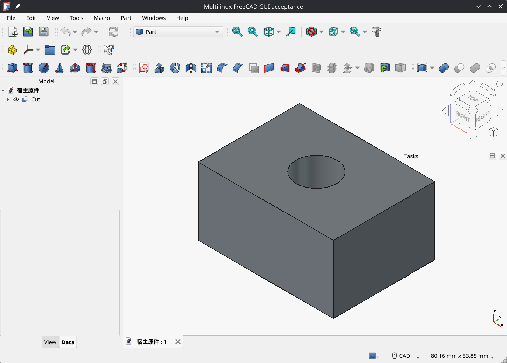
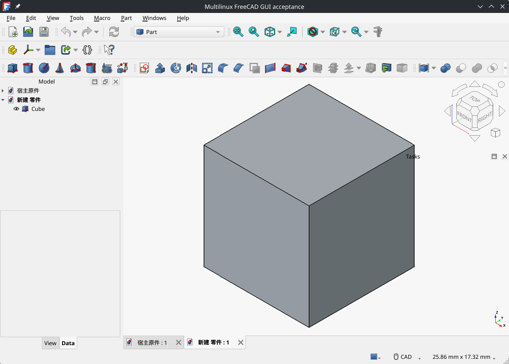

# 目标契约修复与 Arch FreeCAD 真实 GUI 闭环

日期：2026-10-23，Asia/Shanghai。基线为 `fd0b2da` 加接手时已有工作树，未提交。

**结论：两个契约缺口已修复，当前离线回归通过；宿主项目调用 Arch FreeCAD 的打开、修改保存、重新打开、新建保存、停止环境后重开，在本轮真实 Wayland GUI 场景中通过。**

## 1. 两个契约缺口的修复

本次独立补丁见 [contract-fix.patch](contract-fix.patch)，修改前的四个文件保存在 `before/`。没有把之前未提交的全部改动混入这份补丁。

- `resolve_target_contract()` 成为创建、可运行检查和包驱动选择的共同入口。只有已有完整适配的 Debian 13、Fedora 44、Arch 可运行。新的名字即使声明 apt/glibc/FHS，也只是一份描述，创建前拒绝，不先创建容器再失败。
- `resolve_record_contract()` 验证持久记录与固定目标契约。`target=debian13` 却声明 dnf/rpm/musl/Android 后端时，计划返回 `refused`，实际驱动、包查询和安装/升级/卸载/本地安装均拒绝，不启动环境或生成事务。
- 旧记录完全没有 `system` 字段时按已有三目标和旧 `update_policy` 兼容解析。显式 `system=null`、空对象、残缺对象不冒充旧记录；顶层政策与 system 政策矛盾也拒绝。
- 创建校验前移到桌面准备和运行时操作之前。`_native_steps`、原生执行环境变量和查询使用验证过的记录选驱动。

这是收紧当前支持范围，并没有宣称新增 Ubuntu、NixOS 或 Android 支持。未实现政策仍可描述，但实际环境计划和包操作返回 `refused`；此前文档中“image-replace 描述即可返回更换”的宽松分支已收紧。受支持目标改变镜像、挂载等创建契约时仍返回 `replace`，自动迁移仍未实现。

## 2. 修复验证

`python3 -m unittest discover -s tests -v`：**162 项，158 通过、4 项现场集成测试按原配置跳过**，见 [unittest.txt](unittest.txt)。

`tests/test_catalog.py` 从 7 项增至 13 项，新增测试内部还覆盖多个参数组合：

- 新名称加已实现驱动仍在创建前拒绝；无容器、无环境记录。
- 已知目标的配置驱动冲突在创建前拒绝。
- 四种持久契约冲突，逐一验证计划、驱动、查询及四种包变更动作；运行时事件不增加，无事务记录。
- 三套旧记录各执行一次离线模拟安装事务，计划驱动与实际命令一致。
- 畸形 system 和旧政策冲突拒绝。

上面安装事务是 FakeRuntime 回归，不是现场联网升级。现场另外通过新契约创建了本轮 Arch 环境，`env plan` 显示 pacman，原生 `pkg query` 返回 **freecad 1.1.4-3**。未额外安装或升级任何宿主/客体包。

## 3. GUI 运行环境与方法

- 宿主 Fedora KDE/KWin；FreeCAD **1.1.4 revision 45040**，Qt 平台实际为 `wayland`。
- 使用此前保存的 `installstatus-arch` 本地镜像，来源是已安装 FreeCAD 的 `complex-arch` 快照。锁定 digest `sha256:9733d4d09b22b0d20d34c7b6477ae5ebc347d64384ff2a0af045afa82917fec6`，没有 pull、没有网络、没有包安装。
- 新建独立环境 `gui-freecad`，container ID `ba789ca4e813558e42dd8f8c910129939562beda1349202d68b3c55930620eb0`；keep-id，桌面/GPU 配置，`--init`。同一环境复用于各轮启动。
- 当前修复代码冻结在 `project/`，源文件哈希见 [gui-manifest.json](gui-manifest.json)。新测试共享仅为本目录 `host-project/`；旧环境和旧模型保持原状。
- 宿主调用冻结代码的 `ml.py app open freecad-gui -- <宿主文件路径>`，经受管启动器进入 Arch FreeCAD。使用独立 `-u` 配置文件，防止测试修改日常 FreeCAD 设置。
- 本次是**真实可见窗口中的自动化 GUI 验收**：触发 FreeCAD 自身 QAction，填写真实 QFileDialog 并点击其 Open/Save 按钮。模型创建用 `Part_Box`，保存用 `Std_Save`；控制宏没有用 `App.openDocument/newDocument/saveAs` 代替这些步骤。它读取文档状态，并调整视角用于观察。
- KWin 四组最终截图均核对 `XdgToplevelWindow`、非空 buffer、截图前后同一活动窗口。不是 offscreen 渲染，也不是人工鼠标操作验收。

## 4. 实际完成的闭环

| 步骤 | 证据与结果 |
|---|---|
| 宿主项目打开原件 | 将旧模型复制为 `host-project/宿主原件.FCStd`，宿主启动器传路径；GUI 加载 Box/Hole/Cut 三个对象，原 Cut 体积 21738.05328941535 |
| GUI 修改并保存 | `Part_Box` 增加 `Box001`，`Std_Save` 保存回同一宿主路径；文件哈希确实改变，出现同目录 FCBak |
| 关闭后通过 Open 对话框重开 | `Std_CloseActiveWindow` 关闭文档，`Std_Open` 打开真实对话框，点击 Open；重新载入四个对象，新增立方体仍在 |
| 新建文档及几何体 | `Std_New` 创建无文件名文档，`Part_Box` 创建立方体，随后 `Std_Save` 弹出 Save As |
| 核对新建默认位置 | 对话框实际目录为宿主 `host-project/`；只输入 basename `新建 零件.FCStd` 并点击 Save，文件落在宿主项目，不是私有 HOME |
| 正常退出并自动停止 | 启动器退出码 0；记录到环境 `stopped` 后再启动，未创建第二套发行版 |
| 停机后打开两份文档 | 同一启动器传入两个宿主路径，GUI 读回原件四对象和新件一对象；全部 Shape 有效，新立方体体积约 1000；两份文件哈希与停机前相同 |
| 宿主独立回读 | 检查 FCStd ZIP CRC 和 Document.xml 对象清单；与 GUI 读回一致；文件 UID/GID 均为 1000:1000，旁注未变 |

模型文件：[宿主原件.FCStd](host-project/宿主原件.FCStd)、[新建 零件.FCStd](host-project/新建%20零件.FCStd)。原始数值见 [host-readback.json](host-readback.json)、[gui-workflow.json](gui-workflow.json)、[save-as-submission.json](save-as-submission.json)。





默认目录结论限于**本次先打开宿主项目文件、再新建保存的流程**。没有声称任意空白启动、任意应用都会自动采用宿主项目目录；通用文件路由层和 Dolphin 关联也没有在本轮实现。

## 5. 失败尝试与修正

- 首次 create 命令漏写 `--target`，argparse 拒绝，未创建环境；修正后创建成功，输出在 `create.txt`。
- `attempt1-qt-import/`：FreeCAD 的 PySide 兼容模块不导出 QtTest，宏导入失败；核对容器实际安装 PySide6 后改用该模块，停止本轮测试环境后重启。
- `attempt2-dialog-submit/`：模型修改保存已成功，但以排队回车提交 QFileDialog 未完成，随后留下已销毁 QLineEdit 的延迟回调错误。保留该轮脚本、日志、模型和全部命令/回复。改为读取实际对话框按钮并直接点击，重新从旧模型副本开始完整闭环，通过。
- 最终停机重开截图首次查询碰到窗口标题刚被 FreeCAD 改写的短暂时段，探针拒绝捕获；待实验标记恢复后重新捕获。没有接受错误窗口或扩大为整屏截图。

这些是测试控制器/调用方式的失败，不计入最终 GUI 通过率，也不覆盖旧证据。最终三张工作流截图和重开截图均已逐张查看。

## 6. 清理、边界与复核入口

[postconditions.json](postconditions.json)：最终测试环境 stopped，租约为空，bridge 为 null，无本轮窗口/FreeCAD/worker 残留；原有容器状态全部保持；旧证据模型哈希不变。新环境停止保留，宿主测试模型和截图保留。

[validation.json](validation.json)：**41 项证据一致性检查通过**。它核对源码、回归日志、真实窗口、文件回读与清理，不等价于 41 个独立现场场景。

离线复核：

```bash
python3 evidence/contract-freecad-gui-2026-10-23/verify.py /tmp/freecad-gui-recheck.json
```

输出路径必须不存在。重新做 GUI 应建立新的证据目录、冻结代码、创建新的隔离环境和输入副本；`run_gui_steps.py` 拒绝覆盖阶段结果，不要直接在本轮证据上重跑。控制宏的命令目录仅供该显式注册的测试应用使用，不是产品通用远程执行接口。

范围仍为本机单 Arch 环境的 FreeCAD GUI 工作流；未验收一般文件授权、外部并发写入防覆盖、私有 rootfs 投影、每应用隔离、跨宿主、硬件加速归因或新性能指标。
