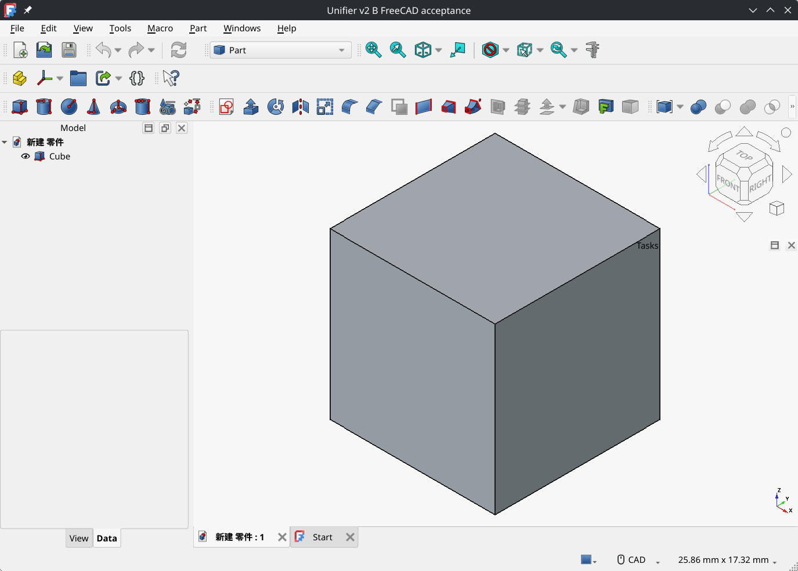

# Unifier v2：A 复验与 B 受限闭环验收

日期：2026-10-24，Asia/Shanghai。分支 `codex/unifier-v2-control`，Git 基线 `9a86520`。**A 的三发行版真实容器复验通过；B 的项目/处理器路由、Arch FreeCAD 真实 GUI 保存闭环及异常启动器回收通过。** 当前改动未提交、未推送。

## 实现与修复

新增显式 Project、Handler 登记和 `file plan/open`。文件打开使用已接受的项目上下文，固定环境 UUID/代际/容器、应用独立实例 UUID、handler UUID 和执行配置指纹；同名同配置重建不继承旧绑定。计划明确显示实际共享目录，使用字面 argv，保留中文和空格。

修复了嵌套根/保存目录策略、挂载遮蔽及子只读挂载判断；readonly 策略无法由实际挂载保证时拒绝。on-demand 文件打开使用独立 worker 持租约。等待容器停止后再次核对最新 app/env 记录，配置在等待期间变化会在任何 start/exec 前拒绝。普通共享目录默认 preserve-host，显式 shared-relabel 才添加 `:z`。

实现来自用户指定的 dsh Command Code `deepseek/deepseek-v4.1-flash` 会话；监督者独立复核反例、执行容器及 GUI 实测。原始模型日志和凭据不在证据目录中。

## 最终证据

| 范围 | 结果 | 证据 |
|---|---|---|
| 全量回归 | 236 项，232 通过、4 项按条件跳过 | [完整输出](finalize-regression.txt) |
| 独立路由反例 | 7/7 通过，含同名 app、只读策略、默认目录、挂载遮蔽与等待后竞态 | [反例记录](independent-boundaries-2026-10-24.json) |
| Debian / Fedora / Arch | 最终源码上三套真实容器创建、迁移、精确备份、退出码 17、同容器复用、旧绑定拒绝、数据保留全部通过；临时容器已移除 | [原生复验](live-three-distros-regression.json) |
| Arch FreeCAD | 新 `file open` 入口驱动真实 Wayland 窗口；打开原件、增加模型、原地保存、真实 Open 对话框重开、新建、Save 对话框仅输入文件名保存到宿主项目 | [GUI 工作流](live-freecad/gui-workflow.json) |
| 停机重开与生命周期 | 三次 GUI 会话共用同一容器；两次正常 launcher 返回 0；第三次 SIGKILL launcher 后 GUI/worker 仍存活，关窗后租约清空、环境停止 | [验收汇总](live-freecad/acceptance.json)、[强杀后窗口](live-freecad/gui-survives-launcher-kill.json) |
| 原生卸载与数据独立 | pacman 真正移除 FreeCAD，包查询 absent、可执行检查失败；两份文档、旁注、root 登记保留；随后删除测试环境仍保留数据根 | [包事务](live-freecad/package-remove.json)、[数据保留](live-freecad/project-survives-package-uninstall.json) |
| 宿主权威及清理 | 创建共享挂载未改变宿主标签；原有 26 个容器及状态文件不变；12,670 个历史证据文件哈希不变；无测试窗口 | [最终状态](postconditions.json) |
| 独立证据检查 | 38/38 通过，包括当前源码与现场快照一致 | [检查结果](validation.json) |

原件停机后回读为 4 个对象，新增文件为 1 个对象；ZIP CRC、XML、哈希、UID/GID 1000:1000 一致。原件的 Cut 几何体积保持 21738.05328941535。最终截图已视觉检查，能看到实际重开的模型：



## 保留的失败尝试

- `attempt1-startpage-focus/`：首次启动欢迎页占据活动页签，虽然模型已加载，Save 动作未启用。测试控制器改为选择真实文档页签并等待动作就绪。
- `attempt2-caption-transition/`：原件已实际保存，标题短暂变化使严格截图检查拒绝该帧。测试控制器改用已确认的 PID 和窗口 ID，并保持截图前后同一活动窗口检查。

两次失败与最终成功使用相同生产源码；仅修正现场测试控制器。失败材料均保留，不能算作通过场景。最终从原始三对象模型完整重跑，没有跳过保存或用 App.saveAs 代替 GUI 动作。

## 复核入口与边界

```bash
python3 -m unittest discover -s tests -v
python3 evidence/unifier-v2-stage-b-2026-10-24/verify_evidence.py --output /tmp/unifier-b-recheck.json
```

GUI 准备与测试脚本在 `live-freecad/prepare_live.py`、`run_acceptance.py`、`run_gui_steps.py` 和控制宏中；脚本拒绝覆盖既有结果。完整 GUI 重测须复制控制脚本到新的实验目录，并从 `input-manifest.json` 指向的原始模型准备新输入，不能直接重复改写本次证据。源码、配置及锁定镜像身份在 `gui-manifest.json` 中。历史验收含本机绝对路径，异机应新建现场证据。

Save As 默认位置仅验收“先打开宿主原件，再新建”的本次 FreeCAD 流程；通用计划仍保留 `save_as_default=unknown`。共享环境属于共同信任域，不提供单文件/单应用隔离；未验收一般 CAD 外部链接素材、其他 GUI 应用或跨宿主组合。C 的停止环境只读投影/FUSE、D 的受管复制移动与断电恢复、E 的通用无前缀工具链/桌面撤销、F 的压力与跨宿主矩阵尚未实施。
