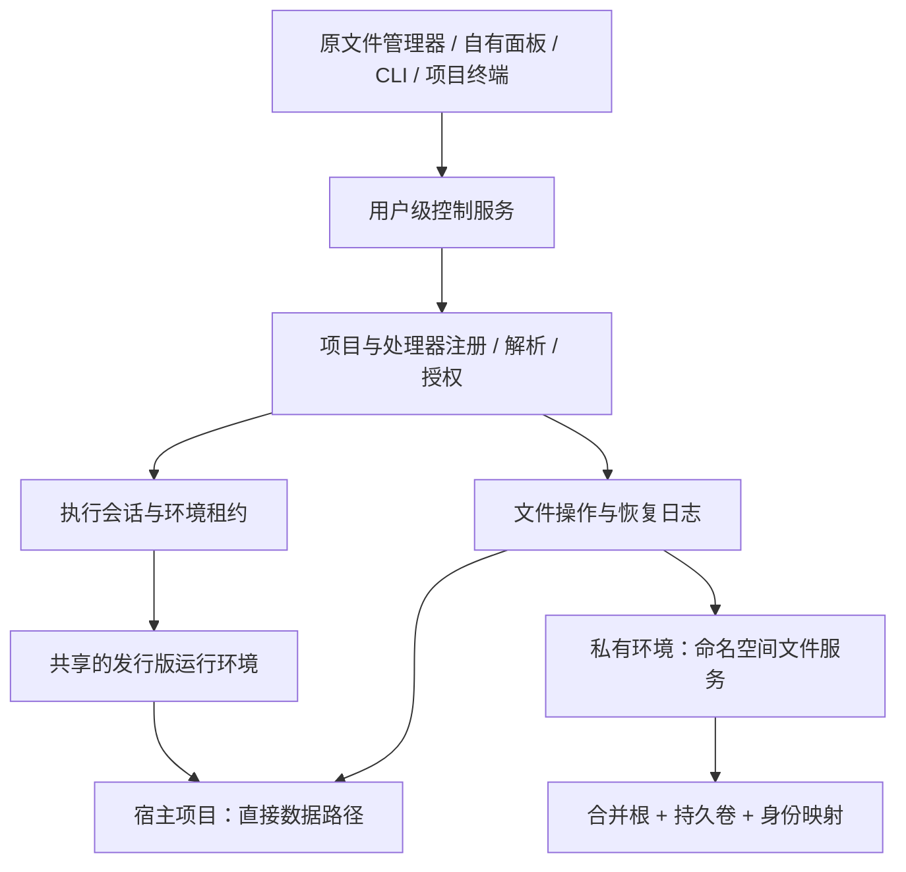

# 文件与执行控制层 v2：从路径别名到可恢复的操作契约

日期：2026-10-23，Asia/Shanghai。状态：**设计迭代，含独立机制原型；未接入产品文件层**。

承接[原架构第 18、19 节](宿主权威与文件执行边界.md)。本次[复核与新增实验](../调研/Grok改动复核与架构迭代-2026-10-23.md)区分当前代码、已有实测和设计。保留宿主最高权威、原文件管理器继续使用、同一环境内多个程序共享发行版用户空间这三个前提。

## 1. 采用的整体结构

共享项目继续直接读写底层目录。环境私有文件由按需启动的文件服务提供视图。选择程序、解析文件引用、授予访问、启动及恢复事务集中到同一用户级控制服务；UI、CLI、桌面入口只是该服务的客户端。



“共享/独立文件”保留为面向用户的操作分类，由文件角色、已注册处理器和当前意图生成。存储位置、管理域、执行环境、来源和授权仍分别记录。安装 VS Code 增加 `.py` 的编辑候选，不会改变解释器。

控制服务处理一次操作的决策，不能拦截任意程序的全部系统调用。直接共享目录上的外部写入仍遵循普通文件系统语义。

## 2. 环境身份、项目身份与文件引用

拟定最小模型：

| 对象 | 必需字段 | 生存规则 |
|---|---|---|
| Environment | `environment_uuid`, `generation`, `target_contract`, `container_id`, `content_revision` | 用户可见名称是别名；重建产生新 generation；包事务只推进内容修订 |
| DataRoot | `root_uuid`, `management_domain`, `backend`, `locator`, `access_policy` | 普通项目根独立于容器生命周期；删除环境不自动删除数据根 |
| Project | `project_uuid`, `root_uuid`, `toolchain_binding`, `default_save_root` | 保存的绑定须经用户接受；复制来的配置不能直接取得执行权 |
| FileRef | `root_uuid`, `relative_path`, `role`, `observed_version` | 路径引用能跨编辑器替换保存继续使用；历史对象身份不靠路径证明 |
| Handler | `handler_id`, `intent`, `provider`, `argv_template`, `save_capability` | provider 为宿主或某环境 generation；环境更换后重新验证 |
| Operation | `operation_uuid`, `intent`, `source_ref`, `destination_ref`, `state`, `evidence` | 用于重试、核对和恢复；不是文件永久身份证 |

`observed_version` 可包含设备/inode、size、mtime/ctime、按需内容哈希。它是变化检测证据，不是所有写入者都遵守的比较交换锁。inode 会因保存而改变；相同内容哈希不能区分复制、独立生成和同内容重建；扩展属性也可能被复制或去掉。

已有产品 `id` 是环境名称式标识，不能直接当作新模型的永久 UUID。迁移旧记录时一次性生成 UUID、保留旧别名；记录中已有的 container_id 可作为当前实例证据。不得让同名新容器继承旧文件授权。此迁移尚未实现。

注册表以已登记根的规则和操作日志为依据，索引可重建。按需核对访问的目录，后台有界扫描失效根，不全盘扫描所有 inode。嵌套根采用最长匹配的显式政策；重复别名、硬链接或冲突政策必须先识别，不能以字符串前缀判定授权。

## 3. 完整环境视图必须定义两种语义

### 3.1 环境内的真实路径

应用在运行环境中继续看到 `/usr`、`/etc`、私有 HOME 和自己的持久卷。执行与库解析发生在该环境。共享项目由经过登记的映射进入该视图。

### 3.2 宿主上的管理投影

`/user/arch` 或用户目录下的等价位置是管理入口，不能把它当成可以直接在宿主执行的 relocated rootfs。第一阶段由文件服务提供：

1. 在运行时认可的存储命名空间取得合并根，同时核对环境 generation。
2. 根据运行时持久挂载清单构造视图；卷和 bind 的覆盖顺序必须与容器一致。挂载缺失返回 `BACKEND_UNAVAILABLE`，不暴露下面的空目录冒充真实数据。
3. 明确读写身份及映射。普通文档按文档身份处理；系统树默认浏览，显式维护时获得独占维护会话。不能递归 chown 真实 rootfs。
4. `/proc`、`/sys`、设备和运行时 socket 单独表示为运行能力；停止时显示不可用，不保存或复制成普通文档。
5. 文件服务的生命周期租约与应用运行租约分开。仅浏览停止环境的持久数据不应启动整个应用环境；有视图使用者时不得卸载或删除底层存储。

**绝对符号链接是额外的关键关口。** 服务端把路径限定在环境根内，只能保护服务端自己的打开操作。如果一个 FUSE 目录向宿主内核原样返回链接 `/etc/os-release`，宿主后续解析仍可能落到宿主 `/etc`；服务端使用 `openat2` 并不会自动修正宿主的这个步骤。

因此管理投影需要明确选择：

- 原始链接文本通过 `readlink_raw` 元数据操作提供，供检查和无损导出。
- 为宿主浏览提供的链接可以改写为当前投影内的目标，标记为“投影链接”；不要声称宿主 `readlink` 结果与环境内完全相同。
- 需要保留原始链接和完整执行语义的操作，交给环境会话或文件 API；跨根链接另行授权，不静默跳到宿主。

第一版文件 API 用锚定的根目录 FD 解析。宿主数据根和环境逻辑根采用不同的链接政策：环境内绝对链接相对环境根；授权宿主根中的路径不能越过授权边界。`openat2` 的 `RESOLVE_IN_ROOT`/`RESOLVE_BENEATH` 等由后端按语义选择，不机械叠加；不支持时使用经过验证的替代实现或拒绝该能力。禁止“resolve 一次，再按原字符串打开”的检查/使用间隙。生产文件服务不靠执行客体里的 `cat`、shell 来实现宿主文件管理。[openat2 手册](https://man7.org/linux/man-pages/man2/openat2.2.html)

本次没有实现 FUSE 投影。必须用宿主 `cat`、Dolphin 和真实编辑器验证上述绝对链接语义，不能只重复容器内 chroot 读取。现有 rootless 挂载实验仍只适用于所测 overlay/Podman 配置；官方也区分 VFS 与其他 rootless 存储驱动。[Podman mount 文档](https://docs.podman.io/en/latest/markdown/podman-mount.1.html)

## 4. 文件授权与共享环境的实际边界

现有容器挂载在创建时冻结，普通共享目录统一读写并使用 `:z`。设计中的 `read-only`、单文件授权、按次授权还没有落到运行时。

首个闭环采用登记的数据根及明确的环境级访问范围。同一环境中能访问同一挂载的应用处于共同信任域；broker 发出的操作 token 不能限制已经启动的进程直接读挂载里的其他文件。界面不能显示成“只授权这个文件”，后端却共享整个家目录。

增加新的静态共享根仍按当前更换契约处理：有活动会话时排队或建立经过用户选择的新配置，不突然停止程序。不为每个进程创建一套发行版来绕过挂载限制。长期若需要每应用挂载视图，可研究共享 rootfs/包状态上的执行子命名空间；这是新运行后端能力，尚无实测，不能提前承诺可用。

未来单文件 Portal 入口须独立验收相邻资源、备份和临时 rename。CAD 工程和构建树通常需要项目目录访问，不能将单个 FD 通过测试扩写为整个工程兼容。

SELinux 政策必须由宿主适配器明确选择；普通项目不允许为了接通视图而默认递归重标记任意宿主目录。当前 `:z` 和 `_shared_workdir()` 的字符串前缀校验是接入新层前的已知缺口，本轮未修改生产代码。

## 5. 保存的两种保证

| 模式 | 用途 | 能给出的保证 |
|---|---|---|
| 直接共享编辑 | 高性能项目、已信任应用、原生文件操作 | 保持普通文件系统保存语义；不保证多编辑器不会互相覆盖 |
| 受管暂存与发布 | 不便直接共享的私有文件、转换产物、需显式冲突处理的操作 | 暂存副本与原件区分；检查版本、保留冲突副本；发布范围内可恢复 |

已有 FreeCAD 实测证明直接共享可以保存、生成同目录备份，也证明后来的 rename 会覆盖宿主新版本。文件模式 444 不等于不可替换，因为替换受目录权限影响。

“检查原件哈希再 rename”也不是无竞争的比较交换：两步之间外部程序仍可写入。advisory lock 只约束遵守它的写入者。只有全部写入由同一受控路径串行、应用合作，或有另行验证的快照/版本机制时，才可提高保证。第一版存在不受控写入者时采用保留版本/另存冲突副本的政策，不自动删除或覆盖不确定对象。不能让用户误以为原文件管理器被接入后所有保存都受到保护。

新建默认位置须由已接受的项目上下文和应用适配器落实。设置 cwd 不代表应用会自动选择该目录；旧 FreeCAD 实验已显示 `~` 写入私有 HOME。保存能力登记区分 `explicit-path`、`dialog-adapter`、`unknown`，用真实 GUI Save As 验收。

## 6. 复制、移动和进程中断恢复

跨管理域复制：新对象采用目的根管理域；来源保留为独立元数据。外部 `cp` 即使复制了旧 xattr，也不能据此覆盖目的根的政策。

受管跨文件系统移动设计为：

```text
INTENT_DURABLE → STAGING → TARGET_PUBLISHED → REGISTRY_COMMITTED
              → SOURCE_CLEANUP_PENDING → DONE
                    ↘ CONFLICT / NEEDS_RECONCILIATION
```

基本约束：

1. 日志先记录操作 ID、源/目标根及 generation、源观察版本、目标覆盖政策。临时文件放目标文件系统，避免发布时再次跨盘。
2. 流式复制、核对目标和源是否变化，处理元数据能力差异。同步目标文件和目录；发布采用不覆盖既有目标的原子机制。大目录、稀疏文件、ACL 等另列能力，不把普通小文件探针算成全部覆盖。
3. 文件系统发布与 SQLite 提交不能组成一个跨系统原子事务。每个阶段可核对，恢复按操作 ID 幂等处理。哈希相同不代表目标一定是该事务发布的对象。
4. 源删除是最后且单独的阶段。目标可靠发布、注册完成，也不足以授权删除一个被外部写入者改过的源。无法证明时保留源和 `SOURCE_CLEANUP_PENDING`，界面明确“目标已复制，源保留”。
5. 删除最后一步还存在核对到 unlink 的竞争；第一版不自动对不受控目录完成该步骤。未来须在可控制的目录/写入协议下设计隔离与最终核对，不能通过再检查一次 stat 宣称已解决。
6. 空间不足、权限变化、媒体断开和任一步中断不能丢掉唯一有效内容；失败时保留可解释的暂存或源。重启不盲目重放覆盖操作。

本次原型只实现普通文件的日志、暂存、无覆盖发布、SQLite 登记和保守恢复。三处进程退出后恢复两次均无重复登记；源变化、目标冲突和同内容的无关目标都保留原字节。**没有实现源清理、断电恢复或完整移动。** 跨文件系统 `rename` 的 EXDEV 及同文件系统原子替换语义参照 [rename 手册](https://man7.org/linux/man-pages/man2/rename.2.html)。

外部移动没有操作日志时，可按当前目的根恢复管理域；无法唯一证明历史来源就标 `UNKNOWN`。通知只标记“需核对”，不是永久审计日志。通知溢出、服务离线和监听遗漏都需要重新核对；本次模拟的是服务离线，没有实际制造 inotify 队列溢出。[inotify 手册](https://man7.org/linux/man-pages/man7/inotify.7.html)

跨管理域硬链接意味着同一 inode 有两个入口。入口的打开偏好可以不同，实际权限却不能按两个独立文件假设；自动授权和归属迁移必须报别名冲突。符号链接本身是别名，访问目标前重新核对目标域。

## 7. 执行会话与发行版契约

一次执行在启动前固定：`provider + environment_uuid/generation + project_uuid + cwd + argv + env_policy + file_refs + access_scope + lease`。使用 exec 参数数组，不经 shell 拼接；退出状态、TTY、信号、流和后台任务均需验收。

宿主普通会话中已有命令优先；已接受项目工具链会话中整条工具链进入同一环境。不能在某个命令失败后换发行版重试，也不能逐个从其他环境补齐子命令。环境替换时旧会话继续绑定旧 generation，新的绑定先验证再切换；不让编辑中的应用突然看到另一套库。

当前 catalog 有正确的分层方向，但还不是通用发行版插件 API。本轮边界探针发现：

- 新名称加上已实现 apt/glibc/FHS 契约可通过 `require_runnable`，`driver_for` 仍只接受 PREPARED 的三个 ID。
- 合成记录若 `target=debian13`、`system.package_driver=dnf`，计划显示 dnf 原地升级，实际驱动按 target 选 apt。未发现现有创建流程产生此矛盾记录；这是导入、迁移和未来扩展必须封住的契约边界。

下一版统一 `resolve_target_contract()`：配置、锁文件、持久记录迁移和运行能力共同产生一个已验证对象，计划器与执行器使用同一个对象。可描述、可创建、可安装、经过应用验收是四个不同状态。不支持的后端要在任何运行时变更之前拒绝。普通包安装/删除也不应在用户界面都称为“升级”；内部 `in-place` 与业务动作分别表示。

更换仍是新建候选环境、验证、切换新会话、保留旧环境。持久项目数据另管，包驱动不能复制旧 `/usr`/`var/lib` 拼成新发行版；应用配置迁移须按程序能力。当前只实现更换判定与单独 create，没有实现自动迁移、切换和回滚编排。

## 8. 生命周期、锁与删除

需要区分应用、文件视图、包事务和维护四类租约。关最后一个应用窗口可以停止应用运行环境，但不能删除仍被视图或复制操作使用的存储。文件服务异常退出后的悬挂租约需按进程身份与 generation 核对。

拟定控制规则：注册表短事务中预约操作及相关资源，按 UUID 排序获得多资源预约；锁内不等待 GUI、外部包命令或长时间复制。已有 lease/lifecycle 锁继续管理 start/stop，新增服务通过一个适配器按既定顺序调用，禁止持有底层锁再回调注册表等待别的预约。

包事务与系统树维护互斥；普通文档编辑不取得整环境维护锁。环境删除分“退役入口”“释放运行资源”“处理私有数据”三步，有未提交保存或待核对事务时显式阻止清理。数据根的删留由其管理政策决定，不由容器是否停止决定。

## 9. 下一阶段的具体交付关口

| 顺序 | 可交付结果 | 必须看到的证据 |
|---|---|---|
| A | 统一目标契约、版本化环境/数据根记录 | 计划和执行选择相同驱动；旧记录迁移；未知驱动零运行时副作用；重名重建不复用授权 |
| B | 一个宿主项目 → Arch 应用 → 原路径保存闭环 | 真 GUI 打开/保存/新建；相邻资源；目录授权范围真实；卸载应用后项目保留 |
| C | 停止环境的只读管理投影 | 合并根/卷覆盖；UID；宿主跟随绝对链接；卷缺失不返回假空目录；视图撤销无残留 |
| D | 受管复制和恢复，随后实现受限移动 | 真实跨盘/空间不足/目标占用/每阶段中断/重复恢复；冲突保留；源删除单独证明 |
| E | 项目会话和可撤销桌面入口 | 无前缀调用、解释器及子进程一致、Ctrl-C/管道/退出码、撤销恢复原关联 |
| F | 压力与跨宿主 | 完整进程树内存覆盖、长时间 I/O/监听/缓存、Fedora 客体并发、第二类宿主 |

不要求先完成完整管理窗口再验证 B–D。面板先展示环境/项目、具体操作和冲突即可。

性能沿用既有实验的有限结论：直接共享保留；私有视图需要单独测。下一轮计时拆成解析、授权、视图获取、启动和首帧，内存分别记录 broker、视图进程树、应用与 cgroup；任何 PID 读不到都显示覆盖率和 UNKNOWN。旧预算作为规划值保留，未产生新的产品内存或尾延迟保证。
