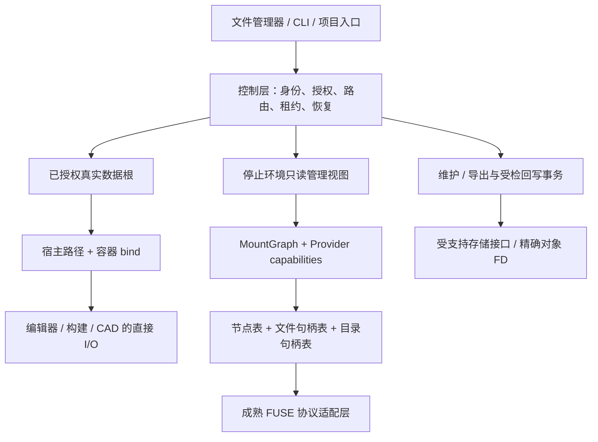

# 投影文件系统架构评审

日期：2026-10-26，Asia/Shanghai。范围：当前工作树的 Unifier 停止环境只读投影，以及与共享项目、文件事务的边界。性质：研究与调整方案，未实施产品改造。

## 结论

主要问题集中在投影的数据路径：**路径、底层文件对象、打开句柄、目录项和缓存版本被混成同一种身份**。当前实现足以演示浏览与只读访问，但无法作为普通本地文件系统的透明替代品。降低缓存时间或换语言只能解决一部分现象。

建议保留已验证的环境身份、生命周期租约、storage broker 和恢复日志；将只读投影核心改为对象和句柄驱动；日常项目及可直接共享的环境文档继续走真实数据根。统一的是用户入口、授权和文件引用，不要求所有字节经过同一 FUSE 挂载。

优先顺序：对象身份与内容一致性 → 挂载树与目录语义 → 引用回收 → 缓存失效与通知契约 → 性能。不要先开放可写系统树。

## 证据与本轮边界

- 已阅读当前 `fuse_view.py`、`view_backend.py`、`view_broker.py`、`views.py`，并检查 `file_operations.py`、`file_routes.py` 的相关消费路径、C/F 设计与验证材料。
- F 阶段现有报告已经完成本机测量，结论为 `LOCAL_MEASUREMENTS_COMPLETE_WITH_OPEN_PRODUCT_GATES`；不能沿用早期记录中的“尚未形成最终报告”。报告包含 270 个路径负载样本、45 次视图生命周期及三发行版真实 FUSE 语义补验。
- 本轮逐文件哈希确认上述六个模块与 F 阶段冻结副本一致。已有真实 FUSE 失败可用于解释当前实现，见 [源码对比](../../evidence/projection-architecture-review-2026-10-26/source-comparison.json)。
- 新增隔离探针直接调用真实 backend 与 FUSE handler，仅修改临时目录，不创建容器或真实 FUSE 挂载。它验证实现机制，不替代内核、GUI 或跨宿主验收。见 [探针](../../evidence/projection-architecture-review-2026-10-26/probe_mechanisms.py) 和 [结果](../../evidence/projection-architecture-review-2026-10-26/mechanism-results.json)。
- 重新运行相关现有 unittest：34 项通过，见 [日志](../../evidence/projection-architecture-review-2026-10-26/unit-tests.log)。宿主没有 pytest，使用项目原有 unittest 运行方式，未安装依赖。测试通过与本轮反例并存，表明测试覆盖不足。
- 本轮没有重跑 F 性能矩阵、修改产品源码、提交或推送，也没有触碰已有容器和主状态。

## 当前调用链

```text
CLI / ViewManager
  ├─ 校验 environment_uuid + generation + exact CID
  ├─ 建立 view lease，阻止环境 start/remove
  ├─ inspect 持久挂载，形成 mounts/capabilities
  └─ podman unshare → broker → podman mount
                              └─ merged-root O_PATH FD，经 SCM_RIGHTS 交接

宿主程序 → 内核 FUSE → Python FuseServer（单请求串行）
                       └─ nodeid → 路径
                          → ViewBackend 最长前缀选后端
                          → 校验后端 + 从根逐级 openat
                          → 临时打开文件 → pread → close
```

broker 当前主要承担存储引用持有，不是每次读取的 RPC 转发者。耗时不能笼统归因于“每次访问都进入容器”或“Podman 太慢”。宿主 worker 自己执行读取，仍受宿主凭据约束。

值得保留的部分：精确实例绑定；停止环境与视图互斥；merged root 的受支持获取方式；只读/noexec/nosuid/nodev；挂载源身份检查；链接不直接跳到宿主根；busy 撤销保留完整依赖；不确定 storage 引用留待核对。当前证据没有理由推倒这些边界。

## 主要问题及原因

| 优先级 | 问题 | 证据等级 | 根因位置 |
|---|---|---|---|
| P0 | 打开文件跨替换/删除后不再指向原对象 | F 真实挂载失败；本轮 handler 复现 | `fuse_view.py:187–207`，`view_backend.py:413–422` |
| P0 | 旧大小与新内容组合，立即读取截短 | F 三发行版真实挂载失败；源码解释 | `fuse_view.py:141–144,176–178,201–206` |
| P1 | lookup 与 readdir 对挂载覆盖的理解不同 | 本轮 backend 复现 | `view_backend.py:295–318,424–439` |
| P1 | 目录分页删除后漏项 | 本轮 handler 复现 | `fuse_view.py:209–229` |
| P1 | FORGET 不回收，路径表随访问历史增长 | 源码及本轮 handler 复现；F 有短时 PSS 观察 | `fuse_view.py:86,104–118,146–148` |
| P1 | 外部修改无投影侧通知，缓存无法主动失效 | F 真实 watcher 失败；源码无通知桥 | `fuse_view.py` 整体缓存/通知实现 |
| P1 | 数据路径成本高，目录代价随页数放大 | F 实测慢；具体开销由源码和调用计数支持 | `view_backend.py:227–240,320–393,424–439` |
| P2 | 属性、权限与能力呈现不完整 | 静态审查，部分尚需内核验证 | `fuse_view.py:231–254`，`view_backend.py:395–407,489–496` |

### 1. 路径身份代替了文件对象身份

`OPEN` 仅做 getattr/type 检查，返回 `fh=nodeid`；没有打开并持有底层文件。`READ` 丢弃 fh，重新按 nodeid 对应路径读取；`RELEASE` 不管理实际句柄。`GETATTR` 同样按当前路径取属性。

因此，宿主原子替换同名文件后，旧句柄会读到新对象；删除后旧句柄直接找不到路径。已经填充的内核页缓存可能暂时掩盖错误，造成“读过一次就正常、没读过就失败”的差别。

本轮反例：原生 FD 始终读到 `OLD`，投影回调在 replace 后读到 `NEW-CONTENT`，unlink 后返回 ENOENT。替换前后 nodeid 均为 2。两个硬链接底层 inode 相同，却分配了 nodeid 2 和 3；这说明同一对象的别名也没有统一，缓存可能被分裂。

修复必须同时覆盖 LOOKUP、OPEN、GETATTR、READ、RELEASE 和节点回收。仅在 OPEN 加一个 FD 而继续复用同一路径的 nodeid，仍可能让新旧对象共享错误的内核缓存身份。

### 2. 一致性没有明确模型

ENTRY/ATTR 的有效时间硬编码为 1 秒，OPEN 没有 direct-io 标志，外部变化也不触发主动失效。F 已观察到：32 字节文件替换为 128 字节后，立即读取只得到新内容的前 32 字节，等待 1.3 秒才读全。

源码与现象一致：属性还在缓存旧大小，数据回调却打开新路径。这是版本混用，不只是“界面刷新稍慢”。

停止客体也没有冻结 bind/volume 的其他写入者。当前视图是外部可变数据的只读入口，不能称为快照。固定打开 FD 只保留对象身份；对同一 inode 的原地写入仍然可见，也不构成内容快照。

应明确分开三种契约：

| 视图/路径 | 推荐用途 | 一致性要求 |
|---|---|---|
| 真实共享数据根 | IDE、构建、CAD、普通编辑 | 使用底层文件系统的实际语义，按目标文件系统验收 |
| live read-only 管理投影 | 停止环境检查、浏览、导出 | 打开对象身份正确；明确外部修改的刷新/事件边界 |
| 有版本的只读快照 | 一致性导出、审计、长期固定查看 | 后端确实冻结或复制出稳定版本；多卷一致性另有协调 |

将 TTL 改成 0 可以减少某些陈旧属性，却不能补上对象身份，也不产生 watcher 事件。direct-io 会改变页缓存、预读及 mmap 条件，只适合作为明确的模式选择和诊断手段，不能直接作为全面修复。[内核 FUSE I/O 模式](https://www.kernel.org/doc./html/next/filesystems/fuse-io.html)

### 3. 当前并没有一棵一致的投影目录树

`_select()` 为明确路径选择最长挂载前缀；`readdir()` 却仅列出选中后端的原始目录，逐个 stat 原始子项，没有注入挂载点/必要祖先，也没有按覆盖后的来源重取类型与属性。

本轮构造 `/data/child` 挂载后，`/data/child/file` 能直接读出内容，但 `/data` 的列举只有 `.` 和 `..`。再创建底层同名文件作为占位，readdir 报 file，而 lookup 报 directory。实际 Podman 是否留下占位目录会影响触发条件，不能把这个构造反例说成所有现有容器都必然漏目录。

应建立独立 MountGraph：规范化 destination、合成必要祖先、挂载覆盖、不可用节点都由这一张图定义；lookup 与 readdir 共用同一解析逻辑。`/proc` 等边界到底隐藏、展示不可用节点还是返回错误，需要一致的产品契约。

### 4. 目录句柄和分页 cookie 没有实现

OPENDIR 也只返回 nodeid。每次 READDIR 都重新扫描、排序、stat 全部目录，以数组下标作为续读 cookie。

本轮第一次读出 `., .., a`，删除 a 后第二次返回 `c, d`，仍存在的 b 被跳过。该问题符合 libfuse 文档明确排除的目录分页行为：新增或删除不能导致无关条目遗漏/重复。[目录与句柄契约](https://libfuse.github.io/doxygen/structfuse__lowlevel__ops.html)

应按打开的目录保留游标或有限生命周期的合并列表，维护稳定 cookie；RELEASEDIR 关闭资源。合并目录可采用有预算的每句柄列表，超大目录再设计分段/溢出方案，避免把一次性全量内存缓存变成新的无界增长。

### 5. FORGET 被当成“无需处理”

无需回复并不等于无需记账。当前 FORGET/BATCH_FORGET 直接 return，nodes/paths 只有增加，没有删除。

本轮创建、lookup、FORGET、删除 1000 个不同名字后，节点数从 3 增到 1003。源码层面已经确认存在“随唯一路径访问历史增长、直到 worker 退出才释放”的对象表保留问题。F 的 12000 路径 PSS 观察与此相符，但仍未测出长期 RSS/PSS 上限，不能给出长期内存数字。

新节点表需要 nlookup、打开句柄数、目录流/内部任务引用。只有所有必要引用归零才能关闭 anchor FD 并回收节点；无引用缓存可设 LRU/预算。不可用简单 LRU 强删内核仍引用的节点。还需处理批量 FORGET 和无逐个 FORGET 的卸载路径。[libfuse lookup 引用规则](https://libfuse.github.io/doxygen/structfuse__lowlevel__ops.html)

### 6. 缓存失效和应用通知是两件事

F 的宿主 watcher 收到修改/rename，投影 watcher 没收到对应变化。当前没有后端监听器、事件到对象的映射或 FUSE invalidation。

建议先为 live 投影建立后端变化检测及 cache invalidation，明确监听范围、丢事件/队列溢出后的重扫与降级。不能承诺“加 inotify + notify_inval_inode 就让任意 IDE 的 watcher 完整工作”：失效接口主要处理缓存；notify_delete 对特定已缓存 dentry 有删除通知语义，不能据此推导所有 create/modify/rename 事件都可透明转发。[libfuse 通知接口](https://libfuse.github.io/doxygen/fuse__lowlevel_8h.html)

自有管理界面可以使用显式 change stream；任意宿主 IDE 的原生 watcher 需求，优先由真实共享路径满足。若必须对整个投影提供通用事件流，需要独立内核/API 可行性实验及编辑器实测，不能只做一次文件重新读取。

### 7. 性能问题可定位，但还没有开销占比

F 三发行版 p50 范围：2000 stat 为 449–457 ms，宿主约 11 ms；2000 read+hash 为 918–950 ms，宿主约 40–44 ms；16 MiB read+hash 为 738–768 ms，宿主约 29 ms。该链路约慢 21–43 倍。原测量顺序、缓存及日常桌面条件保留，不能解释成纯 FUSE 框架的固定损失。[原报告](../../evidence/unifier-v2-stage-f-2026-10-26/report.md)

具体结构成本：

- 每个数据请求都从路径重新解析。持久源 verify 会 open/fstat/read fdinfo/close；merged root 也反复 fstat/read fdinfo；深路径还逐级打开目录。
- 文件 READ 每次重新 open/pread/close。本轮 128 次回调计数得到 128 次 open、128 次 close、256 次 fstat，额外 fdinfo 的打开不包含在这个 Python os 调用计数中。这不是系统调用 trace，也没有测性能占比。
- 单线程处理 FUSE 数据请求，慢目录请求会阻挡其他读取；INIT 未协商异步读等能力，max_readahead 为 0。
- 每个目录分页都完整 list/sort/stat；若目录 N 项、返回 P 页，重复工作可达到 P 次全量扫描/排序，而不是一次扫描后续读。READDIRPLUS 未实现。

顺序应是：保持句柄、消除每块重复路径解析 → 目录流和按需属性 → 根据正确性要求设置缓存 → 有界并发/批量 → 用 profiling 决定语言与零拷贝优化。后端身份检查仍要保留，但分解为获取时验证、健康状态检测、明确失效处理，不必把字符串路径校验重复放在每个已打开 FD 的数据块前。

### 8. 容易被忽略的其他契约

- guest UID/GID 是呈现元数据；宿主 worker 的读取凭据决定实际可读性。不能仅开启 default_permissions 来“补权限”，否则 guest 数字 UID 可能与宿主调用者的判断冲突。OPEN 当前只做 stat，实际 EACCES 可能延迟到 READ；ACCESS 无条件成功，也需要与实际能力统一。[FUSE 权限选项](https://docs.kernel.org/filesystems/fuse/fuse.html)
- 文档字符串声称 default_permissions，实际 MOUNT_OPTIONS 没有该项；架构文档则明确说明未启用，应消除这种描述漂移。
- GETXATTR/LISTXATTR 是占位行为，STATFS 始终取 merged root，st_ino 直接来自不同后端且没有统一分配。不能用这些接口证明 ACL 完整可见、整个复合视图容量准确或跨后端 inode 唯一。
- `file_operations.py` 会接受只读 view 作为复制源，并依赖 fstat、hash 和元数据检查。现有复制有大小/三份哈希复核，不应直接断言已经发生静默损坏；但不稳定对象、隐藏 xattr 等会使其前提不可靠，需补真实投影源的并发复制与 ACL 用例。明确能力不足时拒绝或标明元数据损失，不能把“看不到 ACL”解释为“源没有 ACL”。
- projected-link 文本按词法 normpath 改写。现有简单绝对/相对链接通过；包含中间 symlink 再接 `..`、链接循环及失效视图路径等复杂语义需要另验。本轮未将这些未复现项列为已确认故障。

## 建议的架构



### 控制层保留，日常数据从系统树解耦

环境私有的普通文档/源码可以使用宿主管理、按环境归属登记的数据根，只 bind 给获授权的环境。存储由宿主管理不等于所有环境共享授权，也不改变文件管理归属。现有环境需通过显式迁移和验证接入，不能整体把 HOME/config/cache 混成公共目录。

系统树、包数据库和运行时状态留在各发行版存储域。检查使用只读投影；修改经维护事务和排他策略。文件管理器可提供统一导航，但“打开项目/编辑文档”经路由选择真实数据根，从而避免数据库、watcher、构建热路径都经过管理投影。

当前 view 会阻止环境 start/remove。这对于停止环境检查合理，但不适合作为长期常驻 IDE 工作区。也不能为了消除阻塞就直接放开运行中容器与 rootfs 管理视图并发；那会引入独立的 mount、包事务和变更一致性问题。

### 投影核心拆为四个明确模块

| 模块 | 拥有的状态 | 关键要求 |
|---|---|---|
| MountGraph / Provider | source identity、根 FD、覆盖关系、能力 | 所有路径操作共享拓扑；未知后端显式不可用 |
| NodeTable | view-local nodeid、对象 anchor、身份、nlookup | 替换产生新对象；别名按政策统一；活跃节点不可随便驱逐 |
| HandleTable / DirectoryTable | 每次 open 的真实 FD、flags、游标/cookie | pread/fstat 对同一对象；release 精确关闭 |
| Consistency / Events | 内容与目录版本、失效队列、监听覆盖、降级状态 | live 与 snapshot 明确区分；事件丢失可见且可恢复 |

Node 身份可包含 provider instance、mount identity、dev/ino，并用持有的 O_PATH anchor 防止 inode 复用误认；它只在当前 view 生命周期内有效。不同 provider/权限域即使底层对象相同，也要明确是否允许合并，不能只用数字 ino 作全局主键。给内核的 nodeid/st_ino 统一按投影空间分配；不能把环境 generation 当文件内容版本。

示意接口：

```text
lookup(parent_node, name) -> NodeRef + attributes + consistency policy
open(node, flags)         -> FileHandle(backing_fd, access policy)
read(fh, offset, size)    -> pread(backing_fd)
getattr(node, fh?)        -> fstat(pinned object)
opendir(node)            -> DirHandle(merged namespace, stable cookies)
readdir(dh, cookie)      -> next page
release(fh/dh)           -> close and drop references
forget(node, count)      -> drop lookup refs; reclaim only when safe
```

新 lookup 必须重新辨认当前名称绑定；旧打开句柄继续持有旧对象。live 模式允许陈旧观察时，应返回自洽的旧对象或完整新对象，不能把新内容和旧 inode 属性混装。同一 inode 的并发原地写仍按另行定义的底层语义处理。

### 协议层选型

| 选择 | 适用性 | 代价与建议 |
|---|---|---|
| 在现有 Python 原始协议上逐个补齐 | 快速复现、先修关键缺陷 | 手写协议、兼容性与并发负担持续增长，不建议作为长期主线 |
| Python 控制层 + 小型本地 worker + libfuse3 low-level | 推荐主线候选 | 先用相同 mount/句柄契约对照验证；语言按维护能力选，不能只改写代码就宣布成功 |
| 真实数据根 + 管理 API/UI，减少 FUSE 使用范围 | 日常交互最有效的调整 | 不能单独满足任意 CLI 浏览完整私有系统树，仍保留有限 FUSE 管理入口 |

libfuse 已有以底层 FD、inode 引用、独立目录流为核心的 low-level 示例，可作为机制参考。库负责协议适配，不会替我们解决多后端拓扑、权限和一致性；示例也不能直接当完整产品复制。[官方 passthrough_ll 示例](https://github.com/libfuse/libfuse/blob/master/example/passthrough_ll.c)

内核 FUSE passthrough 可减少数据转发，但官方文档仍列出 CAP_SYS_ADMIN、配置和协商要求。当前 rootless worker 不能把它当作可无条件开启的性能开关；权限、内核和资源记账需专门验证，也不解决 lookup/目录/通知模型。[内核 passthrough 文档](https://docs.kernel.org/filesystems/fuse/fuse-passthrough.html)

## 实施顺序与退出条件

1. **冻结行为与新增反例。** 保存当前源码和失败输入；保持旧实现可选。把本轮 handler 反例升级为真实内核挂载测试。记录视图能力：live/snapshot、只读、事件支持、元数据覆盖，未知项不得默认 true。
2. **对象/句柄正确性。** 重构节点与句柄；让 old-fd 在 replace/unlink 后仍读原对象，新的 lookup/open 看新对象；覆盖 GETATTR(fh)、同大小/变大小替换、硬链接、先读/未读、mmap、FD 压力和句柄耗尽。保留权限检查与撤销错误语义。
3. **拓扑和目录。** MountGraph 统一 lookup/readdir；验证嵌套挂载、无占位祖先、文件覆盖目录/目录覆盖文件、失效后端、目录分页新增删除。随后实现 FORGET/RELEASEDIR 回收与预算；活跃引用必须保留。
4. **一致性与通知。** 选择并记录各 provider 契约，验证缓存失效；对普通应用 watcher 单设关口。需要严格内容快照的导出使用真实快照/协调复制，记录各源版本，不能默认停止环境等于多卷一致性。
5. **性能优化及替换 worker。** 在同一 correctness suite 下比较旧/新 worker，复跑 F 的 stat/read/顺序读取及大目录负载；增加路径深度、挂载数量、并发读、CPU profiling、请求/系统调用数。结果有证据后再决定并发数和缓存策略，避免预设提速倍数。
6. **面向真实工作流验收。** Dolphin 长时间浏览、KWrite/IDE 打开和外部更新、Git 大树、环境启动冲突、busy revoke、SIGKILL 恢复。SQLite/锁验证属于真实可写数据路径，不能拿只读管理投影通过读取来声称数据库可用。

目录/句柄模型修改可先在现实现内建立正确基准；协议 worker 的替换独立进行。每一步保留回退入口和新证据目录，不用改写旧 F 失败结果来证明成功。

## 尚未回答的事项

- 各开销项的 CPU/系统调用占比，以及换库/语言的实际提速：需要 profiling 与同条件新测量。
- 新发现的目录、硬链接、FORGET 问题在真实内核与 GUI 上的完整影响：本轮仅做 backend/handler 机制复现。
- 通用投影 watcher 的事件覆盖、复杂链接、xattr/ACL 与并发复制：尚未完成产品验收。
- rootfs/多卷快照提供者与跨卷一致性协调：尚未实现。
- 长时间资源上限、Debian/Arch 宿主、其他桌面和故障恢复：继续保留为待验，不能从当前 Fedora 单机外推。

复现本轮机制探针：`python3 evidence/projection-architecture-review-2026-10-26/probe_mechanisms.py`。运行相关原有单测：`PYTHONPATH=src:tests python3 -m unittest test_fuse_view test_view_backend test_views`。
