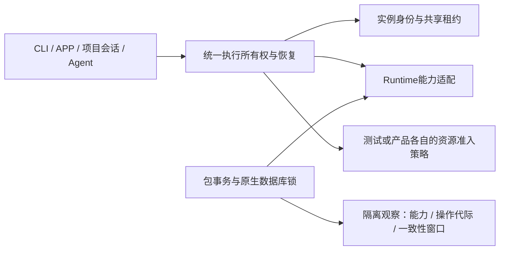

# 共享容器、依赖与架构审查结果（2026-11-05）

**离线可执行范围已覆盖，结果仍不合格；真实容器/GUI专项尚未完成。** 当前工作树存在1项正常CLI回归，并复现了隔离归因、后台应用租约和加载器验收的不足。共享宿主内核、发行版原生用户态、完整实例身份与原生包恢复这条基础路线可以保留；需要调整的是控制面的能力契约、执行所有权与隔离观察方式。

本轮保持产品和既有测试源码不变，完整保留11月4日工作树修复、脏文件和索引。没有部署、提交、推送、新建或启动容器。工作树HEAD：`6f776a61dc599ad8f1c0a476681e892248e55a6b`；日常入口仍为原安装版，不能把当前工作树缺陷直接当成已部署行为。

## 结果与统计口径

| 范围 | 去重项数 | 通过 | 失败 | 跳过 |
|---|---:|---:|---:|---:|
| 当前既有离线套件 | 734 | 727 | 1 | 6 |
| 补充合同：四类操作前拒绝、索引失败、同环境写锁 | 3 | 3 | 0 | 0 |
| 正确性检查合计 | **737** | **730** | **1** | **6** |

另有4项架构诊断，四项均确认了预设观察。这些诊断“通过”表示反例复现，**不计为问题已修复**。6项跳过涉及真实Podman安装/生命周期、GUI和真实GPU/设备条件；不算通过。原生C合成memfd/socketpair、参数与不存在设备的错误路径实际编译运行，未连接宿主屏幕/音频/摄像头/默认PipeWire。

原始批次：batch1=157项（154通过、3报错）；batch2=563项（562通过、1失败，包含前3项重放）；native-offline=17项（11通过、6跳过）。按完整测试ID去重后得到734项，详见 `offline-case-outcomes.json`。前3项错误是fake ProxyPool把相对bus重组为过长绝对路径；产品已使用相对bind地址。采用新的短私有临时目录后3项重放通过，原始错误与退出码保留，未把它们算成产品错误。诊断探针另有一次CreateSpec证据JSON序列化错误，精确子进程正常收尾；仅修正证据收集，单项重放通过。

## 问题与不足

### F01 / P1：多发行版包管理的实际功能回归

正常回归用例 `test_cli_shortcuts.RepairContracts.test_same_alias_is_namespaced_per_target_and_run_picks_the_right_instance` 失败。单发行版install成功；加入第二发行版后，同一目标下一次install在 `isolation-preflight` 被拒绝，native为空，未唤醒同伴。真实PodmanRuntime确实没有 `read_inventory_readonly`。

上次改动解决了“观察时唤醒同伴”的副作用，**尚未完成可用的真实多环境修复**。同一管理根中的包事务依赖所有无关环境都能被独立读取；缺一个适配能力就阻断目标。现有fake PackageBoxes提供该能力，而真实runtime没有，导致局部绿灯掩盖了正常CLI的可用性回归。

源码：[前置拒绝](/home/omg/文档/多兼容linux机/src/unifier/service.py:1504)、[只读能力缺口](/home/omg/文档/多兼容linux机/src/unifier/service.py:1839)。证据：`batch2/command.log`、`counterexamples/cross-environment-admission.json`。

优先完成明确的Runtime能力契约与真实只读数据库适配，或重新定义目标隔离证明的范围。隔离校验必须保留真实证据；不能以删除同伴记录、关闭检查或补一个fake方法使其表面通过。

### F02 / P1：把授权的并发变更误判为隔离污染

两个不同环境各自持有包锁，均获得当前的独立只读快照。双barrier保证两者都在before快照后完成各自包写入、再做after比较。两个包实际均已安装，但A报告“B inventory changed”，B报告“A inventory changed”，两个事务均为failed/verification。

同环境的两个请求已证明串行，原生写入最大并发1、均completed。问题位于跨环境观察模型：它把任何同伴变化当成越界，不区分另一个已授权事务。这个反例使用fake环境，不是真实并行容器结果。

源码：[前后比较](/home/omg/文档/多兼容linux机/src/unifier/service.py:159)、[每环境锁](/home/omg/文档/多兼容linux机/src/unifier/service.py:1410)。证据：`counterexamples/concurrent-peer-false-positive.json`、`completions/same-environment-writer-lock.json`。

需要为授权包操作建立operation ID/代际与一致性窗口，明确锁的顺序。若必须顺序化跨环境审计，应明确排队，而不是在合法写入后给出隔离失败；也不能把“变化来自另一个请求”直接当安全通过。

### F03 / P1（条件性）：APP租约未统一到实际客体执行所有权

managed_open在启动器返回后finally释放lease，runtime.exec只等待podman exec返回。包事务/项目会话已有客体PID/start/token与probe/cancel路径，APP未统一使用。

host自有后台子进程模拟客体应用后台化：启动器返回0后，child仍活，lease已归零，fake环境已经stopped。证明控制模型缺口；**尚未证明某一真实WPS/GUI应用受到影响**，更不能把宿主模拟说成真实容器生命周期验收。

源码：[lease释放](/home/omg/文档/多兼容linux机/src/unifier/on_demand.py:373)、[普通exec](/home/omg/文档/多兼容linux机/src/unifier/runtime.py:716)、[已有客体身份](/home/omg/文档/多兼容linux机/src/unifier/project_sessions.py:785)。证据：`counterexamples/background-app-lease.json`、`background-retry/command.log`。

建议APP、项目会话、Agent请求复用受控执行所有权，分别定义前台命令、后台应用和单实例激活的完成条件。无法证明实际执行结束时保留未知状态和可恢复租约，不按进程名清理、不因一个启动器退出停止整个共享环境。

### F04 / P2：静态补库与可加载性仍有明确边界

真实微型ELF：main链接一个库但不带RPATH，库在另一个私有目录。fake包数据库扫描能看到两者，静态修复报告completed/no-missing-elf-dependencies；实际host动态加载器退出127、找不到该库。源码把所有对象的SONAME/basename视为bundled候选，没有按每个对象解析RPATH/RUNPATH/ORIGIN、符号版本等。

当前字段已经明确 `runtime_loading=unverified`，所以这是一项能力与验收缺口，不能说实现谎报“已验证实际加载”。它也不是一次真实guest安装结果。真实二进制哈希、源码、readelf输出和实际stderr均保留。

源码：[bundled候选计算](/home/omg/文档/多兼容linux机/src/unifier/dependencies.py:177)。证据：`counterexamples/bundled-vs-loader.json`。建议在产品展示和判定中区分安装、静态候选、实际加载、实际工作流；必要时加入有预算、普通用户的加载oracle，不能靠全局LD_LIBRARY_PATH或伪造库名凑成功。

## 架构取舍

保留完整CID/UUID/generation的执行前核验、同target唯一性、原生包数据库锁、持久事务日志与未知状态拒绝、共享租约这些基础机制。本轮大量正向与拒绝合同支持它们的价值；不代表完整实机验收。

建议按实际故障边界划分职责，而不以文件行数为重构理由：

这是建议职责边界，尚未实现。先修F01真实能力闭环并让现有失败用例通过，再验证F02授权并发，随后统一APP执行所有权与F04验收层次。实际产品资源策略和测试预算分别设计；容器未设置某个默认硬配额，本身不能直接判为产品架构或性能缺陷。

## 32项真实专项的完成边界

逐条处置见 `case-results.json`。PRE01只读身份核对、DEP09/DEP10离线负向合同与本轮END01收尾完成；PRE02实际能力和PRE03实机保护仍阻断。共享CLI/依赖真实安装/Writer保存重开/Arch专项未执行，不把737项离线检查代替这些结果。

- Debian：原CID、UUID/代际、所有权标签、镜像、私有挂载、768MiB/192任务等读取核对；原根只有一个环境，没有真实同伴可以独立实测PRE02分支。T2聚合容器cgroup覆盖、保护器失联时的独立客体收尾与全部故障注入尚未完成。T1装置只会收尾自己的worker，不能据此放行另一个scope里的真实容器。
- Arch：原CID/根匹配，但Memory=0、NanoCpus=0、2048任务、父组user.slice，尚无合规汇总预算；未自动改配额、重建或用另一旧容器绕过。
- 实机缺库正向样本仍需自然缺失条件、可信唯一provider、版本/哈希、正式入口和最终真实运行证据；未通过卸载公共库制造缺失或手工补库回填。

## 资源、模型委派与收尾

沿用用户授权的 **1GiB** 保留线；负载512MiB/96任务/1核/无swap，独立保护64MiB/16任务；每250ms采样、30秒低压力准入、总期限和实际整树cgroup核验。所有留存宿主采样MemAvailable最低 **2.481GiB**，各阶段memory.peak/pids.peak、OOM/max和CPU节流在 `resources.json`，不据此发布性能SLO。

本地Qwen仅收到受限摘录进行架构短评，当前路由脱敏核验为local-server/swift-1.5-iq3_s/max；请求90秒未形成final，按期限结束，未调用工具。**没有完成独立模型复核，不引用其结论**，本报告基于主控源码核查与已留存反例。未回退其他模型或扩大期限。

收尾：容器 **10→10，全部exited，新增/启动0**；全部本轮单元MainPID=0、工作cgroup移除，原测试slice TasksCurrent=0；没有显示、监听、真实包事务或客体执行。213个既有源码/测试/工具/文档摘要、Git索引条目、boot/KWin身份及原池登记文件均保全，见 `preservation.json`。

没有修改宿主配置、区域设置、日常部署或活动桌面。私有临时目录按各spec记录并保留必要材料；模型路由覆盖和原始日志在700权限的.lab目录，未公开凭据。未做日常数据全树字节摘要或连续外部容器事件流，不将前后清单一致外推为所有外部事件均已排除。
