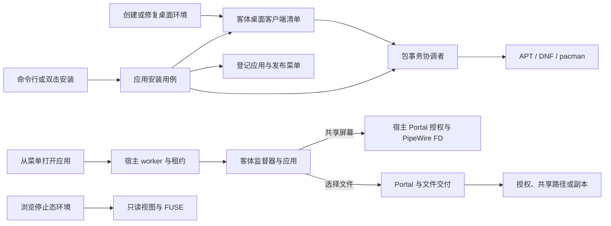

# Unifier v0.0.8 正式版整体代码重构报告

2026-11-19。设计与实现以开发树 `codex/unifier-v2-control@f2a7cee3` 为准。发行对照取正式 v0.0.7 和最初冻结的 v0.0.8 Beta 1，日用对照取本机实际启动的 `0.0.8b1+render.1.portal.2.install.1.media.1`。

**整体重构安排在 v0.0.8 正式发布前完成，主实现沿用 Python。** 在开发树内逐批替换旧实现。优先删除已退役的代码，合并重复防御，把安装、运行、恢复等不同阶段的职责放回各自模块。正式版既要有可核对的源码净减，也要让后来维护的人能从一次故障直接找到负责它的代码。

日用版随开发版同步，现场调整和回执说明哪个功能曾经坏、什么结果算修好。腾讯会议揭示了精简客体可能缺少的桌面客户端，适合做第一批通用兼容改造。一款此前未登记包名、使用同一协议的应用应该能直接受益。v0.0.9 将接入 openSUSE、改善应用打开后的实际操作响应，并完成正式开源上线前检查。现有 WPS 原生适配继续按其 Qt ABI 维护。[三目标专项及现有发布条件](../设计/v0.0.8-硬件专项与v0.0.9准备.md) · [版本路线](../设计/远期规划-2026-11-08.md)

## 一、开发主线、发行基线与日用增量

| 对象 | 这次核实的事实 | 在重构中如何使用 |
|---|---|---|
| 开发工作树 | 分支 HEAD 为 `f2a7cee374516c6755056321403cb37bdf74cf51`。审阅开始时主树和索引干净，源码版本为 `0.0.8b1`。`~/文档/Unifier` 是指向本工作树的符号链接。 | 作为后续改动的源码起点。 |
| 日用安装 | `~/.local/bin/unifier` 指向 `~/文档/unifier测试/unifier-0.0.8b1+render.1.portal.2.install.1.media.1/bin/unifier`。QQ、钉钉、腾讯会议的菜单指向同目录的 `tools/unifier.py`，双击包文件指向同目录的 `bin/unifier`。逐项核对 378 个发行项的内容、链接目标和模式，均与安装清单一致，且该清单与发布回执中的副本字节一致。 | 作为用户可见行为和旧记录兼容基线。清单的 `source_revision` 为 `null`，可用文件树摘要 `3d4afcbc3456…` 识别。 |
| 已组装开发候选 | 另有尾缀 `.desktop.1` 的候选，来源回执绑定上述完整 HEAD。归档和清单 SHA-256 均复核一致，含 386 项。与工作树比较，`src/`、`bin/`、`config/` 的共有文件只有版本模块内容不同，另有 20 个共有文件从工作副本的 0600 变为包内的 0644。 | 可做首个迁移对照。该包包含下述四项 WPS 资源。四个日用桌面入口当前仍指向 `.media.1`。 |
| 正式基线与旁支 | v0.0.7 由正式包摘要和 326 项清单定位。`codex/auto-host-share` 另有独立工作树，含未提交的 `host_share_objects.py`、`host_share_view.py` 以及现有 FUSE、视图后端和测试的改动。 | v0.0.7 用于旧记录与发布来源核查。旁支的宿主只读投影单独保全，安排文件域重构时评估接口兼容。 |

文中 `artifacts/` 链接指向本机开发仓库保存的原始回执。发行包内可查桌面实测台账和源版本清单。[正式版本来源](../config/release-baseline.json) · [日用清单副本](../artifacts/media-regression-20261119-7YbT21RQ/daily-candidate/unifier-0.0.8b1+render.1.portal.2.install.1.media.1.tar.gz.manifest.json) · [开发候选来源](../artifacts/git-desktop-checkpoint-20261119T194859-s_vnh2og/release/provenance.json) · [桌面实测台账](v0.0.8b1-桌面实测与补丁盘点-2026-11-19.md)

### 日用比发行包多出的是什么

正式 v0.0.7 的归档 SHA-256 以 `6d08eadb8142` 开头，初版 Beta 的归档以 `0f3582dfa87a` 开头。本机同名 `unifier-0.0.8b1/` 已换过五个产品文件，故用原冻结归档作比较。按清单逐路径比较 `src/unifier/` 内容，日用相对 v0.0.7 **新增 12 项、修改 12 项**，相对原冻结 Beta **新增 9 项、修改 12 项**，两组均无删除。后一组新增项含 5 个 Python 模块和 4 项 WPS 资源。从冻结 Beta 到日用，各包的 `config/` 均相同，三个目标的基础镜像定义延续下来。26 个 Debian 包是后来的一笔客体 APT 事务，与这 9 项发行文件是两种不同的计数。[原包冻结记录](../artifacts/v008beta-clean-install-20261117-MDi9pIbP/report.md) · [同名运行时补丁](../artifacts/v008b1-runtime-hotfix-20261117-zKD7Mqu1/report.md) · [客体实际包计划](../artifacts/media-regression-20261119-7YbT21RQ/daily-runtime-retest/apt-plan.txt)

| 到达的版本 | 相对上一行新增的可见行为 | 重构时的归属 |
|---|---|---|
| 正式 v0.0.7 | 已有过滤 D-Bus、GTK/Qt 文件选择、选择授权和只读副本、三目标原生事务与恢复。其源码已含会议的 D-Bus 名称所有权规则。 | 可继承的协议、权限与事务基础。选框本身早于这些日用补丁。[正式版说明](v0.0.7.md) · [正式包来源](../artifacts/release-v0.0.7-20261114T155436+0800-EWALREto/promotion.json) |
| 冻结 Beta 1 | 相对正式版新增 `wayland.py`、`input_method.py`、`cuda_device.py`，改动 7 个原模块。已有会话 socket 更新、宿主 XIM、硬件选择路径，以及 QQ 的 `ipc.node` 依赖解析和安装后登记修正。 | 会话接续、依赖扫描和设备管理属于开发版通用能力。CUDA 模块的存在与真实 CUDA 工作负载通过分开记录。[版本与验收范围](当前状态.md) · [QQ 菜单原始故障](../artifacts/qq-menu-repair-20261116-dTsmmw1N/report.md) |
| 同名 Beta 运行时补丁、`+render.1` | 先为应用安装和按包名修复补监督器所需的客体 Python。随后允许原桌面实例选择单一 DRM render node，QQ 原菜单参数即可使用硬件渲染。 | 前者是 Unifier 自身运行依赖，后者是设备配置。两个行为均应能服务其他应用。[运行时补丁](../artifacts/v008b1-runtime-hotfix-20261117-zKD7Mqu1/report.md) · [QQ GPU 对照](../artifacts/qq-render-node-daily-20261118-Vn2eRc48/report.md) |
| `.portal.1`、`.portal.2` | 第一版让已有实例原地启用过滤桥。第二版让三个标准桌面创建入口默认建桥，新登记图形应用选择 GTK Portal，钉钉使用受限的 GTK Native 路径。 | 保留通用默认和旧实例升级，厂商加载器问题单独处理。[两轮发版差异](../artifacts/file-chooser-regression-20261118-BxKhUw/report.md) |
| `.install.1` | 加入 WPS 私有 Qt 选框及格式适配、安装前置项与 Writer 退出默认。FreeCAD 带出 ELF 名、字体及 Qt 模式问题。还修复显式私有 IPC、原生缺包诊断和双击安装结果留窗。 | 字体与标准工具包可进入桌面安装。私有 ABI、安装次序、用户明确的 IPC 和终端行为各有自己的所有者。[办公及 CAD 故障](../artifacts/wps-freecad-20261119-dEcC0w5m/report.md) · [安装器回执](../artifacts/daily-installer-20261119-7NiQHfqN/report.md) |
| `.media.1` | 为原实例新增单一 V4L2 摄像头配置，为 Debian 腾讯会议的安装和依赖修复补 PipeWire 客户端。 | 共享屏幕适合推广为桌面默认能力，摄像头节点继续由用户为环境选择。[会议诊断](../artifacts/media-regression-20261119-7YbT21RQ/report.md) |

### 开发树与日用包的实质差异

| 范围 | 文件级结果 | 对用户行为的影响 |
|---|---|---|
| 共有产品 Python 文件 | 日用有 85 个，开发有 87 个。85 个共有文件中 81 个内容相同，4 个不同，分别为 `__init__.py`、`application_leases.py`、`cli.py`、`service.py`。 | 主体实现一致。开发树继续演进租约和桌面能力，日用固定包提供用户实际运行的行为对照。 |
| 开发树独有的产品模块 | `desktop_clients.py`、`host_portal.py`。CLI 和服务接入 `env desktop-integration`，可查询宿主配置候选与接口版本，并经原生事务补 GTK 3、Qt 6、PipeWire 客户端。 | 日用版有腾讯会议的定向补包规则。新入口还要区分配置候选、前端实际可查询、应用确实走通三种证据。 |
| 退出恢复 | 开发树先根据确证的终止状态释放租约，再报告原生退出码缺失。日用版在释放前抛错，异常分支可把这一笔写回待恢复。 | 原实例已停止且身份核实后可以释放该租约，退出码仍未知。运行中或身份不确定的租约继续阻断。这个差异已有精确用例。[租约实现](../src/unifier/application_leases.py#L49) · [回归用例](../tests/test_application_lifecycle.py#L238) |
| 日用包独有的产品资源 | `wps_portal_assets/` 含 Qt 平台主题、`wps-format-audit.so`、适配清单和 Qt 许可证。开发树有重建源码和补丁。现行候选组装脚本额外从已校验的日用包取回四项。 | 裸工作树登记 Debian Writer 时会选择默认 GTK 路径。若旧登记已经指定 `wps-portal`，缺资源会在准备启动时出错。即使两份 Python 文件完全相同，也能给用户两种不同结果。[默认选择与启动](../src/unifier/file_chooser.py#L24) · [资源校验](../src/unifier/wps_portal.py#L47) · [候选组装](../artifacts/git-desktop-checkpoint-20261119T194859-s_vnh2og/build-desktop-candidate.py) |
| 兼容入口与支撑文件 | `src/multilinux`、`bin`、`config`、`fixtures` 两版逐项相同。工具有 3 项内容变化，开发树多 1 项。测试有 8 项内容变化，开发树多 1 项。 | 工具差异包括三份测试守卫，开发树还多历史补丁查询工具和宿主桌面客户端测试。不能用测试文件变化推算日用启动开销。 |

从同名运行时补丁到 `+render.1`、`.portal.1`、`.portal.2`、`.install.1`、`.media.1`，五次相邻日用清单对照中，**每一次都改动了 `service.py` 和 `cli.py`**。当显卡、文件框和摄像头三个独立问题都需要碰同一对大文件时，再增加软件就容易引入交叉回归。

## 二、代码规模和最值得动的地方

两边所有现行 Python 文件按语法树解析，开发树的产品模块逐个归类见附录。行数为含空行、注释的物理行。函数统计含方法和嵌套定义。另核对了发行清单、shell 入口、WPS 原生构建与补丁、硬件夹具类型、实际运行时引用及相关历史证据。归档的旧代码副本、已安装的第三方应用与 Qt/Podman 上游源码不计入 Unifier 产品行数。

| 目录 | 开发树 | 日用包 | 解读 |
|---|---:|---:|---|
| `src/unifier` 的 Python | 87 文件 / 34,924 行 | 85 文件 / 34,658 行 | 开发树有 1,610 个函数或方法定义，其中 29 个超过 100 行。 |
| `src/multilinux` | 44 文件 / 390 行 | 44 文件 / 390 行 | 大部分是旧导入名转发，已有诊断命令及工具仍依赖。 |
| `tests` | 120 文件 / 30,297 行 | 119 文件 / 29,998 行 | 有大量可留用的故障契约。文件数和静态 `test_*` 数均与某一轮实际执行数含义不同。 |
| `tools` | 52 项 | 51 项 | 开发树 46 份独立 Python 源文件共 20,518 行，另有 `ml.py` 链接、shell、C、Qt 补丁和说明。 |
| `fixtures` | 23 项 | 23 项 | 含 C、CUDA、SPIR-V 汇编等验证素材，适合随完整源码和验收套件分发。 |

最大的五个文件共 **10,779 行，占 `src/unifier` Python 的 30.9%**。五轮日用补丁都改过的服务和命令入口位居其中。可以从一次安装或一次设备配置倒推，把分散在多个入口的同一项决定合到一处。

| 模块 | 物理行 | 维护成本及建议 |
|---|---:|---|
| [service.py](../src/unifier/service.py#L317) | 3,278 | `EnvironmentService` 有 130 个直接方法。环境创建、身份迁移、桌面配置、应用登记、包写入与恢复共用同一对象。保留调用方使用的服务接口，先让安装计划和原生事务有独立负责人。 |
| [shortcuts.py](../src/unifier/shortcuts.py#L1383) | 2,423 | `cmd_install` 长 197 行，串起目标路由、安装、补依赖、选入口、登记及菜单发布。提取可以被快捷入口与桌面安装共同调用的安装用例，终端层负责参数、提示、JSON 和退出码。 |
| [agent_bridge.py](../src/unifier/agent_bridge.py#L738) | 1,947 | 同时定义策略、持久化请求去重、Unix socket 帧、执行与恢复。可以先分出策略和账本，让请求处理流程继续统一协调执行前的去重登记、身份重验和异常恢复。 |
| [cli.py](../src/unifier/cli.py#L16) | 1,615 | `build_parser` 长 552 行。诊断命令、快捷命令和隐式 worker 有不同分派路径。v0.0.8 整理功能所需的入口分派，验证 `--`、双语帮助、错误码和桌面入口。按命令族重排 parser 与帮助文件留到 v0.0.9。 |
| [runtime.py](../src/unifier/runtime.py#L1007) | 1,516 | Podman inspect 解析、OCI 启动组合、挂载、宿主子进程和客体监督脚本共处。先把“需要什么能力”移给调用方，再把现有校验和执行留在 Podman 适配器。 |

静态导入图中，`service`、`cli`、`shortcuts` 分别直接引用 34、29、21 个不同的产品模块，包含函数内导入。例如 `service` 引用视图保护，`views` 为校验环境 ID 又回引 `service`。此外，配置读取、兼容性查询和 rootless 准入共有三处从产品代码反向导入实验工具 `tools.lab`，而工具又使用旧包名读取产品目录。这些依赖比重新命名文件更值得先改。现有 `install.load_catalog`、`catalog`、`compatibility` 和可注入的运行时命令执行器已经提供了起点，合并时需逐项保留两个读取入口原有的验证。[视图反向引用](../src/unifier/views.py#L550) · [项目配置](../src/unifier/project.py) · [兼容性入口](../src/unifier/cli.py#L717) · [rootless 检查](../src/unifier/runtime.py#L1487) · [目录校验](../src/unifier/install.py#L102)

### 防御性代码具体怎么减

| 当前代码 | v0.0.8 的取舍 |
|---|---|
| `identity`、`projects`、`handlers`、`project_sessions`、`views`、`file_operation_journal`、`agent_bridge` 各有一个 canonical UUID 解析函数，共 7 个。大部分重复类型、解析和小写格式判定，桥还承诺协议错误码。 | 合并底层格式判定。磁盘记录、外部请求在读入时各自附上字段、错误类型和现有协议码。内部函数接收已核验的值，同一条同步路径中可以删掉重复格式检查。[环境身份](../src/unifier/identity.py#L42) · [项目登记](../src/unifier/projects.py#L26) · [桥的协议错误](../src/unifier/agent_bridge.py#L227) |
| `projection._mnt_id` 与 `view_backend._mnt_id` 的参数和函数体一致。另一个文件控制入口遇到挂载身份缺失必须拒绝访问。 | 前两者直接共用一份读取实现，保留资源耗尽时的错误。控制入口继续对缺失身份执行自己的拒绝策略。少维护一份解析代码，同时保住文件访问边界。[投影读取](../src/unifier/projection.py#L143) · [后端重复实现](../src/unifier/view_backend.py#L183) · [严格的文件控制入口](../src/unifier/control.py#L58) |
| GPU 和摄像头的配置都要加锁、读环境、核对归属、改设置、落盘。具体设备却有不同的冲突条件，摄像头还须验证采集能力。 | 让一处代码拥有停止态配置的锁及写入顺序，设备模块各自返回明确的校验结果。已知设备换号、挂载冲突、正在使用的环境各按原约定处理。可进一步消除以后每加一个设备就复制一段服务代码的需求。[GPU 配置](../src/unifier/service.py#L908) · [摄像头设备](../src/unifier/camera_device.py#L33) |
| 包事务在外部操作前回读绑定并核对完整 CID，旧记录迁移、进程恢复也会重新取证。即便两次比较字段相同，中间的等待、锁、进程或磁盘状态可能已经变了。 | 由实际执行写入、启动或恢复的入口负责最后一次重验。来自同一份未变化的内存值可以复用，跨进程和跨时间的现场身份要重新取。每个保留的复查应能说清“在此之前什么可能变化”。[包操作绑定](../src/unifier/service.py#L2915) · [旧环境迁移](../src/unifier/identity.py#L148) · [租约收尾](../src/unifier/application_leases.py#L49) |

### 历史代码和可读性的验收

按参数和函数体语法树核对当前 87 个模块，忽略首行文档字符串，只看函数体跨度至少 8 行的跨文件相同实现，共 10 组，其中 9 组涉及冻结的视图/FUSE 代码，含一组嵌套函数。现行 `fuse_view_legacy.py` 和 `view_backend_legacy.py` 共 **1,022 行**。这给出了优先清理对象。旧模块仍有 `python -m` 入口、旧包名转发和显式验证旧后端的用例。按原有备份决定逐项核对调用方、替代路径和回滚后，才能登记其中实际退役的行数。[冻结实现](../src/unifier/view_backend_legacy.py) · [旧入口契约](../tests/test_projection_objects.py#L549) · [历史清理决定与后续复核](../设计/v0.0.8-代码清理与技术债收口-2026-11-16.md)

- **把代码写到读者预期的位置。** CLI 解析参数并呈现结果，应用安装用例串起计划、原生事务和登记。模块按动作命名，函数名说明会查询还是会写入，注释解释故障原因、触发条件和约束。修复日期、版本演进和失败日志归已有台账。以“从双击安装到菜单登记”的路径审读一遍，开发者应能找到每一步唯一的实现。
- **让产品依赖指向产品层。** `project`、`cli` 和 `runtime` 目前会反向导入 `tools.lab`。把目录读取和 rootless 准入的公共部分放回已有产品模块，让实验工具调用它们。`validate_env_id` 也应归到能被服务和视图共同导入的小模块。优先复用现有类型和函数，有两处实际调用需要同一规则时再抽取。[产品配置入口](../src/unifier/project.py#L15) · [运行时准入](../src/unifier/runtime.py#L1494) · [视图反向依赖](../src/unifier/views.py#L550)
- **按同一口径交代删了多少。** 基线为 `src/unifier` 34,924 行、`src/multilinux` 兼容入口 390 行，合计 35,314 行 Python 物理行。现有 29 个函数超过 100 行。按产品目录净减、全仓真正删除与新增、发行包清单及大小分别记账，列出仍需维护的应用专例、大型函数和测试增量。当前发行包也收集 `tools` 和 `tests`。迁移单列，精简数字在第二批按实际去留重估。正式版用同一口径复算，并举出一款新增普通应用所需的实际源码改动。

## 三、哪些兼容问题可以直接转译，哪些应在客体初装解决

### 腾讯会议揭示的通用桌面依赖

腾讯会议 `3.26.10.401` 的 DEB 只声明了 8 项 `Depends`。共享模块在用户使用该功能时才调用 `dlopen("libpipewire-0.3.so.0")`，普通 ELF 依赖扫描看不到这次按需加载。Debian 13 的 GNOME 桌面通过 `gnome-core` 引入 PipeWire 音频栈，Plasma 通过 QtQuick PipeWire 模块引入同一客户端库。Unifier 的 Debian 客体从 `debian:13-slim` 开始，客体即便运行在 Fedora KDE 上也不会因此获得这些库。日用实例以 `--no-install-recommends` 安装 `pipewire-bin` 后实际新增 26 个包，带入共享库、协议与 SPA 模块以及 `/usr/share/pipewire/client.conf`。这个数量取决于该实例原有的库存。[厂商包及加载证据](../artifacts/media-regression-20261119-7YbT21RQ/report.md) · [目标镜像](../config/targets.toml) · [GNOME 依赖](https://packages.debian.org/trixie/gnome-core) · [Plasma 依赖](https://packages.debian.org/trixie/plasma-workspace) · [KDE 模块依赖](https://packages.debian.org/trixie/qml6-module-org-kde-pipewire) · [Debian 客户端文件](https://packages.debian.org/trixie/amd64/pipewire-bin/filelist)

| 屏幕共享这一步发生在哪里 | 可以交给哪一层 |
|---|---|
| 会议进程在客体中加载库和配置 | 随 Unifier 发布“桌面能力 → 客体发行版原生包”的映射，在创建桌面环境时兑现。客体动态加载器需要本架构、兼容 ABI 的文件。直接传 D-Bus 请求解决不了缺库。用自制同名库拦截调用，还要自行维护厂商用到的符号、对象和事件语义，此处已有可用的发行版客户端。 |
| 客体发出 ScreenCast 请求，用户选屏幕或窗口 | 直接经受限 D-Bus 桥送到宿主 `org.freedesktop.portal.Desktop`。宿主按当前会话和接口配置选择 KDE、GNOME 等后端，显示授权界面，处理取消。客体发行版与宿主桌面可独立选择。这段可以供所有使用相同协议的应用复用。[宿主路由实现](../src/unifier/host_portal.py#L127) · [Portal 后端选择规范](https://flatpak.github.io/xdg-desktop-portal/docs/portals.conf.html) |
| 客体取得获准源并消费画面 | `Start` 返回流信息，`OpenPipeWireRemote` 返回授权连接的文件描述符。客体原生 PipeWire 客户端用它接收媒体。宿主提供服务，Unifier 管理桥与会话边界，画面数据走 PipeWire。这条路径足以复用宿主桌面，无须在客体再运行桌面会话或媒体守护进程。[ScreenCast 接口](https://flatpak.github.io/xdg-desktop-portal/docs/doc-org.freedesktop.portal.ScreenCast.html) · [实际帧和停止回执](../artifacts/screencast-generic-20261119-0PcVJX7A/report.md) |

**开发版已经做到哪一步。** `f2a7cee3` 在既有桥上加入宿主后端候选和运行中 Portal 接口版本查询，以及 `env desktop-integration <环境> --install pipewire` 等通用补件入口。GTK 3、Qt 6、PipeWire 已有 Debian、Arch 和 Fedora 映射。只查询时返回宿主情况和可选包名，显式安装走原生事务，重复安装核对包清单。当前自动补件仍匹配 Debian 钉钉、Debian 腾讯会议和 Arch FreeCAD。桌面创建默认建桥，尚未自动安装这三类客户端。标准图形入口的默认选框模式为 GTK，FreeCAD 的 Qt 模式仍按桌面 ID 或可执行入口匹配，WPS Writer 和钉钉另有模式。安装状态、实际加载、宿主后端成功提供服务是三种不同的结果。[能力及包名映射](../src/unifier/desktop_clients.py) · [查询与安装](../src/unifier/service.py#L638) · [实际补包与库存判断](../src/unifier/service.py#L2335) · [选择器默认值](../src/unifier/file_chooser.py#L24)

这里能够直接转译的前提是应用与宿主有共同的公开接口。对只调用某个桌面私有服务的应用，还要核对所用方法、返回值和权限，才能指定对应适配。目前桌面会话也可能直接挂载宿主 PulseAudio 和 PipeWire socket。单次 ScreenCast 授权 FD 的实测说明该条共享路径可用，整个客体仍按实际挂载和环境设备配置判断可见范围。[会话挂载](../src/unifier/desktop.py#L128) · [现有宿主接口适配计划](../设计/宿主桌面与硬件接口适配计划-2026-11-19.md)

**哪些会议例外可以退出。** 日用人工确认会议的动态摄像头预览、共享画面到达对端。另一次开发版回执在测试进程内去掉了 `wemeet` 补包匹配和 `--own=com.tencent.wemeet.*`，用通用命令安装客户端。真实 Portal 前端、私有选源后端和通用客体接收程序完成了取消无 FD、接收 140 帧三色画面、停止后节点消失。这个结果支持把 **PipeWire 安装条件** 提升到桌面环境。总线名称所有权是 v0.0.7 就有的另一项兼容。删除它之前，需要原版会议在无该规则下完成启动、厂商实际依赖的会话操作、共享和退出。此前私有嵌套 KDE 后端在提供源前中止，GNOME 尚缺同类真实记录。[日用人工记录](v0.0.8b1-桌面实测与补丁盘点-2026-11-19.md) · [通用测试及边界](../artifacts/screencast-generic-20261119-0PcVJX7A/report.md) · [仍生效的总线参数](../src/unifier/on_demand.py#L261)

### 其他日用改动应落在哪里

| 能力或故障 | 直接转译、预装或保留的决定 | 验收依据 |
|---|---|---|
| QQ、钉钉、FreeCAD 的系统文件框 | 使用标准 GTK/Qt API 的程序走宿主 FileChooser。Unifier 继续把返回的 URI 交付为客体可访问的共享路径或授权副本。Qt 选框插件须与客体 Qt 主版本匹配。Arch FreeCAD 的 Qt 6 路径可推广到同类应用，Debian FreeCAD 的 Qt 5 需单独选包。 | QQ、钉钉已人工确认宿主附件框。专用 Arch FreeCAD 1.1.4-3 经 KDE 保存、重开 FCStd、导出并重开 STEP，几何尺寸可复核。通用路径需保住取消、可写共享及授权撤销。[桌面台账](v0.0.8b1-桌面实测与补丁盘点-2026-11-19.md) · [文件交付](../src/unifier/portal_delivery.py) · [GTK/Qt 现行模式](GTK原生选择器兼容.md) |
| 客体监督器、默认字体、中文显示 | 当前监督器依赖客体 Python 3，应由 Unifier 应用运行时准备。桌面安装准备 fontconfig 和基础字体。中文桌面按语言需求选 CJK 字体。XWayland 的中文输入走经核验的宿主 XIM，保留用户已有输入法偏好。 | 当前通用检查只验证 `sans-serif:lang=en`。QQ 日用中文显示依靠另装的 `fonts-noto-cjk`，输入另有 XIM 握手。三者可以独立诊断。[字体检查](../src/unifier/service.py#L2529) · [QQ 实测](../artifacts/qq-system-diagnosis-20261118-7ONesT4M/report.md) |
| 钉钉查找 `libgtk-3.so`，WPS Writer 使用私有 Qt | GTK 3 运行库可原生安装。钉钉所查的未版本化名字需要经 SONAME 和符号核验的应用级别名。WPS 在 `postinst` 前需要提供 `hexdump` 的 `bsdextrautils` 和已知运行库。Writer 自绘选框、`kso_qt` Qt 5.12 ABI、保存过滤器和精确子进程退出策略继续限于已验证入口和构建。 | WPS 曾把标为 DOCX 的文件写成 OLE DOC。保留真 DOCX 的正文、表格、关闭重开检查。厂商修复对应行为后逐项移除例外。把办公套件所需包全装进每个桌面会增加无关成本。[钉钉加载器](../src/unifier/native_library_launcher.py) · [WPS 安装前置](../src/unifier/service.py#L2565) · [Writer 适配源码和验收](../tools/wps_portal/README.md) |
| QQ 硬件渲染、会议摄像头、Wayland 重登及私有 IPC | DRM 和 V4L2 节点按用户选择映射到环境，启动时重验身份。实际走 V4L2 的程序需要其选定节点，走 Camera Portal 的程序才可直接请求宿主授权。Wayland 源 socket 随会话更新，保留已登记实例及显式 `--ipc private`。 | QQ 日用用原 argv、单一 render node 硬件渲染并正常退出，一次诊断的 `--disable-gpu` 可退场。会议动态预览已有人工证据，QQ 摄像头仍待验。QQ 托盘点击的修复属于宿主 NextKDE/KOS。[GPU 对照](../artifacts/qq-render-node-daily-20261118-Vn2eRc48/report.md) · [设备选择](../src/unifier/camera_device.py) · [托盘实测](../artifacts/kos-tray-click-20261118-qcSxYAW7/report.md) |
| `ipc.node`、`_PartDesign.so`、半配置包、菜单漏登记和双击留窗 | 两个合法 ELF 名归扫描器。原生事务、依赖诊断和菜单分别报告结果。库存与恢复屏障允许时可单独补登记。包打开器保留退出码和留窗。这些都是安装器对所有软件的正确性。 | 保留 APT/DNF/pacman 原始诊断、失败阶段和恢复入口。测试包的文件名和故障工作流可作为回归样本，产品无需为每个样本加包名分支。[扫描器](../src/unifier/dependencies.py#L44) · [登记条件](../src/unifier/shortcuts.py#L1332) · [安装器回执](../artifacts/daily-installer-20261119-7NiQHfqN/report.md) |

### 如何随下一发行版交付

1. **发布客体桌面客户端清单。** 在开发树维护一份按目标和能力索引的原生包映射。建议启用标准 Portal 的 `--desktop` 环境在初装时准备 PipeWire 客户端、基础字体和默认 GTK 选框客户端。Qt 插件按应用使用的工具包和主版本准备，CJK 字体按语言准备。CLI 环境保留精简安装。三种目标的 PipeWire 映射依次为 Debian 13 的 `pipewire-bin`、Arch 的 `pipewire`、Fedora 44 的 `pipewire-libs`。各目标官方包拆分不同，当前通用媒体接收回执来自 Debian。[开发版映射](../src/unifier/desktop_clients.py) · [Debian 包依赖](https://packages.debian.org/trixie/pipewire-bin) · [Arch 客户端配置](https://archlinux.org/packages/extra/x86_64/pipewire/files/) · [Fedora 44 包文件](https://packages.fedoraproject.org/pkgs/pipewire/pipewire-libs/fedora-44.html)
2. **创建与原地修复复用同一份清单。** 三个标准创建入口都调用现有原生事务，为可联网的桌面客体补缺项。已有客体沿用 `env portal-bridge` 和 `env desktop-integration` 按需修复。返回哪些已装、哪些待装以及失败原因。当前在线事务要求 `--network pasta`，离线创建可先记录待补能力，或使用未来由相同清单构建的带版本预置镜像。保留 `--no-portals`、已有选择器和设备授权。已有无桥会议环境仍可显式保有 PipeWire 客户端。[事务入口及网络条件](../src/unifier/service.py#L2247) · [旧实例配置](../src/unifier/service.py#L858)
3. **普通应用先走协议，确有差异再加例外。** 以实际工具包/插件 ABI 和应用显式偏好决定 GTK 或 Qt 路径。支持桌面 Portal 的新应用应能复用宿主后端，文件授权和 PipeWire FD 走现有通道。把仍需匹配包名、desktop ID、可执行文件、版本或摘要的钉钉、WPS 等规则集中列出，每条关联触发条件、故障回执和退出条件。固定运行时补包顺序和原生资源随发行物交付。[选择器策略](../src/unifier/file_chooser.py#L24) · [历史补丁索引](历史补丁速查.md)
4. **分别验证通用性和厂商兼容。** 先用同协议且未登记包名的应用核对加载、授权、取消和释放，再用原版软件复验原故障。验收记录区分已装包、成功加载、宿主后端、实际结果。共享需看到可辨画面并确认停止，文件需保存并重开。用 KDE 与 GNOME 分别核对后端，旧环境还需覆盖升级、重复执行和关闭 Portal。达到同等结果后，逐条移除会议补包等冗余分支。[通用接收证据](../artifacts/screencast-generic-20261119-0PcVJX7A/report.md) · [既有验收矩阵](../设计/宿主桌面与硬件接口适配计划-2026-11-19.md)

## 四、推荐的职责划分

保留单一安装包和按需启动方式。创建桌面、安装应用、从菜单打开和浏览停止态文件各有清楚的入口。

安装用例只有在事务结果允许时才发布菜单。启动应用时，宿主 worker 须重新核验菜单绑定与实例身份。浏览停止态环境可以独立使用投影，这条路径也可以独立优化。[菜单登记](../src/unifier/shortcuts.py#L1332) · [按需打开](../src/unifier/on_demand.py#L644) · [停止态视图](../src/unifier/views.py)

| 职责 | 现有实现与切入点 | 边界 |
|---|---|---|
| 命令与应用安装 | `cli`、`shortcuts`、`package_offer`、`app_entries` | 参数与呈现放入口层。安装用例接收明确的目标和安装意图，返回原生事务、补库、应用登记和菜单四项结果。安装器保留 TTY、双击留窗、中文提示及原始退出码。 |
| 桌面能力与应用例外 | `desktop_clients`、`host_portal`、`file_chooser` 和各厂商适配模块 | 客体客户端清单归目标发行版，宿主后端随会话选择。新建、装应用和旧客体修复共享能力解析。只有标准协议与原生运行时仍无法覆盖的行为进入应用规则。 |
| 环境与运行时 | `EnvironmentService` 的生命周期部分、`PodmanRuntime`、`catalog`、`identity` 和设备模块 | 按目标生成启动参数。Podman 侧在真正启动前重验完整 CID、所有权、代际、实际挂载和设备身份。Wayland 换 socket 只更新经核验的源。一个管理根一个目标一个环境，同派系拒绝，显式的私有 IPC 及禁用 Portal 的选择照旧生效。 |
| 包事务与恢复 | `packages` 已有 APT、DNF、pacman 驱动，另有 `package_journal`、`package_observation`、三种停止态清单后端 | 单一协调者持有管理根 → 环境包锁 → 生命周期锁的既有顺序，执行前落盘并在失败后收尾。把计划从有副作用的准备动作拆开，尤其是 `_native_steps` 里实际会复制本地包、探查 Arch 密钥环。保留目标提交与同伴审计的区别，读取同伴清单维持原启停状态。[事务入口](../src/unifier/service.py#L2209) · [只读后端](../src/unifier/inventory_backends.py) · [同伴审计](../src/unifier/package_observation.py) |
| 应用监督、项目会话与请求桥 | `LaunchGroup`、`application_leases`、客体 `application_supervisor`、`ProjectSessions`、`RequestLedger` | 共享生命周期只由拥有它的租约组收尾。区分宿主代理退出、客体子树退出、原生退出码已知三件事。请求桥保留宿主签发的范围、持久化去重及重启不自动重放。[租约组](../src/unifier/on_demand.py#L396) · [客体监督器](../src/unifier/application_supervisor.py#L125) · [请求账本](../src/unifier/agent_bridge.py#L738) |
| 文件权限、交付与数据路径 | 复用 `file_access.decide_selection`、grant 账本、`portal_delivery`、受管复制/移动和只读视图 | 共享可写目录允许保存，未共享普通文件可经授权交付副本。撤销、配额和环境级共享语义保留。受管移动保持目标发布、源清理授权及身份复核。停止态 FUSE 保留稳定 inode、FD 预算、旧句柄和同时间戳内容更新的语义。[文件决策](../src/unifier/file_access.py#L184) · [发布流程](../src/unifier/file_operation_publish.py) · [投影协议](../src/unifier/fuse_view.py) |
| 状态与发布 | `atomic_io`、`JsonRecordCollection`、`store`、`view_journal` 和发行清单 | 复用原子替换、文件及父目录 fsync、UUID/摘要解析。每个领域继续拥有状态转换，因为同名的“已完成”在包、租约、文件移动中需要不同证据。先在读写边界引入小型类型与稳定错误码，保留对旧记录、未知字段、私有路径和运行时身份的必要检查。[原子写入](../src/unifier/atomic_io.py) · [记录校验](../src/unifier/json_records.py) · [存储引用日志](../src/unifier/view_journal.py) |

发布时显式列出由路径或字符串启动的部件。宿主会读取监督器源码发送给客体，停止态包探针也从文件路径启动，选择器脚本会复制到挂载目录。普通导入图看不到这些调用，发行包需从实际入口验收。探针、夹具和测试守卫在完整源码包中独立维护。[客体监督入口](../src/unifier/runtime.py#L140) · [文件交付桥入口](../src/unifier/on_demand.py#L334)

## 五、v0.0.8 正式版的实施顺序

正式版按方案 B 分五批实施。原 P6 的通用桌面能力和设备配置由第四批交付。原 P7 中纯 CLI 的 parser 分文件、帮助排版等整理后移至 v0.0.9，桥协议与功能入口仍在本版验收。硬件和日用缺陷沿原用例取得行为回执，受影响的结构改动据此复验。[审批决定](重构计划审批与工程意见-2026-11-19.md) · [各批范围、验收与回退依据](../设计/代码重构方向与精简工程-2026-11-19.md#五个实施批次)

| 批次 | 本批交付 | 放行依据 |
|---|---|---|
| 一 · 基线、备份与入口清单 | 保存 Git 对象、索引、工作树和回退必需的发行输入，登记旧命令、别名、探针、字符串或路径启动的部件。 | 临时副本还原出的 Git 状态、模式、链接和文件清单与现场一致。能读回候选包、WPS 四项资源及关键回执，能检出旧入口或 worker 缺件。 |
| 二 · 旧实现退役与依赖整理 | 核对旧视图、探针、诊断 API 和动态调用方，逐项退役或迁移。串行整理投影、UUID、服务依赖及请求桥的策略、账本和帧协议。 | 旧视图参数、inode、句柄和错误路径有替代用例。包服务动态读取同伴库存、服务锁内删除预检和请求去重恢复均通过。三处产品对 `tools` 的导入归零，按实际去留重估精简量。 |
| 三 · 包事务、安装与三目标路由 | 先分离原生写入、收尾与恢复，再提取 CLI 和双击共用的安装、补登记及菜单用例。三目标共用已实现目标目录。 | 核对失败阶段、锁序、恢复后的三份库存和原生退出码。DEB、RPM、Arch 包路由正确，Leap 可描述且创建被拒绝。菜单发布失败可单独修复，原入口能打开和退出。 |
| 四 · 桌面与设备工作流 | 初装与旧实例修复共用客户端清单，本批统一厂商例外和显式设备配置。 | 未登记包名的同协议应用完成授权、取消和释放。原版会议共享到已获准的接收端并正常停止，Writer 保存重开真 DOCX，FreeCAD 重开 FCStd/STEP。按专项核验设备身份、锁和租约。 |
| 五 · 候选验收与回退 | 用干净检出及声明输入组装候选，汇总三目标、硬件、日用缺陷与精简实数。 | 独立解包回归、五个 CLI 入口、菜单、双击和受影响的真实工作流通过。专用副本升级及回退后，原入口均能打开原数据。全部必测项对照专项发布条件逐项放行。[发布条件](../设计/v0.0.8-硬件专项与v0.0.9准备.md#9-v008-完成与发布条件) |

升级沿用管理根、环境 UUID/generation、完整 CID、桌面 ID 和已装菜单所用路径。迁移时保全旧事务、租约、授权及活跃 worker 的归属。涉及持久格式变化时，在副本上验证旧数据读取、恢复和回退。切换命令软链还须核对直接调用 `tools/unifier.py` 的菜单。[旧标识](布局.md) · [安装兼容测试](../tests/test_release_install.py) · [历史切换回执](../artifacts/media-regression-20261119-7YbT21RQ/report.md)

开发版标记为 Beta 1。历史暂存快照共 1,224 项，1,219 通过、5 跳过。`.desktop.1` 独立解包共 1,224 项，1,214 通过、10 跳过，另有 4 次 `ResourceWarning`（2 次子进程、2 次 SQLite）。两个对象各自记录关键用例名称和跳过原因，后续候选按同一对象比较。本轮交付计划文档，实施状态为待执行。[暂存快照日志](../artifacts/git-desktop-checkpoint-20261119T194859-s_vnh2og/staged-desktop/command.log#L115) · [候选验证日志](../artifacts/git-desktop-checkpoint-20261119T194859-s_vnh2og/release/unifier-0.0.8b1+render.1.portal.2.install.1.media.1.desktop.1.tar.gz.validation.log#L99)

## 六、v0.0.9 的三项工作

### 接入 openSUSE Leap

v0.0.8 要留下可复用的接口。当前 `install.load_catalog` 写死三个目标，`routing.PREPARED_FORMATS` 把 RPM 的默认候选写为 Fedora。先让安装、路由和命令入口读同一份已实现目标目录，并继续核对驱动与镜像锁。仓库已经有 Leap 16.1 的独立候选描述，可在 v0.0.8 验证“能描述、尚不能创建”。到 v0.0.9 再接 zypper，在固定 Leap 实库上核验 RPM 清单、锁与恢复。RPM 有多个合格客体时显式选目标，宿主本族包仍交给宿主。[目标读取](../src/unifier/install.py#L102) · [RPM 路由](../src/unifier/routing.py#L15) · [Leap 候选](../fixtures/opensuse-leap161/target-candidate.toml) · [接入计划](../设计/openSUSE-Leap适配-v0.0.9.md)

### 提升应用内的具体响应与性能

计时从应用已经打开、用户可以操作开始。主指标直接对应用户做的一件事。以下为建议首批样本，均能复用已有功能回执检查结果是否正确。[办公与 CAD 已验样本](../artifacts/wps-freecad-20261119-dEcC0w5m/report.md)

| 操作 | 计时边界 | 与耗时一起核对的结果 |
|---|---|---|
| WPS Writer 编辑与保存 | 在同一文档中输入或滚动，到文字或目标段落实际绘出。保存从确认目标开始，到保存完成，再单独核对重开。 | 文档版式、正文、表格和 DOCX 格式正确。输入、滚动和保存各自列出延迟。 |
| FreeCAD 编辑与重算 | 在同一模型中修改同一尺寸，到重算完成且视图更新。连续旋转另量帧时间与长帧。 | 修改后的几何尺寸正确，FCStd/STEP 能重开。保留模型规模、显示分辨率和渲染后端。 |

先记录当前应用版本和同一操作的基线，分别量输入、应用计算、绘制与持久化中能可靠观察的区段。固定样本、缓存状态、存储位置、显示后端、硬件加速和测试预算，用交替重复对比同一应用改动前后，给出中位数及样本足够时的尾部延迟。若发现重算落在应用自身算法、卡顿来自软件渲染或保存多做了一次文件拷贝，应分别归因，只有定位到可改变的环节才提出优化。Unifier 启动耗时、包扫描、Portal 建连和空闲内存可辅助解释，最终验收看表中具体操作是否更快且结果等价。此前 WPS 的原生/客体对照测过静置内存，尚未给这些操作建立延迟基线。[历史 WPS 对照](../artifacts/wps-native-container-ab-20261103T222720+0800/report.md) · [本机测量规范](本机测试规范.md)

### 正式开源上线前检查

| 当前仓库事实 | v0.0.9 上线前的交付 |
|---|---|
| 当前 HEAD 根目录未见项目级 `LICENSE` 或 `COPYING`。WPS 适配另有 Qt 许可文件、厂商构建输入和来源摘要。 | 由维护者确定项目源码许可证，候选可查 OSI 清单。逐项标注原生适配、补丁、第三方输入与可分发产物的来源及处理方式，确认干净检出可用的构建路径。[OSI 许可证清单](https://opensource.org/licenses) · [WPS 构建输入](../tools/wps_portal/README.md) |
| 现有构建按目录递归纳入 `docs/`、`设计/`、测试等内容，另显式加入 `AGENTS.md`、`HANDOFF.md`。本地报告和交接文档含个人绝对路径与现场实例信息。 | 明确公开源码、发行包和本地回执各自的清单。逐项核对拟公开的文件、Git 历史、示例及资源，私有路径用可重现的示例替换。对最终生成的包再核对一次实际内容。[构建收集逻辑](../tools/build_release.py#L55) · [仓库维护约定](仓库维护.md) |
| 日用包和开发候选有不同的版本来源，部分 WPS 资源此前从本机已验包补入。 | 用公开说明和声明的输入从干净检出组装，在独立目录验证安装、升级、回退、已支持目标和已知限制。发布记录指向明确版本、源码修订和发行清单。[候选来源](../artifacts/git-desktop-checkpoint-20261119T194859-s_vnh2og/release/provenance.json) · [发行来源契约](../tests/test_release_provenance.py) |

## 附录　开发树 87 个产品包模块的审阅索引

按当前文件的主要职责归类，一个文件只计一次。交叉职责已在正文单独指出。`lease` 在文件域中表示 Linux 文件写租约，应用运行租约由 `application_leases` 和 `on_demand` 承担。

| 主要职责 | 数量 / 物理行 | 模块 |
|---|---:|---|
| 入口、配置与安装 | 12 / 5,877 | `__init__`、`__main__`、`cli`、`shortcuts`、`i18n`、`install`、`install_state`、`catalog`、`compatibility`、`package_offer`、`routing`、`project` |
| 环境、运行时与持久身份 | 10 / 6,166 | `service`、`runtime`、`store`、`identity`、`atomic_io`、`json_records`、`operation_lock`、`root_identity`、`share_label`、`resources` |
| 包事务与依赖 | 13 / 2,438 | `packages`、`native_io`、`dependencies`、`dependency_diagnostics`、`package_install_diagnostics`、`inventory_backends`、`package_inventory`、`inventory_probe`、`pacman_inventory`、`rpm_inventory`、`package_journal`、`package_observation`、`loader_verification` |
| 应用、项目和受控请求 | 10 / 5,480 | `app_entries`、`application_leases`、`application_supervisor`、`on_demand`、`exec_control`、`projects`、`project_sessions`、`handlers`、`agent_bridge`、`bridge_client` |
| 桌面、选择器与设备 | 19 / 4,453 | `desktop`、`desktop_integrations`、`desktop_clients`、`host_portal`、`input_method`、`file_chooser`、`kdialog_args`、`kdialog_portal`、`zenity_args`、`native_library_launcher`、`wps_portal`、`portal_mount`、`wayland`、`render_node`、`camera_device`、`cuda_device`、`portal_delivery`、`portal_file_bridge`、`screencast` |
| 文件权限、路由与移动 | 14 / 5,188 | `control`、`registry`、`file_routes`、`file_access`、`file_access_cli`、`file_access_store`、`host_share_paths`、`host_share_policy`、`guest_paths`、`file_operations`、`file_operation_journal`、`file_operation_publish`、`file_operation_cleanup`、`lease` |
| 停止态文件投影 | 8 / 5,314 | `views`、`projection`、`view_backend`、`fuse_view`、`view_broker`、`view_journal`、`view_backend_legacy`、`fuse_view_legacy` |
| 通用异常 | 1 / 8 | `errors` |
