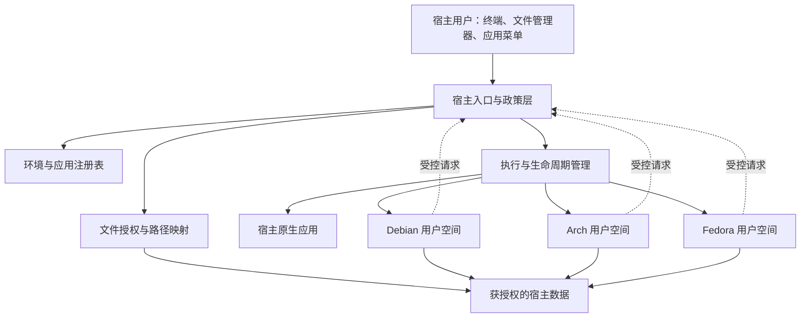

# 宿主权威与文件、命令、依赖边界：架构复审

日期：2026-10-23，Asia/Shanghai。状态：**架构建议及有限实测**。升级与更换的判定、以及 apt/dnf/pacman 的驱动分派，已经写进产品代码（第 19 节）。文件层、执行上下文和管理界面仍不是产品契约。

后续复核见[文件与执行控制层 v2](文件与执行控制层-v2.md)：补充原始链接与宿主管理投影的区别、直接共享保存的保证边界、保守事务恢复及目标契约统一入口。第 18、19 节保留为前一阶段记录；其中“可运行驱动”与实际固定目标分派的缺口见 v2 第 7 节。

后续机制、性能和工作量评估见[文件层可行性与性能评估](../调研/文件层可行性与性能评估-2026-10-23.md)，区分当前机制实验、历史证据与设计预算。

产品目标（按用户本轮补充修订）：**让用户在任何 Linux 发行版中使用有效的 Linux 命令和应用时，尽可能获得原生、优雅、简便的体验。** 发行版差异、环境启动、文件映射和依赖选择主要由系统承担。宿主用户与宿主系统政策拥有最终决定权，尽量少改动宿主和客体发行版。首版验证范围仍为 Debian 13、Fedora 44、Arch；广泛兼容是长期目标，不是当前验收结论。

本轮检查的是 HEAD `fd0b2da877ec6a4059b0260c8aa53695851f1fac` 加现有未提交工作树。没有重置、提交或改写原有产品代码和历史验收记录。当前源码哈希及实验见 [result.json](../evidence/architecture-context-2026-10-23/result.json)，可重跑脚本见 [probe.py](../evidence/architecture-context-2026-10-23/probe.py)。历史性能与 GUI 报告只作为已有工作背景，没有在本轮重验。

## 0. 产品体验优先：环境明确是系统责任

上一版将“显式跨环境调用”过多地当成常规交互方式，需要修正。用户日常不应被要求记住容器名称、手动启动环境、复制文件或反复添加 `ml env run`。内部每次执行必须有确定的上下文，用户侧可以通过已保存的政策自动完成。

预期体验如下；本节是设计目标，尚未实现：

| 用户正常操作 | 系统应承担的工作 |
|---|---|
| 安装应用，然后从菜单打开 | 准备匹配的环境和依赖，导出入口，按需启动与回收；同名应用有可辨认名称 |
| 输入已安装应用的命令，如 `ffmpeg ...` | 默认沿用宿主已有命令；宿主没有时可调用已注册的兼容应用，保留 argv、流、退出码和信号 |
| 打开项目终端，输入 `python`、`pip`、`make` | 根据用户已接受的项目配置进入完整工具链上下文，解释器及子进程保持一致；无需每条命令加环境前缀 |
| 双击文件，或应用内选择文件 | 根据宿主默认关联/用户选择启动应用，自动取得所需文件视图，保存回明确的原对象 |
| 使用某环境生成的文件 | 普通文档继续按用户偏好打开；执行类产物使用已登记的运行环境，不仅凭磁盘位置猜测 |
| 发生真正歧义或缺少授权 | 解释具体选择及影响；用户选定后可记住，不把已经解决的问题反复交还用户 |

自动选择分两阶段：**开始前选定提供者，运行中保持上下文。** 在尚未绑定的普通宿主会话中，宿主原生命令优先；其次是用户选择的、已注册的兼容提供者。进入已接受的项目/应用会话后，按该上下文运行整条工具链。不能在一个构建过程中发现某命令缺失，就逐个从别的发行版拼凑依赖。

默认不自动下载或执行刚在网上发现的同名命令，也不在命令已经运行失败后转向另一个环境重试；这可能重复写入或造成语义变化。安装、来源选择与启动是不同决策，已安装且已授权的提供者可以自动启动。

这需要用户级、可撤销的集成：桌面入口、命令导出、项目终端/IDE 会话和必要 shell 适配。不能以“不改发行版”为由取消所有集成，也不能为透明体验替换 `/usr/bin` 或修改全局系统行为。普通未接入的 shell 仍遵循 Linux 原生规则。

可考虑在宿主原生命令之后的用户 PATH 目录导出受管命令，配合冲突检测；不能把客体 `/usr/bin` 直接加进宿主 PATH。command-not-found 可作为特定 shell 的辅助，但不能成为完整兼容基础，因为脚本、子进程与绝对路径执行不一定经过它。项目工具链切换必须覆盖执行会话，不能只换 `python` 和 `pip` 两个名字。

“像原生”还要求保留 cwd、相对路径、TTY、Ctrl-C、管道、重定向、退出状态、文件保存与后台进程行为。CLI 包装器能启动程序只是第一步；对绝对路径写死的程序、跨环境脚本、桌面文件选择和权限命令，需要对应的会话或能力适配，并如实标记覆盖范围。

`sudo`、包管理、`systemctl`、设备和内核操作必须保持目标清晰：明确宿主操作就由宿主决定；明确客体操作就在客体内完成。不把请求悄悄改成另一个系统上的“成功”。内核能力不满足的任务，需要宿主能力适配或另行设计的虚拟机后端；单纯增加用户空间不能消除这个边界。

体验验收增加：E01 无前缀命令导出与冲突处理；E02 项目整套工具链；E03 菜单和文件双击；E04 文件原地保存；E05 TTY/信号/管道/退出码；E06 已接受政策不重复询问；E07 一键撤销集成且宿主原生行为恢复。必须同时报告任务成功和用户需要的额外操作数，不能只报告“容器里能运行”。

## 1. 核心结论

采用 **宿主控制入口 + 独立发行版运行环境 + 有范围的数据共享 + 可自动选择的应用与项目上下文**。显式环境命令保留为高级控制与诊断入口，不作为日常使用前提。

不要给所有文件强加唯一的“所属发行版”。需要分别记录：

1. **存储归属**：文件实际放在哪里，谁负责备份和删除。
2. **访问授权**：哪个环境可以读取、写入哪部分数据。
3. **执行环境**：哪个环境的程序、解释器、动态库及插件参与运行。
4. **打开偏好**：用户希望用哪个应用查看或编辑；这是可修改的偏好。
5. **生成来源**：哪个环境、哪个版本生成了产物；这是来源信息，不是执行授权。

同一个 `main.py` 可以由宿主编辑器编辑，由 Debian Python 执行，再由 Arch 的检查工具读取。编辑一次不会把它的依赖“改成宿主的”。但如果在宿主明确执行 `python main.py`，启动的就是宿主当前 shell 所解析到的 Python，不能靠文件来源自动纠正。

**无法同时承诺：任意原生命令和程序零改动、任意路径透明共享、每个文件自动携带唯一正确的跨发行版依赖。** Linux 原生执行行为并没有这种文件归属路由。通过应用注册、已接受的项目配置和用户偏好解决常见场景的自动选择；只有无法确定的情况才要求额外选择。明确内部上下文，不等于要求用户每次手动指定。

## 2. 当前实现的基础与缺口

| 观察 | 当前证据 | 架构含义 |
|---|---|---|
| 不合并各发行版系统树，包管理命令进入指定环境 | `runtime.py`、`service.py`、`routing.py` | 这条基础应保留；扩展包格式识别不是解决文件上下文的办法 |
| `--share` 只记录宿主目录到同路径的二元映射 | `CreateSpec.mounts`、`_shares()` | 缺少数据类别、只读/读写、授权范围、有效期、标签政策 |
| 普通共享统一生成 `:z`，没有 `ro` | `runtime.py:133–134`；本轮纯函数探针 | 不仅会暴露可写数据，还可能递归改动宿主 SELinux 标签 |
| `_shared_workdir()` 以字符串前缀判断 | `service.py:1196–1204`；本轮实测接受 `shared/../host-only-marker` | 校验没有兑现“必须位于共享目录”的约定；不等于已逃逸到宿主 |
| `app open` 将附加参数拼到应用 argv | `service.py:486–520`、`on_demand.py` | 传了文件名不代表目标环境已被授予该文件，也没有一般性的路径转换 |
| 桌面入口已有环境 ID、宿主启动器与目标应用绑定 | `desktop.py:130–164`、`service.py:523–598` | 是正确起点；仍缺统一的文件对象和打开政策 |
| 宿主环境变量默认不透传，但显式 `--env KEY` 只校验名字 | `_allowlist()`；`add_app()` 的 overlay | 可以把 `PATH`、`HOME`、`PYTHONPATH`、`LD_LIBRARY_PATH` 等混入，需要受管执行契约 |
| GUI 普通用户模式已建立私有 HOME，但不是所有执行入口默认如此 | `add_app(as_host_user=True)`；`run()` | 需要统一应用用户身份；包管理 root 与应用用户要分开 |
| 桌面模式选择 `label=disable`，且目前直接选择 host IPC | `desktop.py`；`service.py:create()` | 是目前的兼容方式，不是每应用强隔离；需按能力拆分 |
| 原生包事务在同一个环境容器中执行 | `_package_transaction()` / `_exec_record()` | 包脚本会处于该容器挂载视图内；普通 UID 权限可能限制访问，但没有独立的无数据维护视图 |
| 有生命周期锁和启动租约，没有完整的更新排他/文件授权协议 | `on_demand.py:LaunchGroup`、`service.py` | 本轮静态检查未见把包更新与全部应用/CLI 租约统一串行化的机制；不能用包管理器自己的锁替代 |
| 状态和启动器依赖项目目录 | `store.py`、导出的 launcher | 正式安装需稳定的控制目录；不能把可被容器写入的项目当作宿主控制程序或授权数据库 |

原设计已注明实验目录 `:z` 不等于普通文档接入方案。现在产品 `--share` 仍沿用该方式，正是需要补齐的一层。Podman 官方明确说明 `:z/:Z` 会重标文件标签，`:U` 会递归改属主；本文建议禁止对任意用户目录自动采用这些选项。[Podman 卷说明](https://docs.podman.io/en/latest/markdown/podman-run.1.html)

本轮实际复现的是路径前缀校验不足与执行上下文行为；其余条目属于源码观察及设计缺口，没有声称完成漏洞利用、恶意程序隔离测试或全仓安全审计。

## 3. 不允许含糊的产品规则

1. 未选择项目/应用上下文时，宿主已有命令优先。不替换 `/usr/bin/python`，不改全局 shell 配置；允许用户级命令导出和已接受的会话集成，不用宽泛转发器抢占宿主同名命令。
2. 每次受管执行先按用户政策自动或显式确定提供者，再在其环境中解析运行。已经绑定的环境或依赖缺失时明确失败或进入修复流程，不在执行失败后换环境重试。
3. 不在各发行版间合并可写 `/usr`、`/lib*`、`/etc`、`/var`，不共享包数据库、用户配置和可变运行时依赖。
4. 默认只向环境开放用户选择的数据目录，不能因为“最高权威是宿主”就把宿主 `/`、HOME 或容器管理 socket 全挂进去。
5. 宿主用户授权、宿主权限模型与 SELinux/AppArmor 决定能做什么；容器内 root 不能替宿主批准操作。
6. 文件关联、桌面导出和跨环境调用由宿主保存政策。客体包安装脚本不能自行修改宿主默认应用、开机启动或系统服务。
7. 通过普通文件共享得到的是读写数据的权限，不自动得到在宿主执行它的权限。项目中的配置、脚本和 `.desktop` 文件也不能自行授予此权限。
8. 默认每个环境是一个共享信任域。同一环境的应用共享哪些目录，必须如实显示；不能只靠应用 ID 声称每应用隔离。
9. 用户可从宿主检查、停止、撤销授权、备份和卸载环境。宿主控制进程日常以普通用户运行，“最高权威”不要求常驻 root daemon。
10. 保持原生包内容及语义，但承认容器适配有边界：用户映射、挂载、环境变量、桌面入口和受控桥接仍是集成变化。不能承诺所有包钩子、驱动和完整 systemd 无修改可用。

“宿主最高权威”是控制关系，不是权限无限大：普通宿主用户仍受宿主 root、文件权限和安全政策约束。具有宿主管理权限的人可以绕过本产品手动修改环境，这不在产品阻止范围内。

## 4. 建议的整体结构



实现上先保留现有 Python + Podman 适配层。入口层是职责划分，不要求第一步就新增常驻服务；CLI 可完成宿主发起的操作，跨环境及异步文件请求再使用用户级 socket 激活服务。

建议把现在集中的 `EnvironmentService` 逐步拆出以下契约，不在这轮大改：

- `EnvironmentRegistry`：稳定环境 UUID、发行版类型、当前修订、运行实例、应用清单。
- `ExecutionContext`：环境 UUID、修订、身份、argv、cwd、环境变量配置、挂载视图、请求来源、租约。
- `FileReference`：存储域、环境 UUID（如适用）、根目录能力、相对路径、访问方式、生命周期、可选内容版本。
- `MountPolicy`：数据分类、源与目标映射、读写、符号链接及子挂载规则、标签策略。
- `OpenPolicy`：查看/编辑/执行/安装这些不同意图的选择规则。
- `HostAdapter`：文件选择器、MIME、Wayland、Portal、音频、设备等宿主能力；不让它成为任意宿主 shell 的后门。

`host` 是特殊执行目标，不由 `pkg` 接口管理其包数据库。环境类型 `debian13` 不等于环境身份；两套 Debian 环境必须有不同 UUID。同名应用用环境 UUID + app ID 标识，显示名称如“编辑器 · Debian 13 / 工作环境”。

## 5. 文件系统划分：保留发行版内路径，限制共享范围

| 类别 | 存储与视图 | 共享规则 |
|---|---|---|
| 宿主系统目录、宿主配置与包数据库 | 宿主原生位置 | 不以通用读写挂载开放给容器；必要读取通过具体接口 |
| 容器系统树 | 运行时管理的私有 rootfs，内部仍为标准路径 | 只给本环境；包事务管理；不能作为跨环境程序搜索目录 |
| 容器 HOME、XDG config/data/state/cache | 每环境私有，默认不映射宿主 HOME | 保持应用原有配置语义；需要迁移时单独导入 |
| 普通文档、图片、模型、项目源码 | 用户选择的宿主目录 | 共享同一底层数据，可选择 ro/rw；数据写入立即影响其他已授权视图 |
| Python venv、node_modules、本地扩展、编译输出 | 默认环境私有且按项目/工具链区分 | 不把同一个可变依赖目录交给多套发行版共用 |
| 软件源缓存、语言包缓存 | 默认私有 | 日后仅考虑已校验且不可变的内容缓存；不共用包数据库或安装前缀 |
| `/run`、`/tmp`、服务 socket | 各环境私有临时状态 | 只桥接明确的 socket/协议；不共享整个宿主 runtime 目录 |
| 宿主控制程序、注册表、凭据、容器存储 | 用户级受管目录 | 不进入共享根；保护范围不能只排除本 checkout 的 `.lab` |

**共享源数据，不共享全部 HOME。** 整个 HOME 会同时带入 `.bashrc`、`.profile`、`.local/bin`、Python 用户包、浏览器配置、SSH 凭据、桌面启动项等。它们很容易把文件共享变成命令注入、配置冲突和宿主权限暴露。

目录布局只是建议，不是已经创建的产品路径：

```text
宿主用户目录
  ~/.local/share/multilinux/       注册表、应用导出与受管数据记录
  ~/.local/state/multilinux/       事务与审计状态
  ~/.cache/multilinux/             可再生缓存
  $XDG_RUNTIME_DIR/multilinux/     用户级 broker socket、临时授权
  ~/Projects/example/             用户明确共享的项目源码

环境内部
  /usr /etc /var                  原生发行版布局
  /home/<app-user>/               本环境 HOME
  /home/<app-user>/.local/share/multilinux/projects/<project-id>/venv/
  /home/<host-user>/Projects/example/  获授权时的同路径数据视图
```

rootfs 使用 Podman 的正式存储 API，不要求将 overlay 内部目录迁到上述布局，更不能让用户直接编辑 upperdir。控制目录也不因存储在宿主 HOME 下就被广泛共享。

**同绝对路径是优化，不是身份。** 已授权的普通目录尽量保留宿主路径，减少 GUI 参数转换；冲突或临时文档授权则记录另一目标路径。路径冲突必须返回错误或要求选择映射，不能遮盖目标发行版 `/usr` 等系统位置。

## 6. `python` 到底由谁响应

| 用户操作 | 应有语义 |
|---|---|
| 未接入兼容层的宿主终端输入 `python main.py` | 由宿主 shell 的别名/函数/命令搜索及当前激活的环境决定；未安装就失败 |
| 已接入兼容层的一般宿主会话输入命令 | 原生解析优先，缺失时可选择已注册且获授权的兼容提供者；不在运行失败后改换提供者 |
| 从已绑定项目打开的受管终端输入 `python main.py` | 整个执行会话使用该项目工具链，用户不必再写环境前缀 |
| 已进入 Debian 的 shell 后输入同一命令 | 由该 shell 的规则解析 Debian 环境内命令；不会自动调用宿主 |
| 宿主执行 `ml env run debian-work -- python3 /共享路径/main.py` | 明确进入该环境；从该环境的受管命令路径解析 `python3` |
| 宿主直接执行 `./main.py` | 依照宿主执行上下文解析 shebang；文件由哪套系统创建不起决定作用 |
| 容器内执行 shebang 为 `#!/usr/bin/python3` 的脚本 | `/usr/bin/python3` 指的是容器视图下的路径 |
| 脚本 shebang 为 `#!/usr/bin/env python3` | `env` 在当前执行上下文的 PATH 中搜索；不会查询文件来源 |
| 在宿主执行容器二进制的磁盘路径 | 不保证其原环境；ELF loader 和库查找仍受当前上下文影响，禁止作为产品启动方案 |
| 宿主编辑器打开容器运行的源码 | 编辑器仍是宿主程序；其终端、LSP、调试器不会因此自动进入容器 |

显式 `python file.py` 由选定 Python 读取脚本，不能指望脚本 shebang 再帮忙选择解释器。`cd` 到某个共享目录也不切换环境。[Linux execve 规则](https://man7.org/linux/man-pages/man2/execve.2.html)

系统动态库、Python 模块、Qt 插件都需要控制。仅隔离 PATH 不足：loader 会考虑 RPATH/RUNPATH、环境变量等；Python 也会从脚本目录、`PYTHONPATH`、venv 和 site-packages 等位置加载。[动态链接器规则](https://man7.org/linux/man-pages/man8/ld.so.8.html)、[Python 模块路径初始化](https://docs.python.org/3/library/sys_path_init.html)

因此，“依赖属于本环境”的合理承诺是：**受管入口默认给出本环境解释器、系统库和私有项目依赖，不自动混入其他环境路径。** 共享项目本身可以包含代码；应用显式加载其中的 `.so` 或脚本仍可能混入不兼容内容，不能把入口约束宣传成任意代码的依赖来源强制验证。

### 开发项目的建议体验

项目绑定在受管项目终端、IDE 集成和命令入口中生效：用户为项目选定一次默认运行环境、工作目录、解释器和依赖目录，以后自动使用。版本库内的配置文件可提出建议，但实际接受的政策保存在宿主；克隆陌生项目不能自动改变宿主行为。普通宿主 shell 的 `cd` 不会凭空改变执行 namespace；自动化需要真实的会话集成。

以下是**拟议接口，当前尚未实现**：

```text
ml project bind <目录> --env debian-work
ml project run <目录> -- python main.py
ml shell debian-work
ml explain --project <目录> -- python main.py
```

现有接口仍是 `python3 tools/ml.py env run <环境ID> -- ...`，且要求环境已启动、目录已在创建时共享。不能把上述新命令当作可运行功能。

项目绑定可以为 `ml project run` 选择环境私有 venv 的 PATH；普通 `ml env run` 则使用发行版默认工具链，两者要在 `explain` 中说清楚。运行 Python 包安装时使用选定解释器的 `python -m pip`，避免 `pip` 指向另一套环境。

默认把 venv 放在环境私有 HOME 的项目子目录，并用绝对解释器路径配置 IDE。不要在共享源码根放一个被三套系统轮流使用的 `.venv`。官方 venv 文档明确其安装脚本常带绝对解释器路径，虚拟环境一般不能直接移动或复制使用。[Python venv](https://docs.python.org/3/library/venv.html)

如工具强制要求源码目录里的 `.venv`、`node_modules` 或 `build/`，后续可实现每项目独立挂载视图，让该子目录在不同运行视图下映射到不同私有存储；这需要额外 namespace/runner，是单独功能。首版用外部依赖目录或明确的独立工作树，不假装已有透明覆盖能力。

编辑器可在宿主运行，但解释器、LSP、构建和调试需要容器后端或明确包装器。仅把源码放进共享目录不完成开发环境集成。默认不替用户改 IDE 全局设置。

### shell、管道与子进程

结构化 argv 不自动经过 shell。`ml env run A -- tool | host-tool` 中的管道由宿主 shell 解析，右端在宿主；重定向 `> file` 也由外层 shell 处理。整个管道要在 A 内运行，就明确 `ml env run A -- sh -c 'tool1 | tool2'`。两种情况的文件访问权限和退出码不可混淆。

目标程序产生的普通子进程继承本环境上下文，除非显式调用桥接工具。用户进入完整交互 shell 后可以自行修改 PATH 和读取该环境的启动文件；“完整原生 shell”与“固定受管启动配置”应在界面上区分。

## 7. 四个方向的文件操作

| 操作方向 | 默认方式 | 依赖与写入后果 |
|---|---|---|
| 宿主打开共享文档 | 继续使用宿主既有文件关联；用户可选“用 Debian 中的应用打开” | 依赖属于所选应用环境；保存仍写同一数据 |
| 宿主编辑容器内普通私有文件 | 经本环境文件服务读取；支持时提供直接受控视图，否则明确导出副本 | 宿主编辑器不变；私有文件不自动搬家；副本回写需单独确认目标版本 |
| 宿主改容器系统配置或程序文件 | 进入目标环境维护操作；必要时“导出编辑→校验→回写” | 由本环境权限和包管理规则决定；记录与原包的偏离，不能称为未改发行版 |
| 容器 A 打开宿主数据 | 访问已有共享授权，或经宿主文件选择/授权入口获取 | A 的应用依赖不变；无权访问的路径不能静默扩大挂载 |
| 容器 A 请求宿主应用打开文件 | 宿主入口核验文件引用与请求，选宿主应用 | 明确是宿主程序；不能把任意文件字符串当宿主路径 |
| 容器 A 请求容器 B 打开文件 | A → 宿主入口 → B；既有公共数据分别授权，私有数据需显式导出/共享 | B 用 B 的依赖；A 不直接控制 B 的运行时 |
| 容器 A 操作宿主系统 | 常规文件/执行入口拒绝 | 用户如确实需要，回到宿主以原生管理工具操作 |
| 宿主安装下载的 deb/rpm/pkg.tar.* | 先识别格式和目标，再使用目标环境原生包管理 | 下载目录不是依赖归属；包格式只提供候选，不等于同名环境中的任意一个 |

“打开”必须区分 `view/edit/run/install`。双击 `.py` 默认延续宿主编辑偏好，不因为项目绑定就执行代码。未知二进制也不能凭 ELF 架构或文件扩展名猜测唯一发行版；缺少应用注册信息时提示选择或报告不支持。

容器内 `xdg-open` 如果仍是发行版原生实现，会按容器桌面环境处理；不能宣称所有调用已被重定向。优先让支持 Portal 的应用通过标准接口请求宿主打开；不支持的应用可使用独立的 `ml-open` 桥接入口或应用专用适配，不覆盖发行版的 `/usr/bin/xdg-open`。具体工具包是否采用 Portal 必须逐项验收。

Portal `OpenURI` 不接受本地 `file://`，本地文件应使用 `OpenFile` 的 FD 接口；其 `writable` 选项也不是对任意非沙箱宿主应用的强制只读保证。[OpenURI/OpenFile 官方接口](https://flatpak.github.io/xdg-desktop-portal/docs/doc-org.freedesktop.portal.OpenURI.html)

## 8. 文件引用和真正的路径解析

设计中的逻辑引用可以表示为：

```text
shared:<grant-id>/<relative-path>
env:<environment-uuid>/<relative-path>
host:<grant-id>/<relative-path>
```

这只是协议数据，不是已经注册的 URI scheme，也不是授权凭证。显示层可以用“Debian / 项目 / main.py”，底层要带来源域、环境 UUID、授权根与访问模式。不要把环境 A 的 `/tmp/file` 原样交给宿主去打开它自己的 `/tmp/file`。

需要覆盖：

- `..`、重复分隔符、Unicode、空格、前导 `-`、URI 编码、文件名含换行等；argv 使用数组，不能拼接 shell 字符串。对不支持的路径应明确拒绝，不能静默截断。
- 绝对 symlink 在访问者的根目录视图解析。共享 `link -> /etc/config` 会分别指向不同环境；原样复制字符串不能保持目标身份。
- 相对 symlink 指向共享根外时，不能靠字符串检查授权；应拒绝或单独授权其目标，不悄悄重写用户 symlink。
- 注册时 `resolve()` 不能消除之后的替换竞态。授权根保持目录 FD，打开文件时采用受约束解析；`openat2` 的 `RESOLVE_BENEATH` / `RESOLVE_NO_MAGICLINKS` 等可用于实现，但哪些 symlink/子挂载允许需要政策选择。[openat2](https://man7.org/linux/man-pages/man2/openat2.2.html)
- 把 FD 转回一个普通路径再让应用重新打开，会重新引入竞态；必须保留受控视图或验证重新打开对象，而不是宣称一次 FD 检查保证所有后续访问。
- `dev+inode` 可以记录一次访问的对象，但 inode 会重用，原子保存也会替换 inode；不能单独当永久文件 ID。
- 子挂载传播默认采用私有视图，不让容器反向传播挂载到宿主。只读目录也要核验其子挂载是否仍可写。[mount namespaces](https://man7.org/linux/man-pages/man7/mount_namespaces.7.html)
- `noexec` 不会阻止解释器读取脚本；它不能代替“数据不自动授予执行权”的入口政策。

宿主读取容器私有文件时，不直接跟随容器存储中的 symlink 进入宿主路径。由目标环境内部的受限文件操作解析，或使用正确构建的命名空间文件视图；包管理路径的写入通过维护入口。

## 9. 直接共享、临时授权与保存语义

分为三种可见模式，不能混用名称：

1. **项目目录直接共享**：同一数据，普通文件操作实时互见；适合项目和批量文档。读写授权意味着应用可以修改、重命名、删除授权范围内文件。
2. **单文件/目录受控开放**：优先研究 Documents Portal 或专用受限文件视图；适合从文件选择器临时打开。需要真实接入应用身份、文件系统视图和授权撤销。
3. **导出副本**：兼容回退。必须显示“副本”，另行回写并检测原文件变化；不是直接共享成功。

Document Portal 提供 FUSE 文档视图与权限管理，可作为第二种模式的基础。但普通 Podman 容器不会仅因为能连到 D-Bus 就自动获得可信的每应用身份与受限文档视图。当前已有 Documents 服务放行也不证明文件授权已经实现；需要单独验证 FD 转交、应用身份和实际可见范围。[Documents Portal](https://flatpak.github.io/xdg-desktop-portal/docs/doc-org.freedesktop.portal.Documents.html)

特别注意：

- 直接 bind 一个文件可能钉住旧 inode；宿主原子替换后，容器还看到旧文件。目录绑定通常能按文件名看到新对象，但授权范围也更宽。
- 很多编辑器通过“同目录临时文件 + rename”保存。只有单文件 FD 或单文件只写权限时可能失败，不能自动升级为整个 HOME 可写。
- 同文件双写没有通用自动合并保证。协作应用使用自己的锁和冲突处理；副本回写至少检查旧内容版本，冲突则另存。对于原地实时共享，无法用 broker 的检查包住所有原生写入。
- SQLite 数据库、浏览器 profile、包数据库、IDE 状态不应仅因是“文件”就并发共享；格式、锁、扩展和版本语义必须单独判断。
- 撤销授权阻止未来访问，不保证收回已读数据、已打开 FD 或 mmap。硬撤销通常需要结束相关进程/视图；应让用户知道影响范围。
- 文档在容器中打开时需要文件租约与环境租约；启动器退出不等于文档已关闭，长期后台服务也要纳入生命周期。
- 容器停止后，宿主共享数据仍在；容器私有数据的打开请求可以唤起目标文件服务。已删除环境则明确失败，不能改用同名新环境或宿主路径。

现有 Podman 容器的创建时挂载不会因为 `app open` 追加参数就动态扩展。首个实现阶段只承诺已有共享根内文件；临时文件授权作为后续独立能力。不能为了打开一个新文档悄悄重启仍有应用的共享容器，或在宿主做一次挂载便假设会传播进去。

## 10. 共享发行版与应用隔离：必须选明白

**首版保留一套环境运行多个应用的模式。** 同环境应用及其包维护过程属于共同信任域，能够访问该环境已授予的挂载范围；普通权限约束仍存在，但不是逐应用授权的安全边界。

只给应用注册表加 `allowed_files` 字段，不能阻止同 namespace、同用户的另一个应用直接 `open()` 这些文件。撤销某应用授权也不能从公共挂载视图里单独撤掉它看到的路径。

如果以后需要不同应用的强边界，需增加 **每应用或每项目进程组的运行视图**：共享只读发行版基底，独立 mount namespace、HOME/状态和文件授权，必要时独立用户/进程/IPC 隔离。这样仍可复用发行版包和磁盘基底，但不是目前的单容器共享挂载模型，需要重新评估进程数量、启动开销和内存。

这不是现在就改成每个应用安装一套发行版。默认方案与严格隔离模式可以并存，但不能把两者的性能、兼容性或安全结论混在一起。

默认模式用于可信本地软件兼容，不承诺抵御任意恶意代码。共享可执行源码和宿主可写文件可能影响宿主未来的行为；rootless 也不会保护已经授予写权限的数据。尽量不挂控制代码、启动目录、凭据与全 HOME，是此目标下的具体边界。

## 11. 跨环境调用的控制关系

控制链为：**宿主政策 → 用户授权 → 环境能力 → 应用请求**。环境 A 不能修改 B 的注册记录、启动器或包数据库，也不能仅靠请求里的 `source_env=B` 冒充 B。

宿主 broker 只接受小范围的结构化操作，例如 `open_document`、`reveal_document`、`launch_registered_app`；请求绑定可信通道、授权对象、目标环境和可用动作。通用 `run_on_host(argv)` 如果允许 `sh/python/git` 等工具，其能力可等价于任意宿主代码执行，应只供宿主用户明确发起，不成为所有容器默认能力。

认证不能只相信环境变量、JSON 的 app ID 或同 UID 的 `SO_PEERCRED`。rootless 环境往往共享宿主身份映射，需要由宿主创建并绑定到环境实例的通道/能力；同环境内的应用仍不能仅靠通道区分成强安全主体。凭据不能放进共同可写项目。

跨环境任务不能持有 A 的全局生命周期锁等待 B 的交互，再让 B 反向等待 A。使用请求 ID、超时/取消与有限路由跳数；明确传递 stdin/stdout、退出码和信号。管理权限不传递，文件权限也不能因 A 可读就自动升级成 B 可写。

原生程序可选择完全不使用该入口，此时只遵循它所在 namespace 的实际权限。产品能保证受管通道的规则，不能拦截所有原生 shell、系统调用或用户手动配置。

## 12. 包、启动器、服务与更新

现行的升级和更换判定在第 19 节，并且已经由 `env plan` 和包事务入口执行。下面关于维护视图、无数据安装环境和世代切换的描述仍是设计。

### 包和桌面入口

本地安装包先核对格式、摘要、目标环境和架构，再交给原生包管理器校验签名与依赖。一个 RPM 不能推导出“应该安装到母发行版”，即使宿主也是 Fedora；默认仍由用户选定的兼容环境接收。

包中的 `.desktop`、用户服务、autostart、MIME 声明只先在环境内生效。宿主导出是独立动作：唯一 ID、可辨认环境名、绝对宿主启动器路径、固定目标应用。注册可用打开方式与更改默认应用分开；卸载只移除本产品确知拥有的项，且不得覆盖用户后来改动的默认值。

桌面 `Exec` 有自己的转义与 `%f/%F/%u/%U` 规则，不能当任意 shell 字符串处理；扩展到多文件与 URI 时逐项验收。[Desktop Entry Exec 规范](https://specifications.freedesktop.org/desktop-entry/latest/exec-variables.html)

宿主启动器路径必须在不可被客体写入的安装目录。环境缺失或正在维护时显示具体原因，不能回退到宿主同名可执行文件。普通容器内部启动脚本仍原样执行于本环境，不让它改宿主启动服务。

### 维护视图

当前包操作与应用使用同一容器视图，尚不能承诺包脚本看不到共享数据和桌面 socket。仅把 root 改为普通用户也不能解决包维护需求。

近期先统一维护排他：阻止新应用/CLI 租约，等已有租约结束；用户可以取消维护或主动关闭应用，不自动杀掉未保存文档。原生包管理器锁仍保留，但它只保护包数据库事务。

随后实现真正的无用户数据维护视图。建议的可落地路线是：

1. 停止并冻结旧环境，保存恢复点及私有数据清单。
2. 通过受支持的镜像/快照机制生成候选系统版本，在无用户文档、无桌面和管理 socket 的维护容器里执行包事务。
3. 核验系统身份、包结果和关键程序，将新版本注册为候选；新运行实例使用其 rootfs，并重新构建已授权视图。
4. 验收后切换环境逻辑 UUID 对应的当前版本；保留旧版本到明确清理时点。

这条路线需要调整当前可写 rootfs/私有 HOME 的存储组织，并非执行几条 `podman exec` 就能获得。禁止直接让两个活跃容器同时写同一个 overlay upperdir。共享数据和应用数据库不会随系统版本回滚而自动回滚，二者备份/兼容性须分开。

环境更新会改变 rootfs 内容，基础镜像 digest 不等于当前依赖集合。启动记录至少包含环境 UUID、实际 runtime ID、系统修订、包清单摘要与项目依赖身份。当前 `content_revision` 可以作为起点；受管以外的手动安装需重扫或标记未验证。

### 宿主能力

Wayland、Portal、音频、GPU 和网络保持宿主适配器职责。图形 socket、设备、IPC host 模式都单独声明与验收，不因某个应用需要就作为全体默认。

对需要宿主 udev、内核模块、system systemd 服务的包，继续区分“已安装”“维护钩子未完成”“功能未验收”。不为实现客体钩子而自动修改宿主服务或加载驱动。后续有明确宿主适配需要时，将其作为用户可见、可卸载的额外组件。

## 13. SELinux、权限与不侵入目标

优先顺序：

1. 使用已有宿主支持的 Portal/受控文件视图，并验证该宿主下可用。
2. 用户明确选择的受管共享区可采用记录在案的标签策略；不能扩张到任意 HOME 或系统目录。
3. 必要时提供明确命名的可信兼容配置，说明该容器采用 `label=disable`、实际共享范围及降低的隔离。宿主全局 enforcing 保持原状，但不能称该容器仍具有原来的 SELinux 分离。
4. 不能满足时返回限制；副本方案明确标成副本，不悄悄 relabel 或 chown 用户数据。

普通应用默认采用稳定 UID/GID 映射；包管理 root 的映射另行记录。先检测 ACL、补充组、NFS/CIFS 等权限情况，不自动 `chmod -R 777` 或 `chown -R`。首版“本地文件系统可用”的结论不能外推到网络盘和所有可移动盘。

不要把“最少发行版改动”理解为所有应用无需适配。可实现的承诺是：不替换发行版核心命令、不跨系统管理包、不默认改宿主全局配置；集成元数据、用户级启动入口和必要环境适配可枚举、可撤销。

## 14. 现有方案能借鉴什么

| 方案 | 可以借鉴 | 本项目的取舍 |
|---|---|---|
| Distrobox | 原生发行版用户空间、应用导出回到原容器 | 其默认紧密集成与 HOME 共享不是本项目的默认数据政策；host-exec 不直接作为全面开放能力 |
| Bedrock Linux | 明确的 stratum 身份和跨环境命令概念 | 其 hijack/cross-stratum 路线与本项目尽量不改母发行版的取向不同，不采用全局命令融合 |
| XDG Desktop Portal / Documents | 标准桌面请求、FD 文件传递、受限文档视图 | 作为宿主接口基础，仍须解决普通容器的身份与映射集成 |
| 现有 rootless Podman 原型 | 独立原生包生态、显式 exec、已验证的生命周期与桌面能力 | 在其上补政策与文件对象；容器工具本身不提供完整打开语义 |

官方参考：[Distrobox 的共享范围](https://distrobox.it/)、[应用导出](https://distrobox.it/usage/distrobox-export/)、[host-exec](https://distrobox.it/usage/distrobox-host-exec/)、[Bedrock 基本使用](https://bedrocklinux.org/0.7/basic-usage.html)。此处是架构对照，没有对这些项目做本机性能或兼容测试。

## 15. 本轮实测与待验收矩阵

2026-10-23 09:30 +08:00，用当前锁文件中已缓存的三套基础镜像运行同一共享脚本：只读 rootfs、只读测试共享、无网络、无包安装，使用 `label=disable` 避免改动测试文件标签。这个实验配置不代表产品默认隔离等级。

| 项目 | 宿主 Fedora | Debian 13 | Fedora 44 容器 | Arch |
|---|---|---|---|---|
| 共享脚本 inode | 1173 | 1173 | 1173 | 1173 |
| `#!/bin/sh` 的实际 shell | bash | dash | bash | bash |
| 脚本读取的系统身份 | fedora | debian | fedora | arch |
| 共享绝对 symlink `/etc/os-release` | 宿主 Fedora | Debian | 容器 Fedora | Arch |
| 未共享的宿主测试 marker | 可见 | 不可见 | 不可见 | 不可见 |
| `python3` | `/usr/bin/python3` | 未找到 | 未找到 | 未找到 |

因此本轮实测证明：数据 inode 可以相同，但路径解析和命令环境不同；容器缺 Python 不会自动调用宿主 Python。**没有在三容器安装 Python，因此没有宣称完成三发行版 Python 扩展/venv 的运行验证。**

测试文件的内容、mode、UID/GID 和 xattrs 前后一致，容器集合前后一致，三个临时容器已清理。另以纯函数调用复现 `_shared_workdir()` 接受共享前缀后带 `..` 的字符串，记录生成 argv 中统一的 `:z`。没有把该字符串当实际宿主越权访问证明。

后续新契约至少需要以下验收；不能用已有多窗口并发通过替代：

| 编号 | 验收场景 | 必须观察到的结果 |
|---|---|---|
| F01 | 宿主与三环境同名命令；命令缺失 | 只在指定环境响应；无跨环境补位；输出真实解析路径 |
| F02 | 同源码分别使用不同 Python、venv、原生扩展 | `sys.executable/prefix/path` 与扩展来源明确；错误 ABI 失败可见 |
| F03 | `PATH/HOME/PYTHONPATH/PYTHONHOME/LD_*` 与工具包插件变量注入 | 受管默认不继承污染；显式兼容例外可解释 |
| F04 | `..`、绝对/相对 symlink、链接替换竞态、子挂载 | 授权根不被绕过；原环境路径不误解为宿主路径 |
| F05 | 同名宿主/容器文件、中文空格、多文件、URI、前导 `-` | 打开准确对象；argv 不变成 shell 或工具选项注入 |
| F06 | 新文件、原子保存、宿主替换后再读、重命名 | 明确支持能力；不返回旧 inode 内容却声称同步 |
| F07 | 宿主与两环境同时读写 | 权限一致；冲突和应用锁有可见结果，不丢改动冒充合并 |
| F08 | A 请求宿主或 B 打开私有文件 | 检查来源、目标和授权；不能靠裸路径或 app ID 冒充 |
| F09 | 默认应用导出/卸载、用户中途改默认值 | 宿主选择不被覆盖；删除只清理拥有的入口 |
| F10 | 共享 ro/rw、ACL、UID/GID、SELinux | 写入身份正确；无隐式 relabel/chown；ro 实际拒写 |
| F11 | 撤销、停止、删除环境、同名重建、崩溃重开 | 租约与文件引用行为明确；旧 UUID 不命中新环境 |
| F12 | 安装/更新并发应用；恶意或错误包脚本试写测试文档 | 排他生效；维护视图看不到用户数据及宿主能力 socket |
| F13 | 同环境两应用授权不同目录 | 默认共享域如实呈现；若宣称严格模式，实际 open() 必须被拒绝 |
| F14 | 全 HOME、控制目录、其他环境存储、管理 socket 请求 | 默认拒绝，错误信息指出具体边界 |
| F15 | 依赖快照切换、升级失败与回滚 | 系统修订可追踪；用户文档与数据库不被错误回滚 |
| F16 | 宿主 IDE + 容器解释器/LSP/调试器 | 进程和依赖确实在目标环境；普通宿主终端保持原生语义 |

## 16. 建议实施顺序与验收门槛

**P0：先明确与修复已有边界。** 扩展挂载记录为结构化政策；增加 ro/rw 与标签策略；修正路径校验；保护全部控制存储；统一应用用户及受管环境变量；分离桌面注册与默认关联。旧环境只做兼容性审计和标记，不在后台改挂载或标签。通过 F01、F03、F04、F10、F14 的针对性验证后再开启新默认。

**P1：让正常使用简单且语义确定。** 引入稳定环境 UUID、ExecutionContext、项目绑定、用户级命令导出、项目终端/IDE 会话和现有共享目录内 open。实现 F02、F05、F09、F16 与 E01、E02、E05–E07。普通使用无需逐条添加环境前缀；`explain` 作为诊断入口说明在哪运行、用哪个程序/解释器、cwd、哪些数据可见、是否例外模式以及失败原因。

**P2：完成双向文件与生命周期。** 单独研究 Portal 身份和受限文件视图，落实宿主↔容器、A↔B 文件请求；加入原子保存、撤销、并发写与租约。完成 F06–F08、F11 与 E03、E04，才可以宣称通用跨环境文件打开。

**P3：维护与可恢复存储。** 包操作与应用排他、无数据维护环境、版本切换及回滚，完成 F12、F15。系统更新前记录宿主文件元数据与入口变化，不能只比较 RPM 包数量。

**P4：按需求增加严格隔离模式。** 保留默认共享环境，另做应用/项目独立运行视图，验证 F13 并重测性能。随后再扩展网络盘、长期压力及跨宿主矩阵。

原型已有的 GUI、音频、屏幕共享、生命周期和并发证据仍然有效于各自范围。下一阶段优先补上述文件与执行契约，比继续增加更多能启动的应用更能回答“整套架构是否可长期使用”。

## 17. 自有文件层与原文件管理器并存的可行性

用户提出：做自己的文件层和管理界面，负责宿主与容器之间的路由，不显式替代原文件管理器。评估结论：**适合作为核心架构方向；能统一跨环境文件操作和应用启动的决策，但单独一个文件浏览窗口不能覆盖所有程序和命令。** 本节是方案评估，没有实现新文件系统或桌面插件。

### 17.1 四个协作部分

| 部分 | 职责 | 与原有系统的关系 |
|---|---|---|
| 宿主文件与应用关系服务 | 管理文件引用、共享授权、环境身份、项目工具链、打开规则和租约 | 用户级独立服务；CLI、桌面插件和自有界面调用同一套规则 |
| 文件访问视图 | 把获授权对象提供为程序实际能访问的目录、路径或 FD | 普通共享目录尽量直接 bind；需要访问容器私有文件时再用受控文件服务/按需 FUSE 视图 |
| 执行管理器 | 依据应用或项目选择环境，设置 cwd、身份和依赖，再启动程序 | 保持整条工具链上下文；不以文件路径代替执行上下文 |
| 桌面与管理界面 | 环境浏览、共享关系、项目设置、冲突处理、“打开方式”和“项目终端” | 可以有独立管理窗口；Dolphin/Nautilus 等继续负责普通文件浏览 |

管理服务处理授权和启动等控制操作，不要求每次普通数据读写都通过它转发。已授予的项目 bind mount 可直接进行内核文件 I/O；性能敏感的编译、数据库和大文件不能无理由全部绕经自有用户态文件系统。

### 17.2 用户能看到的入口

用户可以继续在原文件管理器中浏览本地文件；添加“用某环境应用打开”“打开项目终端”等动作，并提供“兼容环境”位置或书签。独立界面展示“本机、共享项目、各环境私有文件、运行中的访问、默认应用”，但普通使用不要求先进入该界面。

KDE 的 Dolphin service menus 可在已有右键菜单中增加动作；KIO 提供资源访问抽象，可研究环境文件协议后端。[Dolphin 扩展菜单](https://develop.kde.org/docs/apps/dolphin/service-menus/)、[KIO](https://api.kde.org/kio-index.html)

其他桌面接入 GIO/GVfs 或自身扩展机制属于不同适配工作，不能用一个 Dolphin 插件宣称覆盖所有发行版。核心服务独立于桌面工具包；某桌面尚无插件时仍有 CLI、自有管理界面及普通可访问路径。

逻辑地址例如 `multilinux://env/<uuid>/...` 可以表达来源，但只是拟议协议。URI 不保证存在本地路径，GIO 本身也区分两者；不支持协议的编辑器、Python 和 CLI 需要真正的文件视图或 FD。[GIO 文件路径接口](https://docs.gtk.org/gio/method.File.get_path.html)

FUSE 可让用户态文件服务通过内核文件接口呈现普通路径，因此适合研究“浏览容器私有文件”的统一入口。但权限、缓存一致性、rename、锁、mmap、通知和服务退出后的错误语义都需要实现与测试；FUSE 不是自动具有完整本地文件语义的保证。[Linux FUSE 文档](https://docs.kernel.org/filesystems/fuse/fuse.html)

### 17.3 一次打开如何完成

示例：用户在 Dolphin 打开宿主项目中的模型，并已把该类型文件关联到 Arch 环境中的 CAD 应用。

1. 已注册的应用入口收到打开请求；宿主服务解析文件身份、选定应用和已有授权。
2. 在目标环境准备该文件所需的视图；需要相邻资源的项目以已授权的项目根为单位处理。
3. 启动或复用 Arch 环境，以 Arch 的应用与依赖加载文件。
4. 保存写到明确的原始对象；如果只能使用副本，显式显示副本状态，不声称原地保存。
5. 文件与应用租约维持环境；操作结束后按政策回收。

用户看到的是正常的双击与保存。对于未关联到受管入口的文件，原文件管理器仍直接使用原默认应用；后台服务不能凭空拦截这些操作。让哪些文件采用自动路由，必须通过应用注册、用户选择的关联、项目入口或桌面扩展实际接入。

应用内的“打开/保存”可以通过支持的 Portal 路径接入：FileChooser 会调用后端选择器并向应用提供所选文件的访问。当前宿主后端应尽量复用；不为了文件层而全局抢占 Portal 服务或系统文件管理器身份。普通容器身份/授权集成以及不采用 Portal 的应用仍须单独适配。[FileChooser Portal](https://flatpak.github.io/xdg-desktop-portal/docs/doc-org.freedesktop.portal.FileChooser.html)

### 17.4 文件层解决不了的部分

- 宿主 Python 读取文件视图中的 `main.py`，仍然是宿主 Python。FUSE、symlink、URI 和文件浏览器都不会自动改变进程的解释器、动态链接器和 namespace。必须由执行管理器或已接入的项目会话完成上下文选择。
- 绕过管理入口的 POSIX `open()` 不会查询应用关系注册表。访问控制由实际挂载、身份及权限执行；不能仅记录一条“禁止访问”就声称已阻止访问。
- 共用一个 mount namespace 的同用户应用仍可能看到同一授权范围；文件服务并不自动赋予每应用隔离。
- 两个不同文件系统/环境之间的移动不能普遍保证原子 rename；需要显式的复制、校验和删除流程，以及失败恢复。应用并发写和数据库格式兼容也不是路由能自动解决的。
- 内核模块、设备能力和宿主系统服务需求依然由宿主能力层处理。

### 17.5 首个验证闭环

先实现“共享宿主项目 → 原文件管理器启动容器应用 → 编辑并保存回原文件 → 在同项目工具链中打开终端”，同时保留原文件管理器的日常功能。此闭环验证控制服务、文件视图与执行上下文确实协作，而非只有一个能列目录的新界面。

再扩展“原文件管理器浏览容器私有文档 → 宿主编辑器打开和保存”，最后做按需 FUSE、复杂跨环境复制/移动及多桌面适配。容器系统树先保持维护入口管理，不直接作为随意可写的普通共享目录。

首轮至少检查：双击选对应用与环境；同一数据真实写回；带空格中文及相邻资源；原子保存；Ctrl-C 与退出码；环境停止重开；文件服务崩溃不误删原文件；撤销集成后原文件管理器和宿主命令恢复原有行为。

## 18. 用户提出的环境文件空间与共享/独立文件规则

本节记录用户进一步明确的方案，并给出必要的实现定义。状态仍为设计，未创建 `/user`、改动容器存储或注册系统关联。前文“容器私有”约束的是其他客体的默认访问，不剥夺宿主用户检查、编辑、迁移和维护环境文件的能力。2026-10-23 的停止容器实测见[环境文件视图原型](../调研/环境文件视图原型-2026-10-23.md)：宿主进程看不到 rootless 合并根，绝对链接会解析到宿主，卷数据留在卷目录。

### 18.1 每套环境拥有完整、可由宿主管理的文件空间

采用用户提出的可见布局作为示意：

```text
/user/debian/               Debian 环境的完整文件视图
    usr/                   应用、解释器、库
    etc/                   环境配置
    var/                   包数据库与环境状态
    home/                  环境内用户文档与配置
/user/arch/                 Arch 环境的完整文件视图
/user/fedora/               Fedora 环境的完整文件视图
```

从宿主看到 `/user/debian/usr/bin/python3`，从 Debian 内仍看到 `/usr/bin/python3`。应用和依赖保留本发行版的目录结构与包管理规则，不能把安装前缀直接改成 `/user/debian` 后在宿主执行。可见路径与实际存储可以解耦；路径名是别名，背后绑定环境 UUID，避免同名重建命中旧文件引用。

`/user` 是用户给出的示意位置，不是已决定的安装路径。普通用户安装优先提供用户可写位置及原文件管理器书签；如果最终选择系统级 `/user`，安装阶段需明确其所有者和挂载方式，不能假设 rootless 安装可以写系统根目录。

宿主可以浏览、复制、移动、编辑普通环境文件，也可以发起系统文件维护。视图必须正确处理 rootless UID/GID 和安全政策；宿主普通用户并不天然等于所有容器文件的磁盘 UID。必要管理能力通过宿主发起的环境文件服务/维护入口提供，不靠递归更改真实 rootfs 属主解决。

如果保留 Podman，不能直接把存储里的 overlay upperdir 当成完整环境目录暴露；需要受支持的合并视图或文件服务。完整环境视图包括各持久挂载的实际内容，不能只浏览一份缺少卷数据的镜像导出。运行期 `/proc`、`/sys`、设备和 socket 是单独的能力边界，停止后不伪装成仍存在的普通持久文件。

宿主直接修改系统包文件时允许进入维护流程，记录环境已被外部修改并核对包清单/文件状态。宿主拥有最终决定权，但正在执行的包事务不能被无声并发覆盖；环境维护不等于把客体系统树开放给其他容器。

### 18.2 共享文件和独立文件：作为操作分类

采用用户提出的两类体验：

- **共享文件**：宿主已声明可处理相应操作的普通文档/项目文件，可以默认由宿主入口选择应用处理。提供者可以是原生应用，也可以是已注册的容器应用；后者的执行环境仍明确记录。
- **独立文件**：当前操作依赖特定环境的专用工具，尚未形成通用宿主处理路径，或文件角色要求保留环境内语义。默认交给所属环境的工具处理，宿主仍可显式管理或导出。

文件类型只提供候选。分类必须结合文件角色、项目关系和操作意图；不能把“能作为文本读取”的一切都当作普通共享文档。例如 `/etc` 配置、包数据库、安装脚本和 Python 包实现即使 VS Code 能编辑，也仍是环境系统/运行时的一部分。

应用能力至少分别登记 `view`、`edit`、`run`、`convert`，并标记提供者为宿主原生或指定环境。宿主安装 VS Code 可以增加 `.py` 的编辑能力，但不自动声明 Python 执行环境、扩展依赖和调试能力。简单的 MIME 声明只作为候选，不等于已验证可无损编辑所有同后缀文件。

同一文件可以“共享编辑、指定环境运行”。安装或卸载一个处理应用会改变可用能力及默认路由，不应移动文件或重写其管理归属。注册容器快捷方式后，部分原来的独立文档可以获得宿主可用的处理入口；这不把容器的程序、库和包数据库转成宿主组件。

### 18.3 管理归属、存储位置和工具环境分别记录

“宿主文件/某容器的文件”是文档或项目的管理关系，不等同于 Linux UID/GID，也不等同于最后编辑它的进程所在位置。建议最小记录：

```text
management_domain: host | env:<uuid>       文档/项目由谁管理
storage_reference: <根引用和相对路径>      当前持久对象的位置
role: document | source | runtime | system 文件的用途
handlers: {view, edit, run, convert}       各操作的提供者及环境
project_reference: <项目身份或空>          承接项目级规则
provenance: <创建者或复制来源>             来源信息，不是授权
```

共享/独立分类从这些记录及所请求的操作生成，不以一个排他的“发行版标签”覆盖所有含义。默认以目录/项目规则管理普通文件，只有需要例外时建立单文件记录；不要求预先扫描并登记整台机器每个 inode。

用户给出的 CAD 示例按以下方式落地：宿主项目中的 CAD 文件，由宿主程序调用已注册的 Arch FreeCAD 编辑，**文档仍属宿主项目，FreeCAD 及其依赖仍属 Arch**。保存回原文件不改变此关系；新文档在宿主项目工作流中创建时，默认目标也应是该项目，而非悄悄落到 Arch 私有 HOME。

反过来，宿主编辑器打开 `/user/arch/etc/...` 或 Arch 私有文档，不会仅因调用来自宿主就将它变为宿主文件。分类依据已登记的项目/文档关系及明确的迁移操作，不能只看是谁发起了打开请求。

### 18.4 编辑、回写与复制/剪切/移动

| 操作 | 对管理归属的影响 |
|---|---|
| 宿主或其他环境查看/编辑原文件 | 不改变归属；更新内容版本及必要的编辑来源记录 |
| 借用某容器应用编辑宿主文件 | 不改变宿主管理归属；该应用只提供处理能力 |
| 临时导出给宿主编辑，再回写 | 原件归属不变；暂存副本不被当作正式迁移；检查原件版本以避免覆盖新修改 |
| 复制到另一管理域 | 原件保持归属；新副本按目的目录/项目规则归属，保留来源信息 |
| 剪切但尚未粘贴 | 不改变归属，不提前删除原件 |
| 跨域移动/完成剪切粘贴 | 目标内容持久化并验证后更新位置和归属，再处理源；失败时保留可恢复记录 |
| 同一管理域内重命名/移动 | 位置变化，管理归属不变 |
| 建立快捷方式、书签、硬链接或符号链接 | 不作为归属转移；别名与原对象需分别处理，跨域硬链接默认不作为迁移机制 |

这里的“目的管理域”指实际存储目的地所属的项目/目录；同一共享文件从两个环境的不同路径访问，不构成两份文件或跨域移动。宿主上管理面板执行“复制到 Arch”时，目标新副本才属于 Arch 数据域。

“编辑完扔回去”优先实现为直接编辑同一底层对象并保存，无需真的复制来回。确实无法直接开放时才进入暂存与受检回写流程，界面明确区分副本、原件、未保存和冲突。

复制或移动 `.py` 不会自动迁移 venv；移动可执行程序也不会搬齐库和包记录。运行类内容跨域后保留原运行环境引用，或标成需要重新绑定/验证，不能根据新归属就假定依赖已经转换。环境系统文件的迁移属于维护操作，普通文档的归属规则不替代包管理。

宿主用户可通过原文件管理器和命令行操作文件。因此注册表不能依赖“所有移动都经过自己的界面”。受管移动提供完整事务；外部移动按目的根规则和对象证据进行核对，不能在丢失事件、跨盘复制、inode 重用或离线修改后猜测身份。证据不足标记待核对，后续访问时修复引用。外部编辑不要求重新归类，但外部移动的即时追踪能力仍需单独验收。

### 18.5 此次规则新增的验收

1. 宿主能浏览每个环境的完整持久文件视图；发行版内部系统路径不变。
2. 宿主 VS Code 编辑容器 Python 源文件，归属与运行解释器均不被自动改变。
3. 宿主项目调用 Arch FreeCAD，打开、保存、新建默认位置和卸载 Arch 后的数据保留均符合宿主管理关系。
4. 共享图片由宿主应用编辑并原地保存；独立格式由已登记环境工具处理；增加处理器只改变能力。
5. 复制、跨域移动、剪切取消、失败重试、外部移动均可解释；移动完成前不丢源文件，普通编辑不转移归属。
6. 系统配置和依赖不能仅因宿主文本编辑器能打开就被归为普通共享文档；显式维护仍由宿主发起。

## 19. 可升级与可更换

三套已锁定目标继续作为可运行的实验目录。后续的 Alpine、NixOS、openSUSE、Gentoo、Void 和 Android 使用同一份契约描述，在对应驱动可以运行之前不能创建。

每个目标记录这些字段：`family`、`libc`、`layout`、`package_driver`、`package_format`、`runtime_backend`、`update_policy`。Debian 13、Fedora 44 和 Arch 都是 `glibc`、`fhs`、`podman-rootless`。驱动分别是 apt、dnf、pacman。更新政策分别是 `versioned-release`、`versioned-release`、`full-system-upgrade`。`config/targets.toml` 与代码里的 `PREPARED` 必须一致，准备工具会拒绝偏差。

已经命名、但还没有驱动的政策：

| 更新政策 | 包事务应做的事 | 当前结果 |
|---|---|---|
| `versioned-release` | 原地升级，留在该版本线 | apt upgrade、dnf upgrade，可以执行 |
| `full-system-upgrade` | 原地升级整个环境 | pacman -Syu，可以执行 |
| `generation-switch` | 切换一代不可变系统 | 拒绝，不运行包命令 |
| `source-build` | 按该环境自己的编译配置构建 | 拒绝，不运行包命令 |
| `image-replace` | 更换整份系统镜像 | 判定为更换，不在旧环境里升级 |

包安装、升级和卸载先经过这个判定。判定不是 `upgrade` 时，事务在调用原生命令之前失败。Arch 的整环境升级仍然是原地升级：环境身份不变，`content_revision` 前进。基础镜像摘要变了则不是升级。

下列字段一旦要变，就是更换，不是修改旧容器：目标 id、镜像摘要、用户命名空间、网络、桌面会话、设备、IPC、SELinux 标签、共享目录、家族、C 库、布局、包驱动、包格式、运行时。`python3 tools/ml.py env plan <id>` 只读地给出这个判定。加上 `--target`、`--network`、`--userns`、`--desktop` 或 `--no-desktop`、`--share`、`--ipc` 时，它试算一次更换，不创建容器，也不停掉旧环境。更换本身仍由一次新的 `env create` 完成；旧环境保留到明确删除。

本地包文件先认格式，再列出接受该格式的目标。只有一个候选时，`target` 仍是这个候选。rpm 同时可以落到 Fedora 和以后的 openSUSE，这时 `target` 为空，调用方必须选定环境。一个 rpm 不会因为宿主是 Fedora 就自动进宿主或某一套 Fedora 环境。

新环境的记录写入 `system`。已有记录没有这个字段时，判定回退到它的 `target` 和 `update_policy`。这三套旧记录的包事务仍然按原来的驱动执行。
