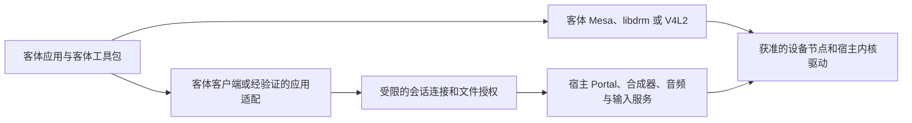

# 宿主桌面与硬件接口适配计划

2026-11-19。基于本机日用 `0.0.8b1+render.1.portal.2.install.1.media.1`、当前 `0.0.8b1` 工作树和已留存的实测回执。首要目标是让客体应用使用当前宿主桌面已经提供的文件选择、通知、输入、音视频和硬件能力。发行版软件包、动态链接器和应用仍在各自的客体用户空间运行。[本轮实测与补丁盘点](../docs/v0.0.8b1-桌面实测与补丁盘点-2026-11-19.md)

## 可行性与适配边界

Unifier 的 rootless Podman 客体与宿主共享 Linux 内核。宿主负责会话、设备权限和用户确认，客体负责应用二进制的 ABI 与包依赖。适配点优先选已有的 D-Bus、Wayland、X11、PipeWire 和内核 UAPI。客体看见的是本发行版构建的客户端，实际弹窗、文件授权、音视频源和设备操作由宿主执行。

| 接口 | 可行做法及边界 | 当前证据 |
|---|---|---|
| 文件选择、打开 URI、通知、桌面设置 | 客体通过标准接口提出请求，宿主 `xdg-desktop-portal` 根据当前会话和 `portals.conf` 选实现。KDE、GNOME 和其他会话按接口实际探测。文件选择成功后的路径与写权限继续走现有 FileRef 和授权账本。 | WPS Writer 和 FreeCAD 已经用 KDE 真正保存并重开。QQ/钉钉有冷启桥接证据，用户已实测确认两款应用的宿主附件框。OpenURI、通知及设置的跨桌面对照需要独立验收。[Portal 后端配置](https://flatpak.github.io/xdg-desktop-portal/docs/portals.conf.html) · [FileChooser](https://flatpak.github.io/xdg-desktop-portal/docs/doc-org.freedesktop.portal.FileChooser.html) |
| 窗口、输入、托盘 | 客体通过 Wayland 或 XWayland 连接宿主合成器。输入根据实际窗口协议转发，托盘由宿主实现 SNI 或 XEmbed 代理。其他桌面根据真实 watcher、菜单能力和坐标系选路径。 | QQ 默认入口硬件渲染和同屏 KOS 左右键通过。宿主中文输入的既有实测限定 QQ 的 `host-xim`；GNOME、原生 Wayland 输入和多屏物理托盘仍需验证。[QQ 日用验收](../artifacts/qq-render-node-daily-20261118-Vn2eRc48/report.md) · [KOS 实点](../artifacts/kos-tray-click-20261118-qcSxYAW7/report.md) |
| 音频、屏幕和摄像头 | 音频由宿主音频服务接入。支持 Portal 的客户端使用宿主授权后的 PipeWire FD。V4L2 直连仅为已选设备和确有需要的应用提供兼容路径。 | 现有音频 socket 接入保留。已验证合成 ScreenCast FD 通过桥、客体 PipeWire 加载和单节点 `/dev/video0`；用户已确认腾讯会议动态预览与共享画面到达对端。[ScreenCast 会话](https://flatpak.github.io/xdg-desktop-portal/docs/doc-org.freedesktop.portal.ScreenCast.html) · [Camera 授权](https://flatpak.github.io/xdg-desktop-portal/docs/doc-org.freedesktop.portal.Camera.html) · [媒体回执](../artifacts/media-regression-20261119-7YbT21RQ/report.md) |
| GPU、视频加速和计算 | Intel/AMD 首选客体 Mesa、libdrm、VA-API 驱动配宿主内核与选定的 render node。宿主驱动必须与用户态库严格配套时，可保留已核验的窄接口，例如现有 CUDA 单卡配置绑定已加载驱动版本的只读 `libcuda.so.1`。 | QQ 的 DRI3 FD、设备可见性、首次锁等待及 GPU 提交已有 A/B 证据。已有 CUDA 设备和库 pinning。按 GPU、客体驱动及媒体格式分别验收。[DRM render node](https://www.kernel.org/doc/html/latest/gpu/drm-uapi.html#render-nodes) · [CUDA 配置](../src/unifier/cuda_device.py) · [NVIDIA 容器运行时](https://docs.nvidia.com/datacenter/cloud-native/container-toolkit/latest/arch-overview.html) |
| 其他物理设备 | 优先由有宿主后端的标准接口处理，例如打印。只有目标工作流确实需要且接口明确时，再评估指定设备或受限的宿主服务调用。 | 这轮覆盖 DRM、摄像头节点与已有音频连接。USB、打印和其他设备按用例探测能力并留证。 |

直接装载宿主库需要逐件证明架构、SONAME、动态依赖闭包、符号版本、工具包 ABI、实际加载路径和宿主升级后的兼容性。Qt 平台插件还可能依赖私有 ABI、构建配置和 C++ 命名空间。WPS 把 Qt 5.12 放在 `kso_qt` 命名空间内，实际可行的是匹配这一套客体 Qt 的 Portal 适配。GTK 3 的别名也只由客体自己的已核验运行库提供。宿主桌面服务可在宿主进程内使用本机库。客体的 `/usr`、`/lib*`、`/etc`、包数据库和加载路径继续由各发行版管理，签名包依赖保持原生求解。[Qt 插件加载规则](https://doc.qt.io/qt-6/deployment-plugins.html) · [Debian 共享库依赖规范](https://www.debian.org/doc/debian-policy/ch-sharedlibs.html#dependencies-between-the-library-and-other-packages)

媒体连接由 D-Bus 协商 FD 传递，画面缓冲留在 PipeWire 和图形接口的数据通路。DMA-BUF 需要两端协商像素格式、modifier 和同步。双方支持时可评估共享内存路径，分别记录实际协商结果、首帧时间、持续帧率和内存峰值。验收按同一合成素材和同一节点对照，保留所用传输方式。[D-Bus FD 协商](https://dbus.freedesktop.org/doc/dbus-specification.html#auth-command-negotiate-unix-fd) · [PipeWire DMA-BUF](https://docs.pipewire.org/1.4/page_dma_buf.html)

## 现有代码可复用的部分

第一批接入 `unifier env desktop-integration`。宿主配置、Portal 接口版本和客体包名可以从同一命令检查。选择客户端后复用原生包事务，并回读安装结果。KDE 和 GNOME 的选择器请求继续走同一 Portal 桥，实际窗口由该宿主选择的后端提供。[宿主探针](../src/unifier/host_portal.py) · [原生包映射](../src/unifier/desktop_clients.py) · [操作说明](../docs/GTK原生选择器兼容.md)

| 位置 | 已实现的职责 | 本计划要补齐的地方 |
|---|---|---|
| [desktop.py](../src/unifier/desktop.py) · [wayland.py](../src/unifier/wayland.py) · [input_method.py](../src/unifier/input_method.py) | 发现宿主 Wayland、X11/Xauthority、PulseAudio 和 PipeWire socket。停止态冷启动对照保存记录及本次 Wayland 连接。核验后按应用使用 XIM。 | 记录当前会话和服务身份、接口版本及客体客户端能走的路径。随会话退出或重连重新核验。GUI 桌面与无头环境分别报告。 |
| [on_demand.py](../src/unifier/on_demand.py) · [portal_mount.py](../src/unifier/portal_mount.py) | 日用按需桥按环境起停；`xdg-dbus-proxy` 当前按服务名放行 Desktop、Documents、SNI Watcher 和 Notifications 等。桥接目录与 render node、camera 可以在同一 OCI 启动中处理。 | 按实际需要逐接口收敛允许范围，区分普通文件调用及带授权、异步 Request/Session 的媒体调用。沿用租约、启动所有权和最后一个任务收尾。 |
| [file_chooser.py](../src/unifier/file_chooser.py) · [portal_file_bridge.py](../src/unifier/portal_file_bridge.py) · [portal_delivery.py](../src/unifier/portal_delivery.py) | 按应用选择 GTK/GTK Native/Qt/kdialog/zenity/WPS 路径。文件桥对照 Portal owner、请求和真实共享挂载交付所选对象。 | 把宿主后端和客体工具包选择分别记录。跨桌面验证取消、共享写入、原件与快照、同名、授权撤销和重启。 |
| [native_library_launcher.py](../src/unifier/native_library_launcher.py) · [wps_portal.py](../src/unifier/wps_portal.py) · [service.py](../src/unifier/service.py) | GTK 只在客体为经验证的库提供应用级别名。WPS 适配按版本和构建内容校验。Debian 已为 WPS 和腾讯会议补特定安装或运行缺项，FreeCAD 已接入 Qt Portal 及字体按需安装。 | 把随应用触发的运行时依赖集中维护在一处，绑定客体发行版、包版本和验证回执。继续复用现有 APT/DNF/pacman 事务及已安装包修复。 |
| [dependencies.py](../src/unifier/dependencies.py) · [loader_verification.py](../src/unifier/loader_verification.py) | 客体 ELF 扫描覆盖 `DT_NEEDED`，用目标仓库查提供者并复核安装。支持从诊断日志补一个具名 SONAME。加载器核验现为受信夹具工具。 | 对 `dlopen`、外部程序和后台服务按已知调用及缺项提供精确依赖或提示。缺符号版本、未验证 ABI、缺 D-Bus 服务分别记结果。实际加载和工作流留验收记录。 |
| [screencast.py](../src/unifier/screencast.py) · [probe_screencast.py](../tools/probe_screencast.py) | 有 ScreenCast Portal 客户端和消费者探针。它们尚未接上生产 CLI/服务。腾讯会议自身包含独立的 Portal 客户端，日用进程连接现有桥。合成 FD 转发已通过，用户已确认腾讯会议实际共享到达对端。私有会话的授权和采集协议回执另补。 | 首先复用为私有会话验收工具，证明选择、取消、FD、首帧、格式协商和结束。只有厂商确实缺一段协议适配时才接入产品路径。 |
| [render_node.py](../src/unifier/render_node.py) · [camera_device.py](../src/unifier/camera_device.py) · [cuda_device.py](../src/unifier/cuda_device.py) | 有精确的绑定入口、设备身份检查和停止态原地配置。日用摄像头是环境级选择，同一环境内的应用共享这个设备。 | 明确记录授权范围、热拔插和权限变化。遇到身份变化应停用该路径并引导重选。涉及同 UID 同容器的设备或原生 socket，产品说明使用环境级权限。 |

现有桌面环境还直接挂载 PulseAudio 和 PipeWire socket，桌面记录带现行 SELinux 桌面配置，日用 Debian 保留原 host IPC。逐项验证后才收窄连接范围。应用模式决定启动参数；同一个 keep-id 容器可见的原生 socket 与设备按环境级授权管理。宿主 Portal 自己的用户同意和会话生命周期仍由宿主执行。升级时保留已登记的 `--no-portals`、选择器模式、输入法模式和显式设备选择。[会话挂载](../src/unifier/desktop.py) · [现有文件授权设计](../docs/统一文件访问与权限系统-20261113.md)

## 实施顺序与完成条件

1. **冻结实测和发布基线。** 用现有部署清单核对安装版、工作树、桌面入口和桥 worker 的对应关系。下一份候选纳入已经离线通过的缺原生退出码租约修复。复用 `env inspect` 和应用登记记录明确宿主会话、后端接口版本、实际挂载、客体客户端和所选设备。只读查询保持客体原有启停状态。完成条件是三个目标的已有记录仍可读取，旧配置和原容器身份可回滚，失效 socket、无桌面和缺客户端给出具体原因。[实测台账](../docs/v0.0.8b1-桌面实测与补丁盘点-2026-11-19.md) · [E2E-01、02、03、11、19](v0.0.8-真实功能验收计划-2026-11-17.md)
2. **先收口桌面服务。** 从 FileChooser 开始。保持现有应用级模式和兼容入口，用同一客体及样本先后连入私有 KDE 和 GNOME 会话。核对已选择的实际宿主后端、对话框、URI 和文件授权。随后复查输入、通知和托盘的工作流。保留标准工具包路径，对厂商自绘和私有 ABI 使用版本受限的适配。完成条件是 KDE 与 GNOME 各至少有一个 GTK 和一个 Qt 的实际回执，保存重开、取消与租约结束均有证据。[E2E-12、14、16、21、22、23](v0.0.8-真实功能验收计划-2026-11-17.md)
3. **收口客体运行时与诊断。** 把已有 WPS、FreeCAD、腾讯会议依赖及模式依据汇合到现有包和应用登记入口。记录签名提供者、版本、客体加载证据、当前宿主能力和失败原因。桌面补件保持小闭包。缺宿主服务时按功能状态报告，安装诊断继续保留原生退出码、事务和可用命令。完成条件是 Debian、Arch 以及获准宿主上的 Fedora 各原生验证一次实际安装、缺依赖或缺包提示、加载与正常退出。对照 `dpkg`、`rpm`、`pacman` 清单和同伴容器状态。[E2E-04、07、08、09](v0.0.8-真实功能验收计划-2026-11-17.md)
4. **验证媒体和硬件。** 复用私有 ScreenCast/Camera 探针，先以合成窗口或测试视频检查授权、同一调用方的会话、受限 FD、首帧和撤销。对设备路径核对实际 UID、节点身份、权限和关闭后的释放。GPU 记录渲染设备、驱动、调用条件及硬件提交。有明确设备和双端许可时，补 QQ 摄像头动态预览及腾讯会议的收音、指定窗口、撤销和停止后的资源核对。腾讯会议既有人工预览和共享画面结果与受控回执分别记录。[E2E-33、34、35](v0.0.8-真实功能验收计划-2026-11-17.md)
5. **用候选包复验和回退。** 先跑受保护 T1 及独立解包检查，再按记录选择固定实例执行真实用例。验证活租约保护、会话失效后重连、用户取消、包事务中断恢复以及旧版入口恢复。发布证据绑定候选清单和应用实际版本，回退后的真实打开和原数据核对各有记录。[项目测试规范](../docs/测试禁令与规范.md) · [E2E-36、37](v0.0.8-真实功能验收计划-2026-11-17.md)

## 验收组合和放行判据

| 组合 | 代表用例 | 必须取得的结果 |
|---|---|---|
| Fedora KDE/KOS → Debian 13 | QQ、钉钉、WPS Writer、腾讯会议 | QQ 默认入口启动、托盘、输入及取消附件框。钉钉打开/取消宿主附件框。Writer 文件格式和保存重开。会议设备映射、可变化预览、共享画面到达测试接收端。保留现有通过证据并补缺失环节。 |
| Fedora KDE → Arch；合规的 GNOME 宿主 → Debian 或 Arch | FreeCAD、GTK/Qt 轻量应用、CLI 安装 | 同一项目做合成文件的开、存、取消、重开，记录实际 Portal 后端。FreeCAD 核对几何。GNOME 与 KDE 分别报告，按现有 [宿主关系策略](../src/unifier/compatibility.py) 选方向。 |
| 合规的非 Fedora 宿主 → Fedora 44 | 同类原生 RPM 应用与轻量桌面样本 | 既有命令行和桌面新回执各记状态。T2/T3 使用现有具备边界的实例。宿主或后端条件不足时记 `BLOCKED`。 |
| 失败与清退 | 客户端缺包、后端变更、用户取消、设备换号、同伴在运行 | 明确哪一段失效，原生包数据库一致。权限在宿主关闭或撤销时收回。已获准设备仅在规定范围使用。所有进程、租约、FD 和桥注册按创建者身份退场。 |

首轮交付顺序为文件选择和已知客户端缺项，接着是无真实媒体内容的音视频接口验证，再做有明确许可的实际会议和硬件工作流。Linux ABI 与桌面能力逐接口验证；未知的支持范围保留在台账。现行同派系拒绝、签名包事务、私有显示与测试配额适用于全部阶段。[发布验收计划](v0.0.8-真实功能验收计划-2026-11-17.md)
