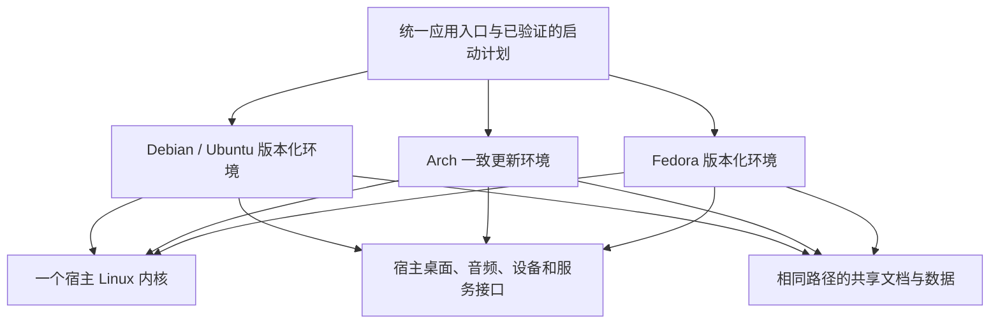

# 发行版差异与共享内核子系统的性能、占用分析

调研日期：2026-10-18，Asia/Shanghai。

执行范围更新：首版实验已按用户要求固定为 **Debian 13、Fedora 44、Arch 当前滚动版**。下文其余发行版用于机制比较；当前目标和实施边界见 [第一版准备与实施](../设计/第一版准备与实施.md)。

本轮已读取引用聊天《分析 Fedora 兼容 deb 的方案》，沿用其最后确定的范围：同架构、共享宿主内核，分别维护发行版用户空间，共享文档路径，统一应用入口，并支持 Debian/Ubuntu、Arch、Fedora 三类宿主。这里研究普通应用兼容；独立内核、跨架构指令翻译不属于首版范围。

**判断：该方案的主要资源代价会来自多套用户空间、应用及后台服务，而非额外的 Linux 内核。性能是否接近宿主原生，主要取决于实际的存储、网络、图形和启动路径。应先做环境级依赖复用、按需运行和直接文件共享，再评估少数跨发行版库复用。** 这是基于机制的工程判断，尚不是子系统跑分结论。

本文区分三种证据：官方资料说明已有机制；“推断/建议”表示本项目的设计判断；本机实测包括第 8 节的一次状态快照和第 5.4 节的文件映射实验。没有把计划中的架构写成已经实现的兼容能力。

## 1. 各大发行版最大的差别是什么

发行版可以看成一组共同维护的约定：软件版本和补丁、二进制接口、构建选项、包状态、文件布局、服务、安全策略，以及升级方式。包文件后缀只覆盖其中一部分。

下面选取会改变兼容方案的主要类型，不按流行度排列。桌面环境及预装软件需要单独比较。

| 代表 | 包管理与依赖组织 | 最影响兼容的特征 | 对性能、占用分析的意义 |
|---|---|---|---|
| Debian stable | APT/dpkg；版本化仓库和 Debian 包策略 | 稳定版的软件集合相对固定；有自己的拆包、维护脚本和多架构布局 | 较旧版本不等于较慢；最小用户空间与完整桌面的占用必须分开测 |
| Ubuntu | APT/dpkg；在 Debian 基础上维护自己的版本、补丁和发行节奏 | 与 Debian 共享格式，但可能存在 Ubuntu 专属修改和依赖要求 | 不能为省一份环境而默认让 Debian 接收所有 Ubuntu 厂商包 |
| Fedora 常规版 | DNF/RPM；固定发行版持续更新 | 软件栈更新较快，宿主集成需要考虑 SELinux | 重点测新运行库、图形栈和服务组合，不能把这些差异算成 RPM 格式本身的成本 |
| RHEL 及相关企业生态 | DNF/RPM；围绕指定大版本维护接口和支持周期 | RHEL 有分级应用兼容承诺；不是 Fedora 用户空间的同义词 | 老版本号可能有修复回移；企业 RPM 仍应识别目标版本 |
| Arch | pacman/libalpm；滚动仓库 | 应维持整体仓库一致性，不支持部分升级 | 环境维护需要整套更新；更新下载、缓存和候选环境空间值得单测 |
| openSUSE | RPM + Zypper；Tumbleweed 按滚动快照更新 | 与 Fedora 同用 RPM，但仓库、依赖策略和升级流程不同 | 需要独立环境适配器；发行快照与 Btrfs 文件系统快照是两回事 |
| Alpine | apk、musl、BusyBox、OpenRC | libc、基础命令和服务环境都与主流 glibc 桌面发行版不同 | 最小环境可以很小，但接收 glibc 桌面软件后不能沿用其最小镜像占用作预算 |
| NixOS / Nix 生态 | 用 Nix store 对象与依赖闭包组织软件 | 不可变对象通过具体 store 路径引用依赖，允许多个组合共存 | 值得借鉴版本共存和依赖记录；保留的多个闭包仍然消耗空间 |
| Gentoo | Portage、USE 配置、源代码构建及二进制包能力 | 功能与构建配置可定制 | 裁剪可能减少依赖；编译耗时、临时空间和运行收益需要分别计算 |
| Void | XBPS、runit；支持不同 libc 选择 | 服务管理和 libc 也是独立变量 | 说明“都用 Linux”不代表都能接收 systemd 服务或同一种动态二进制 |

以上事实分别依据 [Debian 发行与生命周期](https://www.debian.org/releases/)、[Ubuntu 与 Debian 的同步和合并](https://ubuntu.com/project/docs/how-ubuntu-is-made/processes/merges-and-syncs/)、[Ubuntu 发行周期](https://ubuntu.com/about/release-cycle)、[Fedora 生命周期说明](https://fedoraproject.org/wiki/Fedora_Release_Life_Cycle/zh-cn)、[RHEL 9 应用兼容指南](https://access.redhat.com/articles/rhel9-abi-compatibility)、[Arch 官方 pacman 文档](https://wiki.archlinux.org/index.php?search=Pacman)、[Tumbleweed 更新文档](https://doc.opensuse.org/documentation/tumbleweed/updating_upgrading_reverting/)、[Alpine 项目介绍](https://www.alpinelinux.org/about/)、[Nix store 对象规范](https://nix.dev/manual/nix/2.34/store/store-object.html)、[Gentoo make.conf 文档](https://wiki.gentoo.org/wiki/Make.conf)和 [Void Handbook](https://docs.voidlinux.org/about/index.html)。

这一比较包含两个重要维度：

- **同格式不等于同平台。** Debian 和 Ubuntu、Fedora 和 openSUSE，都不能仅凭后缀合并环境。
- **同发行版也不等于同部署模型。** Fedora 常规桌面与 Atomic Desktops 的宿主管理方式需要区分；官方明确将 Silverblue 等定位于适合容器工作流的原子桌面。[Fedora Atomic Desktops](https://fedoraproject.org/atomic-desktops/)

派生发行版应继续记录自己的版本、仓库与修改，不能只记上游家族。首版集中支持 Debian 13、Fedora 44、Arch 三种环境模板及对应宿主适配。Ubuntu 在本轮保留为研究对照，若以后纳入，应作为独立版本化模板。

## 2. 真正影响互通的差异，按工程影响排序

### 2.1 内核接口相近，用户空间接口仍然不同

同架构 Linux 程序可以直接使用宿主系统调用，不需要因为来源是 deb 或 RPM 就翻译 CPU 指令。共享内核仍受宿主的版本、配置、驱动和权限约束；用户空间 ABI 的稳定性与内核内部驱动接口的稳定性是不同问题。上游不提供可普遍依赖的稳定内核内部驱动 ABI，因此外来预编译内核模块仍需针对宿主处理。[Linux ABI 文档](https://docs.kernel.org/admin-guide/abi.html)、[内核驱动接口说明](https://docs.kernel.org/process/stable-api-nonsense.html)

**本项目建议：保留受维护的宿主内核，检测具体能力。** 不需要先开发“兼容 deb/rpm 的专用内核”。但新用户空间需要的内核功能不能由旧宿主凭空提供；容器内安装一个 kernel 包，也不会更换正在执行的宿主内核。

### 2.2 动态加载器、基础库和插件 ABI 是运行边界

动态链接器不仅加载程序，还负责共享对象与后续插件加载。程序记录的解释器路径、库搜索路径、所需符号及其版本，都影响执行。`libc6` 与 `glibc` 的名称映射，不能证明某个具体程序可安全复用宿主实现。[glibc 动态链接器](https://sourceware.org/glibc/manual/latest/html_node/Dynamic-Linker.html)、[ld.so 搜索规则](https://www.man7.org/linux/man-pages/man8/ld-linux.8.html)

需要分别处理：

| 边界 | 典型问题 | 首版处理 |
|---|---|---|
| glibc / musl | 加载器、扩展及行为并非普遍可互换 | 保持目标运行环境；不能靠软链接普遍修复 |
| C++ 库 | 符号版本、对象布局、编译 ABI 和选项 | 随依赖组合维护，按程序验证 |
| Python 等解释器扩展 | 普通扩展可能绑定具体解释器 ABI；稳定 ABI 是有条件的例外 | 保留解释器与扩展组合 |
| Qt/GTK 等插件 | 同名插件文件可能依赖不同运行库和插件接口 | 控制插件搜索路径，避免串到宿主插件 |

C++ 与 Python 的接口约束见 [GCC libstdc++ ABI 指南](https://gcc.gnu.org/onlinedocs/libstdc++/manual/abi.html)和 [Python C API/ABI 稳定性](https://docs.python.org/3/c-api/stable.html)。插件行是基于动态加载机制提出的设计要求，不能由单次 ELF 静态扫描证明全部兼容。

这也是不宜默认混合三套 `/usr/lib*` 的原因。**文件可以被找到，与文件满足接口要求，是两项不同检查。**

### 2.3 包管理语义决定安装、更新、卸载是否可靠

Debian 包关系包含 `Depends`、`Pre-Depends`、`Breaks`、`Replaces` 等；RPM 有自己的 `Requires`、`Provides`、`Obsoletes` 等关系。字段相似时，生效阶段和所有权意义仍可能不同。[Debian 包关系](https://www.debian.org/doc/debian-policy/ch-relationships.html)、[RPM 依赖规范](https://rpm.org/docs/latest/manual/dependencies.html)

维护脚本还可能创建用户、更新缓存、调用服务或进行失败恢复。Debian 明确规定了脚本调用与幂等性；ALPM hooks 也有事务前后阶段和触发规则。因此通用兼容设施不能只翻译元数据字段。[Debian 维护脚本](https://www.debian.org/doc/debian-policy/ch-maintainerscripts.html)、[ALPM hooks](https://man.archlinux.org/man/alpm-hooks.5.en)

**建议：各环境保留原生包管理器、包数据库和脚本辅助工具。** 统一层协调操作、记录状态和导出应用，不让三套包管理器共同维护宿主根目录。包管理器大多数工作发生在安装或更新阶段；不必因为支持三个生态就让三套依赖求解器一直常驻。

### 2.4 路径布局与系统状态需要完整视图

Debian multiarch 的库目录可包含 `/usr/lib/x86_64-linux-gnu/`；其他发行版的布局和包拆分并不相同。[Debian 多架构目录说明](https://www.debian.org/doc/manuals/maint-guide/advanced.en.html#multiarch)

为每个环境保留以下内容的明确归属：

| 内容 | 归属建议 |
|---|---|
| 程序、运行库、解释器、插件 | 目标发行版环境 |
| 包数据库、仓库状态、升级缓存 | 目标发行版环境 |
| 发行版配置、服务状态、运行目录 | 环境私有；必要接口选择性接入 |
| 文档、项目、媒体、数据盘 | 在相同路径绑定共享 |
| 用户应用配置 | 可共享，但同一应用的不同版本冲突时单独覆盖 |
| 内核、引导、设备管理、登录与桌面合成器 | 宿主 |

mount namespace 为进程提供不同的挂载视图，适合在保持应用路径不变的同时映射不同目录。这不是每次文件访问都调用一个用户态路径翻译服务。[Linux namespaces](https://man7.org/linux/man-pages/man7/namespaces.7.html)

### 2.5 服务与权限比软件包后缀更容易成为实际障碍

Ubuntu 默认装载 AppArmor；当前实测 Fedora 宿主为 SELinux Enforcing。应用能否访问图形套接字、设备和共享目录，最终还受宿主策略约束。[Ubuntu AppArmor 文档](https://ubuntu.com/server/docs/how-to/security/apparmor/)

systemd、OpenRC、runit 也不能仅靠同名命令互换。需要完整 init 的环境必须满足容器内的进程、挂载、cgroup 等要求，而非把 `systemctl` 文件放进去就完成服务支持。[systemd 容器接口](https://systemd.io/CONTAINER_INTERFACE/)

对于向日葵这类应用，应分别验证界面、后台服务、捕获屏幕、注入输入和登录会话接入。用户空间兼容只解决其中一部分。这里应通过实际宿主接口适配，不能从“程序成功启动”推断远控功能已经成立。

## 3. 现有方案给本项目的启示

| 路线 | 适合借鉴什么 | 本项目仍需处理什么 |
|---|---|---|
| Podman + Distrobox | 原生发行版环境、应用导出、文件和桌面接入 | 目标版本识别、统一状态、更新验证、资源管理 |
| Toolbx | 现有 Fedora 主机上的集成式环境基线 | 产品化应用管理、跨环境配置和服务边界 |
| systemd 系统容器 | 需要内部 init 和服务树的场景 | 更完整的启动、常驻和权限成本 |
| Bedrock strata | 跨环境命令选择、文件视图和执行上下文 | 不应据此假设所有共享库可互换，需处理依赖发现串环境 |
| Nix store 思路 | 依赖闭包、版本化身份和多版本共存 | 不能自动接收任意 deb/rpm 的安装语义 |
| 完整虚拟机 | 需要不同内核或完整系统的情况 | 超出首版共享内核路径，单独核算资源 |

Distrobox 已基于容器运行时提供主目录、图形、音频与设备接入；Toolbx 也明确说明其基于 Podman/OCI。两者适合作为原型与对照，能减少重复实现环境启动和桌面连接的工作。[Distrobox](https://distrobox.it/)、[Toolbx](https://containertoolbx.org/)

Bedrock 要求通过 `strat` 执行指定 stratum 的命令，并指出构建工具可能误发现不同环境的依赖。这恰好说明执行路由和依赖归属应显式记录。[Bedrock 基本使用](https://bedrocklinux.org/0.7/basic-usage.html)

**建议的首版：每个发行版版本默认一个可复用的普通应用环境，按需启用完整 init；有依赖冲突的应用再分出独立环境。** Distrobox 的 `--init` 本身也是可选能力，能用于对照普通环境与完整服务环境的增量成本。[Distrobox create](https://distrobox.it/usage/distrobox-create/)

这些工具的集成能力不等于已经通过本项目的兼容验收，也不能将深度共享的桌面环境当作强隔离沙箱。

## 4. 性能分析：把时间花在哪里拆开

可以用下面的概念模型组织测试，各项可能相互影响，并非天然可逐项精确相加：

```text
观察到的执行时间
  = 应用和所用运行库的工作
  + 启动入口与环境准备
  + 实际文件系统、网络、图形和服务路径的影响
  + 调度、内存回收、后台活动和测量噪声
```

### 4.1 CPU 吞吐：没有指令翻译，不代表所有构建都一样快

**推断：** 对同一个二进制、同一数据和相同宿主资源配置，CPU 密集任务有较低额外开销的机制基础。不同发行版的软件构建则可能因版本、补丁、编译器、CPU 指令选择和底层算法而出现差异。

因此不能把“Arch 仓库里的版本跑得更快”直接解释成兼容层加速，也不能把某个 Fedora 默认桌面的负载解释成 RPM 执行较慢。实验必须分成“同一二进制测设施开销”和“各自仓库构建测实际体验”两组。

若出现明显退化，优先检查 CPU 限额、线程数、温度、电源状态、内存回收和实际调用的软件版本，再判断 namespace 的影响。不能预先宣称只有固定的 1% 或 5% 损耗。

### 4.2 启动：长任务和短命令的敏感度不同

首次准备镜像、首次容器初始化、停止环境的首次启动、已运行环境里的新进程、应用界面首次可交互，应记录成不同指标。

**纯算术示例，不是测量或预测：** 假设入口增加 100 ms，原本 50 ms 的命令总时间将变成 150 ms；原本 60 s 的任务则变为 60.1 s。相同入口成本，对短命令影响显著，对长任务影响较小。

**建议：** 不在每次命令启动时扫描整个依赖图；缓存已验证的启动计划。支持把一组短命令作为一次环境内任务执行，再测其与逐条跨环境调用的差异。

### 4.3 文件 I/O：直接共享目录与可写镜像层要分别处理

共享文档绑定到原路径，不需要网络文件协议。OverlayFS 则存在额外的查找和 copy-up 行为：对 lower 文件的某些修改会先生成 upper 副本；是否复制数据还受选项和操作类型影响。[OverlayFS 内核文档](https://docs.kernel.org/filesystems/overlayfs.html)

**推断与建议：** 大型源码树、构建输出、数据库和频繁写入的数据优先使用明确的数据目录挂载。镜像层适合管理运行环境，但不应默认承载所有高写入工作。首轮分别测顺序 I/O、小文件查找、构建和同步写入，不能用一次大文件复制代表全部 I/O。

内核 OverlayFS 与用户态 FUSE 存储路径也要在结果中注明，不能将不同后端的结果混成“容器性能”。

### 4.4 网络：额外路径来自具体网络后端

Podman 提供 host 网络、独立网络及用户态网络等不同方式；现行文档将 pasta 描述为 rootless 场景的用户态网络路径。[Podman 网络选项](https://docs.podman.io/en/latest/markdown/podman-run.1.html#network-mode-net)

**建议：** 为宿主集成型普通应用测试共享宿主网络作为一组对照；需要独立网络时另测吞吐、延迟和 CPU。共享网络会改变隔离边界，也会带来端口及 localhost 服务可见性问题，不能为了某个跑分直接设成所有场景的默认值。

不能承诺“容器网络统一损失几个百分点”；文件下载还受到外部服务器、DNS、TLS 和缓存影响。

### 4.5 图形：共用内核驱动，用户态驱动仍是变量

图形栈可能同时包含宿主内核驱动、环境里的用户态驱动和显示连接。Mesa 的 RADV 文档以 AMD 为例，明确区分 KMD 和 UMD；这不是对本机 Intel GPU 的兼容实测。[Mesa RADV 架构](https://docs.mesa3d.org/drivers/radv.html)

**建议：** 先验证硬件加速实际启用，再比较帧时间、首帧和图形内存。软件渲染退回、设备权限失败或驱动组合问题，可能比 namespace 本身影响大得多。窗口能显示不代表 Vulkan、视频解码、屏幕捕获都通过。

### 4.6 安装和更新：一次性成本也影响日常体验

分别记录仓库元数据获取、依赖求解、下载、解包、维护脚本、缓存更新及验证的耗时与峰值内存。网络下载与本地安装应分列。

Arch 环境需要维持完整升级，不能通过 `pacman -Sy package` 降低表面更新量；该方式可能造成不支持的部分升级。[Arch pacman 警告](https://wiki.archlinux.org/index.php?search=Pacman)

**建议：** 当前小内存主机先串行更新多个环境，以控制峰值内存、磁盘写入和热负载。这是初始策略；是否值得并行，待实际安装任务的数据决定。

## 5. 内存占用：共享内核究竟省什么

### 5.1 环境状态比“装了几套发行版”更重要

| 状态 | 占用判断 | 不能忽略的部分 |
|---|---|---|
| 环境仅保存在磁盘、进程已退出 | 不需要为该环境预留一整块客体 RAM，也没有该环境应用的常驻匿名页 | 运行时全局服务、残留可回收页缓存和元数据仍可能存在 |
| 环境已启动但空闲 | 取决于入口、监控进程、init 和已启动服务 | 必须观察真实进程树，不能只统计一个 shell |
| 正在运行应用 | 应用私有内存、运行库工作集、服务及内核对象 | 多环境之间不一定共享相同库页 |
| 进程被 pause/freeze | 停止调度不代表释放内存 | 不应把暂停当作退出或回收 |

因此，“三个发行版 = 三个完整桌面的内存”没有必要成立；“共享一个内核 = 只需一套运行库的内存”也不成立。首版应该共用宿主桌面、音频和设备管理，避免每个环境再启动一整套桌面会话。

### 5.2 磁盘共享、文件缓存共享、应用私有内存是三件事

| 复用方式 | 磁盘层效果 | RAM 层效果 |
|---|---|---|
| 绑定同一个底层文档文件 | 数据只有一份 | 普通缓存 I/O 可复用该文件的页缓存；应用解析后的对象通常仍各有一份 |
| 多个进程使用同一份只读库文件 | 文件只有一份 | 干净的文件映射页可共享；私有数据、重定位和运行时对象另外计算 |
| 多容器使用同一镜像 lower 文件 | 共用底层文件 | OverlayFS 支持对应文件的页缓存共享 |
| Btrfs reflink / 快照中的独立文件 | 可以共用数据块，修改后按需分离 | 不保证独立 inode 的页缓存也被合并 |
| 各发行版分别构建的同名库 | 可能是不同内容、不同文件 | 不能因为名字或上游版本相同就当作只占一份 |
| 多个 Electron、JVM 或解释器应用 | 运行时文件可在部分条件下复用 | 每个进程的堆和业务对象仍会增长 |

Btrfs 明确将 reflink 定义为共享数据块但保持独立文件；Linux VFS 通过文件的 address_space 管理缓存。由这两点可推断：块共享本身不是文件缓存去重承诺。[Btrfs reflink](https://btrfs.readthedocs.io/en/latest/Reflink.html)、[Linux VFS](https://docs.kernel.org/filesystems/vfs.html)

多个 OverlayFS 容器访问同一底层文件时可共享页缓存，已有存储驱动文档对此作出说明。但这不意味着 Debian、Arch、Fedora 各自的 libc 会自动变成同一文件。[OverlayFS 页缓存说明](https://docs.docker.com/engine/storage/drivers/overlayfs-driver/#page-caching)

KSM 也不是通用补救：它合并符合条件的匿名页，不合并文件页缓存，并且扫描会消耗 CPU。首版不宜把开启全局 KSM 当成默认省内存方案。[KSM 内核文档](https://docs.kernel.org/admin-guide/mm/ksm.html)

### 5.3 怎样统计才不会得到虚假的占用

概念上，需要关心新增私有内存、只计一次的驻留文件页、新增内核对象，以及管理服务；这些项目不能直接从相互重叠的指标机械相加。

- **进程归因看 PSS。** RSS 求和会重复计算共享页；PSS 按映射共享比例分摊，但不覆盖全部未映射缓存和内核消耗。[Linux /proc 内存统计](https://docs.kernel.org/filesystems/proc.html)
- **环境整体看 cgroup。** 使用 `memory.current`、`memory.peak`、`memory.stat` 和事件统计；其中包含文件缓存等，并不是纯“不可回收内存”。共享页的归属也不按 PSS 平均分摊，不能将它与 PSS 再相加。[cgroup v2 内存控制器](https://docs.kernel.org/admin-guide/cgroup-v2.html#memory)
- **交互风险看压力与延迟。** 同时观察 PSI、换页活动和应用响应；不能仅因 `free` 显示的已用内存上升就判断发生卡顿。[Linux PSI](https://docs.kernel.org/accounting/psi.html)

建议将环境放进互不嵌套的测试 cgroup，在启动时就建立归属。宿主共享的显示、音频服务产生的增量可能留在宿主侧，须在实验说明中列出这一边界。

### 5.4 本机小实验：磁盘共享没有自动变成 RAM 共享

2026-10-18 09:51:59 +08:00，在当前 Btrfs 文件系统上，为每组两个子进程分别映射并读入 8 MiB 的测试文件。每组源与目标内容一致，只统计该文件映射的 PSS；不包含 Python 进程堆或容器开销。

| 文件关系 | 两进程映射 RSS 合计 | 两进程映射 PSS 合计 | 观测 |
|---|---:|---:|---|
| 两个硬链接路径，同 inode | 16 MiB | 8 MiB | 文件映射页共享，RSS 求和会多算 |
| 普通副本，不同 inode | 16 MiB | 16 MiB | 两份文件映射分别驻留 |
| Btrfs reflink，不同 inode、共享数据区段 | 16 MiB | 16 MiB | 磁盘共享仍未合并这两份映射页 |

`btrfs filesystem du` 对 reflink 源与目标均报告 8 MiB 的共享区段；三组映射均没有匿名页或 swap。**这为“不能从磁盘去重直接估算节省同量 RAM”提供了本机证据。** 它不是时延测试，每组仅执行一次，也不证明所有容器后端的共享效果。

原始数据见 [文件共享实验 JSON](../evidence/file-sharing-probe-2026-10-18.json)，方法和限制见 [验证方案第 1.2 节](性能验证方案.md)。实验临时文件与子进程已清理。

## 6. 磁盘占用：默认预计增加，具体数值由软件闭包决定

独立用户空间通常需要增加基础程序、库、包数据库和必要配置。共享内核可以避免每个环境都需要一套可启动系统，但不会消除用户空间文件。不能从压缩镜像下载量推导安装后大小，也不能用某发行版的最小镜像宣传值预测完整 GUI 应用环境。

建议按以下类别记账，明确互不重复：

| 类别 | 包含内容 | 优化方向 |
|---|---|---|
| 当前环境有效文件 | 应用、库、配置、包数据库；不含下列单列项 | 同发行版版本内共享依赖，按实际用途选择包集合 |
| 下载与构建缓存 | 原始包归档、仓库列表、构建缓存、临时文件 | 制定保留策略，比较清理前后的重装成本 |
| 应用数据与日志 | 数据库、用户状态、日志 | 与环境生命周期区分，避免重建环境时复制全部用户数据 |
| 旧环境独占部分 | 旧快照或候选环境在共享块之外保留的内容 | 保留可用回退点，设置有限保留数量 |
| 运行时及存储元数据 | 镜像索引、层元数据、文件系统元数据等 | 使用后端实际统计并记录误差 |

**高收益的复用单位是“同一发行版、同一目标版本的共享环境”。** 假设十个应用可共用同一依赖集合，未必需要十份发行版根目录；真正冲突时再分出环境。

跨发行版相同文件可以研究存储去重，但应检查内容身份、可写性、元数据与标签约束。不能把各环境可被包管理器修改的库直接硬链接在一起。快照或 reflink 复制后文件独立的属性，更适合准备候选环境，但仍需验证升级行为。

空间统计至少同时报告：逻辑文件大小、已分配空间，以及共享/独占块信息。普通 `du` 不能完整表达 Btrfs 压缩与共享数据块的实际增量；也不能把多个 reflink 根目录的数字简单相加作为物理总量。

**更新峰值可能显著高于稳定占用。** 下载包、候选环境、发生 copy-up 的文件、旧版本保留和临时文件可能同时存在。具体上升量取决于变更集合与后端；不预设“每次必然翻倍”。

## 7. 对“能复用就复用”的具体落地顺序

保留这一原则，同时把复用拆成可验证的层次：

1. **宿主能力复用。** 同一个内核、设备访问、桌面合成器、音频接口和明确的宿主服务。
2. **数据复用。** 文档、项目和数据盘在相同路径绑定；配置冲突时局部隔离。
3. **环境内依赖复用。** 同发行版版本中的应用共用原生依赖集合与更新状态。
4. **存储复用。** 同一基础镜像、快照、reflink、经过验证的内容去重；分别核算磁盘和内存效果。
5. **进程级能力复用。** 通过显式启动代理调用宿主工具，记录来源、版本、协议和生命周期依赖。
6. **少量库复用。** 仅为有明确接口契约和回归验证的软件维护白名单，宿主升级后重新检查。

这一路径的价值是：先减少重复服务、重复环境和重复文件，同时保留原生依赖语义。它不会把“名字相同”当成兼容性证据。

按这个边界，首版应用的执行路径可表达为：



图中共用内核与宿主接口，不表示图中三个环境必须常驻，也不表示它们的库自动合并。

## 8. 当前机器的基线实测

采集时间：**2026-10-18 09:47:25 +08:00**。原始数据见 [JSON 快照](../evidence/host-baseline-2026-10-18.json)，可复现方式见 [采集脚本](../tools/collect_host_baseline.py)。采集只读取状态和工具版本，没有拉取镜像、启动实验环境或改变系统配置。

| 项目 | 观测结果 | 能支持的判断 |
|---|---|---|
| 系统 | Fedora Linux 44 KDE，x86_64 | 可以优先在当前 Fedora 宿主做原型 |
| 内核 | `7.2.7-200.fc44.x86_64` | 是本机版本记录，不能仅凭版本判定所有应用兼容 |
| CPU | i5-1135G7，8 个逻辑 CPU | 后续记录电源状态、频率与温度，控制笔记本性能波动 |
| 系统识别物理内存 | 7.43 GiB | 资源预算应以约 8 GB 机器为背景 |
| 当时 MemAvailable | 3.24 GiB | 只是一时估算，不能视为固定可分配额度 |
| 当时已用 swap | 2.24 GiB 逻辑页 | 该快照中主要位于 zram，不能直接算成同量物理 RAM |
| zram 物理内存消耗 | 约 0.54 GiB | 与压缩前数据和逻辑容量分别记账 |
| 工作目录所在文件系统 | Btrfs，`compress=zstd:1` | 值得测试 reflink / 快照；需验证后端与共享行为 |
| 该文件系统可用空间 | 约 380.28 GiB | 是整文件系统空闲量，不是项目或子系统占用 |
| cgroup | v2，具有 cpu、memory、io 等控制器 | 具备采集和管理资源的基础条件，实际委派仍需验证 |
| 安全状态 | SELinux Enforcing | 保持该状态完成共享目录和设备验收 |
| 已有工具 | Podman 5.8.7、Toolbx、bubblewrap、unshare | 有现成原型基础，但工具存在不代表环境启动已验证 |
| 最近压力指标 | memory/io PSI 的 avg10/60/300 均为 0 | 该瞬时快照未显示近期这两类停顿，不能代表全天负载 |

zram 文档区分原始数据、压缩数据与实际分配内存；逻辑 swap 用量与这些数字也可能因分配和采集时点而略有区别。[zram 统计定义](https://docs.kernel.org/admin-guide/blockdev/zram.html)

**针对本机的初始建议：** 按需创建环境，避免三套完整系统服务常驻；先测试一个前台外来应用，然后增加第二个环境，记录总压力和交互延迟；更新任务先串行。此时没有依据声称三环境一定流畅，也没有依据仅凭 swap 已用就认定现在正在内存抖动。

不需要为了本轮研究更换宿主或关闭安全策略。当前硬件和软件信息足以进入第一轮验证，但仍未完成跨发行版应用测试。

## 9. 三类宿主的支持范围与验证次序

| 宿主 | Debian 13 用户空间 | Arch rolling 用户空间 | Fedora 44 用户空间 |
|---|---|---|---|
| Debian 13 | 依目标选择原生或独立模板 | 共享内核环境，待验证 | 共享内核环境，待验证 |
| Arch rolling | 共享内核环境，待验证 | 依版本需求选择原生或独立环境 | 共享内核环境，待验证 |
| Fedora 44 | 共享内核环境，待验证 | 共享内核环境，待验证 | 依目标选择原生或独立环境 |

这张表表示完整应用验收的设计范围，不表示完成状态。三套模板均记录版本和基础镜像身份。共用核心由环境适配器和宿主适配器组合，避免为每一种方向开发独立转包器。

建议顺序：

1. 在当前 Fedora 上测量宿主直接执行、最小环境执行、启用完整 init 三种路径；先确认额外资源花在哪里。
2. 安装并验收一组 CLI、GUI、语言扩展和后台服务应用，逐项记录兼容边界。
3. 验证共享文件、配置隔离、更新、卸载、停止后回收与失败恢复。
4. 再到 Debian 13 和 Arch 宿主验证对称性；性能结论必须记录各宿主配置，不能把换内核、换桌面的差异混入设施开销。

具体实验条件与指标见 [性能验证方案](性能验证方案.md)。

## 10. 目前可以确定什么，还有什么不能确定

| 状态 | 结论 |
|---|---|
| 官方机制已核对 | namespace、原生包管理、版本化用户空间、宿主接口共享可组成该方向的技术基础 |
| 本轮已实测 | 当前 Fedora 主机配置、资源快照、现有工具、内核配置项，以及文件共享对映射 PSS 的局部影响 |
| 架构建议 | 环境内共享依赖、按需运行、共享数据和宿主服务、完整 init 按需启用 |
| 尚未测量 | 每个环境的最小磁盘大小、空闲 PSS、应用工作集、启动增量、I/O 和网络退化 |
| 尚未验收 | 外来应用完整功能、更新恢复、三类宿主的兼容矩阵 |

最值得优先优化的是**环境生命周期、重复服务、存储路径和同环境依赖复用**。发行版选择会通过软件栈与默认配置影响表现，但不能仅按 deb/rpm/pacman 排出一个可靠的速度或内存排行榜。

资料可访问性说明：部分 Fedora Docs、ArchWiki 和 Gentoo 页面直接访问受到站点防护或抓取限制；对应条目使用了可检索的官方页面摘要或其他官方文档。未把被拒绝页面当作已读正文，也未依赖论坛跑分形成数值结论。发行版版本和支持状态会变化；正式选型时应固定镜像摘要、仓库和具体版本重新核对。
